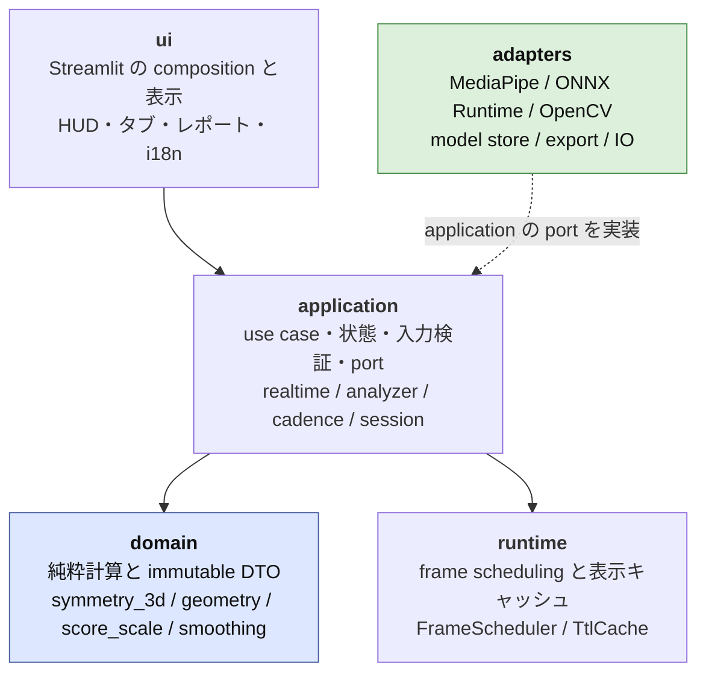
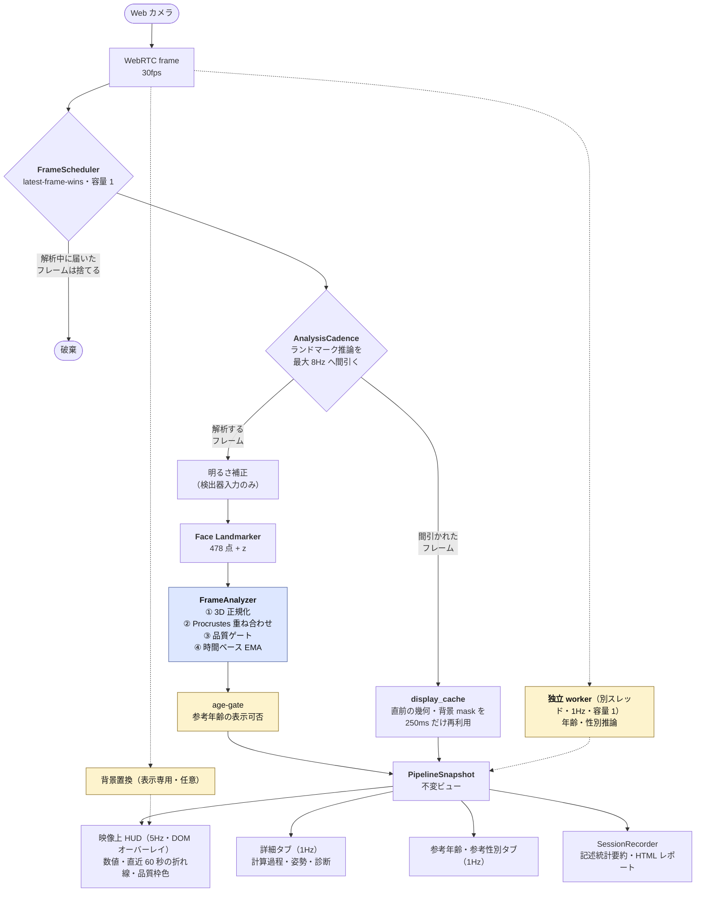

# Face Symmetry Lab

**顔の左右差は、頭の向き（姿勢）を数学的に消したうえでなら、Web カメラのリアルタイム映像でも再現性をもって測れる。** 本アプリはそれを 3D object symmetry 解析として実装し、実写測定で **信号 ÷ ノイズ床 = 5.52 倍**、セッションを撮り直したときの標準偏差 **0.150pt** を得た。同じ顔を測って 2 回で 75% 違う値を返していた 2D 指標を、**−4%** まで詰めた指標である。処理は端末内で完結し、画像・映像・派生値を外部へ出さず、顔埋め込みを作らない。そして **美醜・順位・偏差値・合否は一切出さない。**

|                  |                                                                                          |
| ---------------- | ---------------------------------------------------------------------------------------- |
| **測るもの**     | 顔の左右対応点 63 組（126 点）の 3D 幾何のずれ — 全体の対称度と部位別 4 つの対称度       |
| **測らないもの** | 美しさ・優劣・順位・偏差値・パーセンタイル・合否・医学的状態・本人性                     |
| **動く場所**     | 端末内のみ（`127.0.0.1` 限定待受、外部送信なし、暗黙のファイル保存なし、顔埋め込みなし） |
| **主指標**       | `symmetry-3d/1.0.0`（鏡映 + 剛体 Procrustes による object symmetry 解析）                |
| **参照統計**     | UTKFace 14,754 枚の事前集計セルテーブル（非商用研究限定、探索値）。閲覧専用ページだけが読み、利用者の測定値とは並べない |
| **実装**         | Python 3.13 / uv / Streamlit + MediaPipe + OpenCV DNN + ONNX Runtime                     |

仕様の正本は [requirement.md](requirement.md)、リポジトリ探索の入口は [STRUCTURE.md](STRUCTURE.md)。本 README は概要であり、数値・受け入れ基準の正本は `requirement.md`、実測の正本は [`docs/`](docs/) と[モデルカード](docs/model-cards/)にある。

---

## 1. 課題設定

**結論。** 解くべき問題は「顔を採点すること」ではない。「**撮り方に汚染されない左右差を、端末内で、恣意的な係数なしに測ること**」である。世に出回る顔採点アプリは、この 3 つをどれも満たしていない。

### 1.1 問題提起 — 過剰な美容ブームが、検証できない採点を日常へ持ち込んだ

「美人度 87 点」「左右対称率 92%」「あなたの顔は上位 15%」。この種の数字は、いまや無料アプリと SNS フィルタで日常的に提示される。だが提示されている数字には、次の 3 つの欠陥が同時にある。

| 欠陥                 | 何が起きているか                                                                       | 帰結                                                                 |
| -------------------- | -------------------------------------------------------------------------------------- | -------------------------------------------------------------------- |
| **較正されていない** | 点数を作る重み・感度係数・変換関数が公開されず、固定評価セットでの較正記録もない       | 追試も反証もできない。数字は測定ではなく演出になる                   |
| **外部へ送られる**   | 画像・映像がクラウド API へ渡り、保存先・保存期間・二次利用を利用者が制御できない      | プライバシーの主導権が利用者の手を離れる                             |
| **姿勢に汚染される** | 頭の向き（yaw / pitch / roll）と照明で値が動き、「顔の形」と「撮り方」を分離していない | 首を数度傾けただけで点数が動く。数字は顔ではなく撮影条件を測っている |

3 つ目は本アプリで実測している。**同一人物の同じ顔を 2 回撮っただけで、2D 系の左右差指標は 2.622mm と 4.592mm、75% 違う値を返した**（`docs/symmetry-metric-measurements.md` §2）。差の原因は yaw が −0.82° から −3.38° へ動いたことで、`2·z·sinθ` の理論予測（+0.032）と実測差（+0.031）がオーダーで一致する。**3° 首を回すだけで、数字は「臨床的に非対称」の域へ移動する。**

にもかかわらず、この種のアプリは断定的な点数と順位を出す。**測れていないものを、測れたことにして返している。** これが本プロジェクトの出発点である。

### 1.2 本アプリが解く問題

**Web カメラのリアルタイム映像から「顔の形の左右差」を、撮影条件から切り離して数値化し、同一人物・同一環境内の相対的な変化として観察できるようにする。** リアルタイムでは頭が絶えず動くため、姿勢と形の分離が特に重要になる。次の 3 条件を同時に満たす必要がある。

1. **プライバシー** — 画像・映像・ランドマーク・派生値を端末内に閉じ、外部送信・暗黙のファイル保存・顔埋め込みを行わない。
2. **姿勢に汚染されない指標** — yaw / pitch / roll によらず「顔の形の左右差」だけを測る。
3. **恣意性の排除** — 較正されていない自由パラメータや、順位・偏差値・合否・美的評価を持ち込まない。

### 1.3 既存手法の限界

| 手法                               | 破る条件 | 具体的に何が起きるか                                                                                           |
| ---------------------------------- | -------- | -------------------------------------------------------------------------------------------------------------- |
| クラウド型の顔解析 API・アプリ     | 1        | 画像・映像を外部サーバで処理する。端末内完結・オフラインの要求と両立しない                                     |
| 「美人度」「対称性スコア」系アプリ | 3        | 較正されていない重み付けで 0〜100 の断定的なスコアや順位・偏差値を出し、母集団や撮影条件を跨いだ比較を許す     |
| 顔認識・埋め込みベースの手法       | 1        | 顔埋め込みを生成・保存し、人物同定や人物間比較へ転用されうる                                                   |
| 単眼撮影の 2D 左右差指標           | 2        | 姿勢・照明で値が動く。実測では、同じ顔の 2 回の測定で 75% ずれた（§4.2）                                       |
| 正中線あてはめ型の 2D 指標         | 2, 3     | **部位によって応答の符号が逆になる。** 鼻を非対称にすると「より対称になった」と報告する（ゲイン −0.472、§4.1） |

### 1.4 用途外（禁止事項）

医療・本人確認・採用・保険・教育・監視・人物比較の用途には用いない（`requirement.md` §10）。年齢ゲートを年齢認証・未成年判定・入場制限へ使わない（§10.11）。偏差値・順位・パーセンタイル・分位・合否・「平均より上／下」を作らない（§10.12）。左右差は **試験中の指標**、対称化画像は **加工画像**として UI に明記する。

---

## 2. システムアーキテクチャ

**結論。** Web 的な MVC ではなく **層 + port/adapter** の 5 層で構成し、依存を一方向に固定する。重い推論（年齢・性別・背景置換・年齢ゲート）はすべてクリティカルパスの外へ出し、**どれが失敗しても左右差の分析と表示は止まらない**。

### 2.1 層構成と依存方向



| 層            | 役割                                                                                          | 置いてはいけないもの                                    |
| ------------- | --------------------------------------------------------------------------------------------- | ------------------------------------------------------- |
| `domain`      | 純粋計算と immutable DTO（対称性・幾何・スコア定義・DTO）                                     | Streamlit / MediaPipe / ONNX Runtime / OpenCV の import |
| `application` | use case・状態・入力検証・port（リアルタイム pipeline、解析周期、セッション記録、年齢ゲート） | UI 描画、モデルの自動取得                               |
| `adapters`    | MediaPipe / ONNX Runtime / OpenCV / export / IO                                               | 表示文言、価値判断                                      |
| `ui`          | Streamlit の composition と表示（HUD・タブ・レポート・i18n）                                  | 推論式、幾何計算、ファイル永続化                        |
| `runtime`     | frame scheduling と表示キャッシュ                                                             | —                                                       |

`tests/` はこの層構成をそのまま鏡写しにする。

### 2.2 アプリ内の処理フロー（リアルタイム）

`application.realtime.RealtimeLandmarkPipeline` が 1 フレームに対して行うこと。



点線の経路（年齢・性別推論・背景置換・age-gate）は**クリティカルパス外**であり、失敗しても実線の経路を止めない（失敗分離、不変条件 12）。

### 2.3 設計上の要点

- **latest-frame-wins** — 解析中に届いたフレームは捨てる。キューを伸ばして遅延を積むより、最新の 1 枚だけを見る。
- **間引きと保持** — 重いランドマーク推論を最大 8Hz へ間引き、間引いたフレームは直前の幾何を 250ms だけ再利用する（`runtime.display_cache`）。
- **数値は映像へ焼き込まない** — HUD は映像の上に重ねた DOM レイヤーで、映像 pixel を書き換えない（遅延要件 FR-013）。HUD は位置選択とドラッグ移動ができる。
- **タブは 1Hz** — 5Hz のフル再描画はブラウザのメインスレッドで WebRTC 映像と競合する。HUD だけが NFR-003 の 4〜5Hz を維持する。
- **モデルは暗黙に取得しない** — `configs/model-manifest.json` に URL・size・ライセンス・SHA-256 を固定し、明示操作でのみ取得する。1 byte でも違えば配置しない。

---

## 3. データセットおよび手法

**結論。** 主指標は **3D object symmetry 解析（`symmetry-3d/1.0.0`）**。折る平面を先に決めず、鏡映してペア名を入れ替えた配置を、元の配置へ**並進と回転だけ**で重ね合わせ、残った残差の RMS を距離とする。剛体変換が姿勢を吸収するので、**値は yaw / pitch / roll に対して不変**になる。自由パラメータは 1 つも持たない。

定義の正本は `requirement.md` §8.5.1 / §8.6.5 / §8.6.7、詳細は[指標カード](docs/model-cards/symmetry-3d-v1.md)。

### 3.1 入力と記号

MediaPipe Face Landmarker が返す 478 点のうち、`landmark_map_version` が凍結した左右対応ペア 63 組（126 点）を使う。**正中点 27 点は使わない。**

```math
\mathbf{P} \in \mathbb{R}^{126 \times 3}, \qquad
\mathbf{p}_i = (x_i W,\; y_i H,\; z_i W)
```

$W, H$ は画像の幅と高さ。奥行き $z$ は $x$ と同じ係数（幅）で画素相当へ戻す。3 軸で単位が揃っていないと、次の重ね合わせの回転が軸ごとに違う長さを混ぜてしまう。

対応ペア表は手書きせず、Face Landmarker のメッシュ構造から導出して凍結する（`scripts/derive_landmark_map.py`）。

| 部位           | ペア数 |    点数 | 最小ペア数 |
| -------------- | -----: | ------: | ---------: |
| 輪郭 `contour` |     17 |      34 |          8 |
| 目 `eyes`      |     26 |      52 |         13 |
| 鼻 `nose`      |      7 |      14 |          3 |
| 口 `mouth`     |     13 |      26 |          6 |
| **合計**       | **63** | **126** |          — |

### 3.2 正規化 — 唯一の設計判断

両眼アンカー $\mathbf{a}_L, \mathbf{a}_R$（左右それぞれの目頭・目尻の中点）を取り、**3 次元で測った**アンカー間距離を $1.0$ とする。

```math
s = \lVert \mathbf{a}_R - \mathbf{a}_L \rVert_2 ,\qquad
\mathbf{X} = \frac{1}{s}\,\bigl( \mathbf{P} - \mathbf{c} \bigr)\mathbf{R}_{\text{roll}}^{\mathsf{T}}
```

**2D 投影距離を使ってはならない。** yaw が $\theta$ のとき投影された両眼間距離は $\cos\theta$ 倍に縮むので、それで割ると距離が $1/\cos\theta$ 倍に膨らむ。剛体不変性で表口から追い出した姿勢依存が、正規化という裏口から戻ってくる。なお $\theta = 0$ では両者が一致するため、正面の合成顔だけを見ていると発見できない。

重ね合わせが並進と回転を吸収するので、**正規化のうち距離へ効くのはスケール $s$ だけ**である。原点の取り方と面内回転（roll 補正）は 3D の剛体変換であり、残差を変えない。

### 3.3 鏡映と置換

$x$ の符号を反転し、対応ペア表そのものである置換 $\sigma$ で左右の名前を入れ替える。ここで新しい対応を推測しない。

```math
\mathbf{J} = \mathrm{diag}(-1,\,1,\,1), \qquad
M(\mathbf{X}) = \sigma\!\left( \mathbf{X}\,\mathbf{J} \right)
```

### 3.4 剛体重ね合わせ（Procrustes）

$M(\mathbf{X})$ を $\mathbf{X}$ へ、**並進と回転だけ**で最小二乗フィットする。**スケールは合わせない** — 自由にすると、非対称の大きさそのものが吸収されてしまう。

```math
(\mathbf{R}^\ast, \mathbf{t}^\ast) \;=\; \underset{\mathbf{R} \in SO(3),\; \mathbf{t} \in \mathbb{R}^3}{\arg\min}
\; \bigl\lVert\, \mathbf{X} - \left( M(\mathbf{X})\mathbf{R} + \mathbf{t} \right) \bigr\rVert_F^2
```

解は共分散行列の特異値分解で閉形式に得る。回転が鏡映になる場合、すなわち $\det < 0$ の場合は、右特異行列 $\mathbf{V}$ の最終列の符号を反転して真の回転へ落とす。

```math
\mathbf{H} = \tilde{M}^{\mathsf{T}} \tilde{X} = \mathbf{U}\boldsymbol{\Sigma}\mathbf{V}^{\mathsf{T}}, \qquad
\mathbf{R}^\ast = \mathbf{V}\mathrm{diag}\!\left(1,\,1,\,\det(\mathbf{V}\mathbf{U}^{\mathsf{T}})\right)\mathbf{U}^{\mathsf{T}}
```

残差ベクトルを次で定める。

```math
\mathbf{r}_i \;=\; \mathbf{x}_i - \left( M(\mathbf{X})\mathbf{R}^\ast + \mathbf{t}^\ast \right)_i
```

**$\mathbf{X}$ を剛体で動かすと $M(\mathbf{X})$ も同じだけ動く。** したがって $\mathbf{r}_i$ は頭部の並進・回転（yaw / pitch / roll のすべて）に対して不変である。姿勢ゲートはフレーム採否の条件として残るが、距離の値そのものは姿勢に依存しない。

### 3.5 出力値

同じ **1 回の**重ね合わせの残差を、読み方を変えて集計する。

```math
d_{3D} \;=\; \sqrt{ \frac{1}{126} \sum_{i=1}^{126} \lVert \mathbf{r}_i \rVert^2 }
\qquad\text{(全体の対称度 — 対応点を 1 票ずつ数える)}
```

```math
d_{3D,p} \;=\; \sqrt{ \frac{1}{m_p} \sum_{i \in p} \lVert \mathbf{r}_i \rVert^2 }
\qquad p \in \{\text{contour},\,\text{eyes},\,\text{nose},\,\text{mouth}\}
```

```math
xy_p = \sqrt{ \frac{1}{m_p}\sum_{i \in p} \left( r_{i,x}^2 + r_{i,y}^2 \right) }, \qquad
z_p  = \sqrt{ \frac{1}{m_p}\sum_{i \in p} r_{i,z}^2 }
```

いずれも両眼アンカー間距離を $1.0$ とする無次元量で、下限は 0、上限はない。小さいほど鏡映配置がよく重なる。この量は $\exp$ 変換・感度係数・部位重みを**持たない**。

**部位別は並列の診断値であり、総合値へは寄与しない。** 部位ごとに Procrustes を走らせ直さないのは、3D の剛体変換が 6 自由度を持つためである。少ない点で 6 自由度を消費すると残差が構造的に小さくなり、ペア数の少ない部位（鼻 7 組）ほど値が下がる。部位間の差が「非対称さ」ではなく「ペア数」を反映してしまう。

**2 つの恒等式**（誤差 0 で成立、§4.2 で実測確認済み）:

```math
d_{3D}^2 = xy^2 + z^2 , \qquad
d_{3D}^2 = \frac{\sum_p m_p \, d_{3D,p}^2}{\sum_p m_p}
\quad (m_p \text{ は版管理された点数であり、設定値ではない})
```

**部位等重み距離 $s_{3D}$** — 部位を 1 票ずつ数える、もう 1 つの総合量。

```math
s_{3D} \;=\; \sqrt{ \frac{1}{P} \sum_{p} d_{3D,p}^2 } \qquad (P = 4)
```

$d_{3D}$ と $s_{3D}$ の違いは**重みだけ**である。重みは全部位について $1$ に固定され、調整の余地を持たない。

**$s_{3D}$ は画面へ出さない。** 内部記録の `distance3d_parts_equal_raw` 列と、参考年齢の表示ゲート `age-gate/1.0.0` が読む 41 次元特徴の 1 つ（`s3d_distance`）としてのみ使う。かつてこの値を 0〜100 の「点」へ写して「全体のスコア」として表示していたが、2026-09-03 に撤回した。

```math
d_{3D}^2 = \sum_p \frac{m_p}{\sum_q m_q}\, d_{3D,p}^2 \quad\text{(点を 1 票)}, \qquad
s_{3D}^2 = \sum_p \frac{1}{P}\, d_{3D,p}^2 \quad\text{(部位を 1 票)}
```

### 3.6 表示変換

画面には距離ではなく **対称度** を出す。係数のない可逆変換である。

```math
\text{symmetry\_percent} \;=\; 100 \times (1 - d) \quad [\%]
```

$d_{3D}$（全体）と $d_{3D,p}$（部位別 4 つ）のいずれもこの同じ変換を通す。**画面へ出す左右差はこの 5 つだけで、他の総合量・目盛り・点数を持たない。**

**「全体のスコア」は撤回した（2026-09-03）。** $s_{3D}$ を 2 点のアンカー（ずれ 1.0% = 100 点、ずれ 5.0% = 0 点）で 0〜100 の「点」へ引き伸ばす表示スケール `display-scale/1.0.0` を持っていたが、機能ごと削除した。目盛りを 25 倍にするとばらつきも 25 倍になる（§4.4 のセッション間全幅 0.273pt は 6.8 点にあたった）ため、**分解能は上がっても情報は増えなかった**。実測が 98% 前後の狭い幅へ集まるという事実（§4.3、§4.5）そのものは変わらず、`ui/hud.py` の折れ線グラフが y 軸を 95〜100% に固定する対処だけが残る。

### 3.7 平滑化

全体の対称度と部位別を、時間ベース EMA で平滑化する。部位等重み距離 $s_{3D}$ は対象外で、記録には常に生値が入る。

```math
\alpha_t = 1 - e^{-\Delta t / \tau}, \qquad
\hat{d}_t = \alpha_t\, d_t + (1 - \alpha_t)\, \hat{d}_{t-1}
```

$\alpha$ を固定するとフレームレートが動くたびに実効時定数が変わるため、経過時間 $\Delta t$ から毎回導く。時定数 $\tau$ は映像直下のポップオーバーから選べる（既定 0.4 秒、0.05〜30.0 秒の離散段）。**平滑化は表示の追随の速さだけを変え、生値・計算式・エクスポート列を変えない。**

### 3.8 欠測規則

$z$ が欠測、または使用可能な対応ペアが各部位の `min_pairs` の合計を下回るフレームでは、**重ね合わせ自体を行わず、総合値・部位別値のすべてを欠測とする。0 で埋めない。** $s_{3D}$ は部位が 1 つでも欠測なら欠測とし、使用可能な部位だけで平均しない（記録も `null` にする）。

### 3.9 モデル資産

すべて `configs/model-manifest.json` に取得元 URL・サイズ・ライセンス・SHA-256 を固定し、アプリは起動時に自動取得しない。

| 用途                            | モデル / データ                                                                           | 版                             | ライセンス                     |
| ------------------------------- | ----------------------------------------------------------------------------------------- | ------------------------------ | ------------------------------ |
| 顔ランドマーク（478 点）        | MediaPipe Face Landmarker                                                                 | `float16-1`                    | Apache-2.0                     |
| 背景置換（表示専用）            | MediaPipe Selfie Segmenter                                                                | `float16-1`                    | Apache-2.0                     |
| 参考年齢・参考性別（18〜75 歳） | Open Model Zoo `age-gender-recognition-retail-0013`（固定 IR から派生 ONNX を決定的生成） | `2023.0/FP16` → `FP16-onnx-v2` | Apache-2.0                     |
| 参考年齢の表示可否ゲート        | `age-gate/1.0.0`（同梱の決定木、幾何特徴 41 次元入力）                                    | `1.0.0`                        | 非商用研究のみ（UTKFace 学習） |

推論 runtime は **`opencv-contrib-python` の DNN と `onnxruntime` の 2 つだけ**で CPU 実行し、OpenVINO / PyTorch / torchvision / InsightFace を runtime lock へ混在させない（`onnxruntime` は age-gate の決定木モデル専用）。変換専用の package は PEP 723 script へ隔離している。

### 3.10 参照統計データセット（UTKFace）

参照統計ページ（FR-037）だけが読む、事前集計済みのセルテーブル。**個票・画像・ランドマーク座標を同梱しない。**

| 項目         | 値                                                                                                                                                |
| ------------ | ------------------------------------------------------------------------------------------------------------------------------------------------- |
| データセット | UTKFace（Aligned & Cropped Faces）／ 非商用研究のみ                                                                                               |
| ラベル       | 配布時のファイル名注釈（年齢・性別・人種）。アプリは推定しない                                                                                    |
| 選別条件     | 年齢 18〜75、\|yaw\| ≤ 15°、\|pitch\| ≤ 15°、\|roll\| ≤ 25°、単一顔                                                                               |
| 集計粒度     | `(race, gender, age)` の 536 セル。件数 8 未満のセルは統計値を出さない                                                                            |
| 同梱物       | `configs/reference/utkface_symmetry3d_cells_v1.csv`（平均と二乗和のみ）                                                                           |

**選別の内訳:**

```text
発見 23,708 枚
  ├─ 年齢が 18〜75 の外        −5,084
  ├─ ファイル名が解析不能          −3
  ├─ 姿勢が範囲外              −3,638
  ├─ 顔なし                      −205
  └─ 複数顔                       −24
有効 14,754 枚（有効率 79.2%）
```

**参照統計の使い方の制限（`requirement.md` §10.7）:** **利用者自身の測定結果と参照統計を結び付けず、両者を同じ画面へ並べない。** 参照統計は独立した閲覧ページの中だけで完結し、利用者の測定値を持ち込まない。偏差値・順位・パーセンタイル・分位・合否・「平均より上／下」を、数値としても語としても作らない。群間差の原因を示唆する文言・グラフを持たず、人種別・性別別の値をランキングに読める形で並べない。

2026-08-16 から 2026-09-03 までは、参考年齢・参考性別で選んだセルの平均を利用者の測定値の隣へ併記する機能（FR-039）があったが、利用者の指示で撤回した。

---

## 4. 定量的な評価

**結論。** 3 行で言える。

1. **2D 指標は精度が足りないのではなく、部位によって符号が逆に出る。** 鼻を非対称にすると「より対称になった」と報告する（ゲイン **−0.472**）。較正では直らない構造的欠陥である。
2. **3D 化はこれを解消し、全部位で正の応答を保った唯一の方式だった。** 信号 ÷ ノイズ床は **0.79x → 5.52x**、セッション間標準偏差は **2.968pt → 0.150pt** へ改善した。
3. **それでも絶対値は読めない。** 同一人物を撮り直すだけで、表示値の中央値は実測で全幅 **0.273pt** 動く——文献上の対称群と非対称群の差 2.11pt の約 13% にあたる。読んでよいのは同一人物・同一環境内の相対変化だけである。

以下は特記なき限り被写体 1 名・単一環境の実写測定であり、母集団統計・順位・正常範囲としては解釈できない（正本: [`docs/symmetry-metric-measurements.md`](docs/symmetry-metric-measurements.md)）。比較基準は Prog Orthod 2015（3D スキャン＋鏡像重ね合わせ、n=28/27）の「対称と判定された成人 1.52mm / 非対称 2.85mm」。

### 4.1 感度 — 部位別ゲイン（既知量の非対称を注入したときの応答）

$1.0$ = 注入した分を正しく検出。take01・600 フレーム・領域変位場 $\sigma = 0.12$ IOD。

| 部位 |  `symmetry-2d/2.0.0` | `symmetry-3d/1.0.0` |
| ---- | -------------------: | ------------------: |
| 輪郭 |               +0.905 |              +0.138 |
| 口   |               +0.147 |          **+0.238** |
| 目   | **−0.008**（無反応） |          **+0.200** |
| 鼻   | **−0.472**（逆向き） |              +0.057 |

2D が壊れている原因は 2 つの構造にある。**正中線あてはめ** — 測っていない正中点 27 点の変位があてはめ直線を動かし、測っている全部位の残差を動かす。**眼アンカーの循環参照** — 正規化基準そのものである目の非対称は、正規化に吸収されて距離へ現れない。object symmetry 解析は折る平面を先に決めないので、どちらの経路も持たない。

### 4.2 姿勢の分離と再現性

| 方式                        |        平均 |    ノイズ床 |   信号÷床 | \|yaw\| 相関 |  鏡像差 |
| --------------------------- | ----------: | ----------: | --------: | -----------: | ------: |
| ① 現行 2D（正中線あてはめ） |     2.622mm |     1.673mm | **0.79x** |       +0.854 | 0.834mm |
| ② 2D Procrustes             |     1.921mm |     1.078mm |     1.23x |       +0.842 | 0.591mm |
| ③ **3D Procrustes**         | **1.157mm** | **0.241mm** | **5.52x** |       +0.369 | 0.131mm |

- **②は姿勢依存をまったく落とさない**（+0.854 → +0.842）。yaw が生む偽ズレ $2 z \sin\theta$ は点ごとの奥行きに比例する非剛体的なズレなので、2D の並進+回転では吸収できない。**姿勢問題を解いているのは Procrustes ではなく $z$ である。**
- **再現性**: 同一人物・別セッションで 2D は 2.622mm → 4.592mm（**+75%**）、3D は 1.157mm → 1.108mm（**−4%**）。
- **姿勢の分離**: 生の $z$ 左右差 1.792mm のうち **77%** は剛体回転（＝姿勢）で、重ね合わせ後 0.404mm へ落ちる。恒等式 $d_{3D}^2 = xy^2 + z^2$ は誤差 0 で成立。
- **物理的妥当性**: 3D の距離中央値 **1.157mm** は文献の「対称と判定された成人 1.52mm」と同じ土俵に着地する。**ただし入力は 3D スキャンではなく単眼推定の $z$** であり、値を直接あてはめて個人を分類してはならない。
- ノイズ床の層別（yaw ±0.5°）が示すのは、**2D のノイズ床の 82% が姿勢**だということ。検出器そのものの再現性は 0.300mm。

### 4.3 表示スケールの実効分解能

単位はすべて pt（対称度 %）。

| 軸                          | take01 2D | take01 3D | take02 2D | take02 3D |
| --------------------------- | --------: | --------: | --------: | --------: |
| 表示値の中央値              |    96.762 |    98.280 |    92.682 |    98.249 |
| ノイズ床（標準偏差）        |     2.656 | **0.383** |     0.720 | **0.128** |
| 分布の全幅 p95−p05          |     8.975 |     1.205 |     1.936 |     0.434 |
| \|Δ\| 中央値（5Hz・EMA 後） |     0.101 |     0.041 |     0.096 |     0.031 |
| 整数 % の種類数             |        13 |         3 |         7 |         2 |
| 参考: 文献の信号全幅        |      2.11 |      2.11 |      2.11 |      2.11 |

テイク間の中央値差は **2D −4.080pt / 3D −0.031pt**。3D の EMA 後のフレーム間差 0.031〜0.041pt はテイク間の中央値差と同じ桁で、表示のちらつきとしては現れない。

### 4.4 セッション間ばらつき（3 テイク）

| 方式    | take01 | take02 | take03 |  標準偏差 |      全幅 |
| ------- | -----: | -----: | -----: | --------: | --------: |
| **3D**  | 98.280 | 98.249 | 98.523 | **0.150** | **0.273** |
| 現行 2D | 96.762 | 92.682 | 98.457 |     2.968 |     5.775 |

**3D のセッション間全幅 0.273pt は、文献上の対称群と非対称群の差 2.11pt の約 13% にあたる。** これが「絶対値ではなく相対変化を読む」根拠であり、UI にも明記している。信号 ÷ セッション間全幅は、口 6.40x / 目 2.97x / 輪郭 1.64x で 1 を超えるが、**鼻は 0.54x で 1 を下回る** — 鼻に δ=8mm を入れても、セッションを撮り直しただけの差と区別が付かない。

### 4.5 データセット（UTKFace 14,754 枚）での対称度とスコア

`symmetry-3d/1.0.0` を UTKFace の選別済み 14,754 枚へ適用した記述統計。**探索値であり、正常値・目標値ではない。**

| 量                              |         平均 | 標準偏差 |  中央値 |    最小 |    最大 |
| ------------------------------- | -----------: | -------: | ------: | ------: | ------: |
| 全体の対称度 $100(1-d_{3D})$    | **96.147 %** |    2.060 |  96.736 |  81.308 |  98.976 |
| 全体の距離 $d_{3D}$             |      0.03853 |  0.02060 | 0.03264 | 0.01024 | 0.18692 |
| 部位等重み距離 $s_{3D}$         |      0.03862 |  0.02091 | 0.03234 | 0.01102 | 0.18761 |

部位別の対称度 $100(1 - d_{3D,p})$:

| 部位 |     平均 | 標準偏差 | 中央値 |
| ---- | -------: | -------: | -----: |
| 輪郭 | 95.046 % |    3.478 | 96.067 |
| 目   | 97.043 % |    1.495 | 97.357 |
| 鼻   | 97.018 % |    2.445 | 97.810 |
| 口   | 96.396 % |    1.279 | 96.695 |

**この表の読み方。** 対称度が 96% 前後へ集まるのは「ほぼ上限」という意味ではなく、**0〜100% の目盛りが実測の分布に対して粗い**ことの帰結である。かつてはこの粗さを補うために $s_{3D}$ を 25 倍へ引き伸ばした「全体のスコア」を併記していたが、拡大すればばらつきも同じだけ拡大し情報量は増えないため、2026-09-03 に撤回した（§3.6）。**この数値を個人の位置づけ・順位・合否の基準に使ってはならない。** 群間差はデータセットの撮影条件・注釈・構成比や、ランドマーク検出の群ごとの挙動差を含みうる。

### 4.6 参考年齢・参考性別と年齢ゲート

**参考年齢・参考性別**（`age-gender-recognition-retail-0013`、上流公開値）:

| 指標          | 値      |
| ------------- | ------- |
| 年齢平均誤差  | 6.99 年 |
| 性別 accuracy | 95.80 % |

上流の validation dataset（約 20,000 人の内部データ）は公開されておらず、本アプリの撮影条件で同じ精度を保証しない。アプリが実行する派生 ONNX は、**2 つの独立した実行系**（`cv2.dnn` と `onnxruntime`）で年齢差 $2.4 \times 10^{-5}$ 年・確率差 $1.07 \times 10^{-6}$ と一致し、決定的に再現できる。

**年齢ゲート**（`age-gate/1.0.0`、固定テストセット n=3,806）:

| 指標                               | 値                                |
| ---------------------------------- | --------------------------------- |
| ベースライン（常に範囲内）accuracy | 0.7759                            |
| accuracy                           | **0.8836**                        |
| 範囲内を範囲内と言えた率           | **0.9888**（誤って弾くのは 1.1%） |
| 6 歳未満を範囲外と言えた率         | 0.8949                            |
| 18 歳未満を範囲外と言えた率        | 0.6068                            |
| 76 歳以上を範囲外と言えた率        | 0.0959（**使いものにならない**）  |

**このゲートは年齢認証ではない。** 15〜17 歳は 18〜20 歳と原理的に分離できず、正答率 0.043 である。UI は判定を属性として提示せず、「この画像では参考年齢を表示できません」までとする（§10.11-2）。

### 4.7 この評価で言えないこと

- **母集団統計ではない。** §4.1〜§4.4 は被写体 1 名・単一環境。人物間の差、正常範囲、順位は導けない。
- **文献値との照合は土俵合わせであって分類基準ではない。** 入力が 3D スキャンではなく単眼推定の $z$ である以上、文献の閾値を個人へあてはめてはならない。
- **§4.4 の比の有効数字を額面どおりに読まない。** 分母の標本はテイク 3 本しかない。
- **§4.5 は UTKFace と固定した選別条件に限定した探索値である。** 正常値・目標値・個人評価・人物間比較には使用できない。

---

## 5. その他

### 5.1 実行方法

```bash
# 1. 依存の同期（Python 3.13 / uv）
uv sync --frozen

# 2. モデル取得（manifest を表示して同意後に取得。1 byte でも違えば配置しない）
uv run python scripts/bootstrap_models.py

# 3. 起動
uv run face-symmetry-lab
```

Streamlit は `.streamlit/config.toml` により `127.0.0.1` だけで待ち受け、利用統計を送信しない。カメラは STUN / TURN を使わず、音声 permission を要求しない。

**モデル準備の補助コマンド:**

```bash
uv run python scripts/bootstrap_models.py --accept-manifest    # CI / 非対話
uv run python scripts/bootstrap_models.py --verify             # 配置済みファイルを検証
uv run --script scripts/convert_demographic_model.py           # 公式 IR → 派生 ONNX を決定的生成
```

取得は一時ファイルへ書き、SHA-256 が一致した場合だけ `models/` へ atomic rename する。配置先を変える場合は、ランドマークに `FACE_SYMMETRY_LAB_LANDMARKER_PATH`、年齢・性別の派生モデルに `FACE_SYMMETRY_LAB_DEMOGRAPHIC_ONNX_PATH` を設定する。別パスも manifest と同じ size・SHA-256 でなければ読み込まない。モデルは Git に含めない。

### 5.2 技術スタック

| 区分         | 採用                         | 版                     | 選定理由                                                    |
| ------------ | ---------------------------- | ---------------------- | ----------------------------------------------------------- |
| 言語 / 管理  | Python / uv                  | 3.13、`uv.lock` で固定 | `uv sync --frozen` で再現可能な環境                         |
| UI           | Streamlit + streamlit-webrtc | 1.59 / 0.75            | 単一プロセスの計算主体アプリ。ローカル待受と WebRTC の両立  |
| ランドマーク | MediaPipe Face Landmarker    | 0.10.35                | 478 点 + 推定 $z$ をローカル CPU で取得                     |
| 推論 runtime | `opencv-contrib-python` DNN  | 5.0                    | 年齢・性別の派生 ONNX を CPU 実行                           |
| 推論 runtime | `onnxruntime`                | 1.24                   | `ai.onnx.ml` の決定木（age-gate）専用。`cv2.dnn` は読めない |
| 数値         | NumPy / pandas               | 2.5 / 3.0              | Procrustes（SVD）と記述統計                                 |
| DTO / 検証   | pydantic                     | 2.13                   | immutable DTO と入力検証                                    |
| 品質         | ruff / mypy(strict) / pytest | 0.15 / 2.2 / 9.1       | `scripts/verify.py` が CI と同じ 6 ステップを同順で実行     |

**入れないもの:** PyTorch / torchvision / LightGBM / InsightFace / OpenVINO をアプリの runtime lock へ混在させない。顔埋め込みライブラリを追加しない（例外なし）。学習 notebook と checkpoint はアプリから直接参照せず、境界は ONNX asset / model card / hash / 固定評価 report だけとする。

### 5.3 主な機能

**リアルタイム（Web カメラ）を主軸とする。**

- 478 点のランドマーク表示と、推論を最大 8Hz へ間引き幾何表示を 250ms 保持する低遅延 preview。
- 映像に重ねる DOM レイヤーの HUD — 全体の対称度・部位別 4 つ・参考年齢・参考性別、直近 60 秒の折れ線、品質ゲートの枠色、直すべき主要因 1 件の指示（例「顔を正面に向けてください」）、明るさの助言。位置選択とドラッグ移動が可能。
- 姿勢（yaw / pitch / roll）・顔サイズ・連続安定性による撮影品質ゲートと OK / HOLD ヒステリシス。満たさないフレームでは数値を出さず、欠測を 0 で埋めない。明るさの非ブロッキング警告（`LOW_LIGHT` / `OVEREXPOSED`）は採点・品質ゲートを止めない。
- 時間ベース EMA の時定数と表示の更新間隔を、映像直下のポップオーバーから選択。
- 独立 worker による 18〜75 歳の参考年齢・参考性別推論。参考性別は確率として表示し、対象範囲外へは参考年齢を出さない表示ゲートを通す。
- UTKFace 事前集計による参照統計の閲覧（人種・性別・年齢で絞り込む独立したページ。**利用者自身の測定結果は持ち込まず、両者を同じ画面へ並べない**）。
- 背景の黒 / 白置換（表示専用・任意）、中心線の ON / OFF。
- セッションの記述統計要約（有効率・中央値・変動幅・主な HOLD 理由）と、HTML レポート保存（`metric_version` / `config_fingerprint` 付き。画像・landmark 座標は含めない）。
- 日本語 / 英語の UI 表示言語切替。

**画像アップロード（補助）:** JPEG / PNG のサイズ・形式・アニメーション検証、ランドマーク検出・重ね描き、左右対称にそろえた点の可視化と対称化画像の生成（既定 OFF の明示操作、変位が大きい場合は生成せず理由を表示。生成物は加工画像であることを明示し、保存・送信しない）。

**共通の安全性:** 単一顔ポリシー（0 顔・2 顔以上では数値を出さない）、固定 manifest と SHA-256 検証によるモデル準備、モデル未配置・不正出力・推論失敗のアプリ全体からの分離。

### 5.4 プライバシーと安全性（不変条件）

正本は `requirement.md` §1.3.1。要約のみを置く。

1. 画像・映像・ランドマーク・派生値は端末内に閉じ、外部送信と暗黙のファイル保存を行わない
2. Streamlit は `127.0.0.1` だけで待ち受け、利用統計・STUN・TURN を既定無効にする
3. 同意を得てから画像 upload と camera permission を開始する
4. 年齢は断定年齢ではなく「モデル推定の参考年齢」として表示する
5. 参考年齢・参考性別と左右差は別々の結果として扱い、利用者自身の測定結果と参照統計を同じ画面へ並べない
6. モデルは版と SHA-256 を追跡する
7. **顔埋め込みを追加しない（例外なし）**
8. 対称度は「試験中の指標」、対称化画像は「加工画像」であることを UI に明記する
9. `cv2` provider は `opencv-contrib-python` 1 distribution に限定する
10. 採点に影響する自動調整を持たない
11. 欠測・NaN・Inf・不正 shape を 0 やその他の値で埋めず、結果や UI へ流さない
12. ある推論の失敗が、他の分析・表示・エクスポートを止めない（失敗分離）

### 5.5 開発

変更は Red → Green → Refactor → Verify の順で進める。

```bash
uv run python scripts/verify.py          # CI の quality job と同じ 6 ステップを同順で実行
```

個別コマンド:

```bash
uv run ruff format --check .
uv run ruff check .
uv run mypy src
uv run pytest
uv run pytest -m model                                              # 実モデル smoke（未配置なら skip）
uv run python scripts/generate_structure.py --include-untracked --check
uv run python scripts/derive_landmark_map.py --check                 # 対応ペア表が凍結値と一致するか
```

実機テストは合成顔画像で 478 点検出、複数顔の拒否、VIDEO / IMAGE 両モードを検証する。実写で確認する場合は、本人または同意のある写真をローカルに置き `FACE_SYMMETRY_LAB_SMOKE_IMAGE` にパスを指定する（実写ファイルはリポジトリへコミットしない）。テストを追加・移動した場合は [testbox.md](testbox.md) も更新する。

### 5.6 ドキュメント

| 文書                                                                         | 役割                                                              |
| ---------------------------------------------------------------------------- | ----------------------------------------------------------------- |
| [requirement.md](requirement.md)                                             | **プロダクト仕様の唯一の正本**（要件 ID・受け入れ基準・不変条件） |
| [STRUCTURE.md](STRUCTURE.md)                                                 | 探索索引（`scripts/generate_structure.py` の生成物）              |
| [testbox.md](testbox.md)                                                     | テスト対応表                                                      |
| [docs/adr/](docs/adr/)                                                       | 設計判断の記録                                                    |
| [docs/model-cards/](docs/model-cards/)                                       | モデル・指標カード（入出力契約・公開評価値・制約）                |
| [docs/symmetry-metric-measurements.md](docs/symmetry-metric-measurements.md) | **実写実測の正本**（§4 の数値はここから）                         |
| [docs/capture-protocol.md](docs/capture-protocol.md)                         | 測定の撮影手順                                                    |
