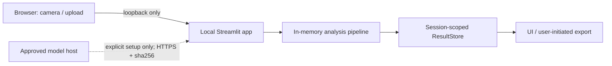
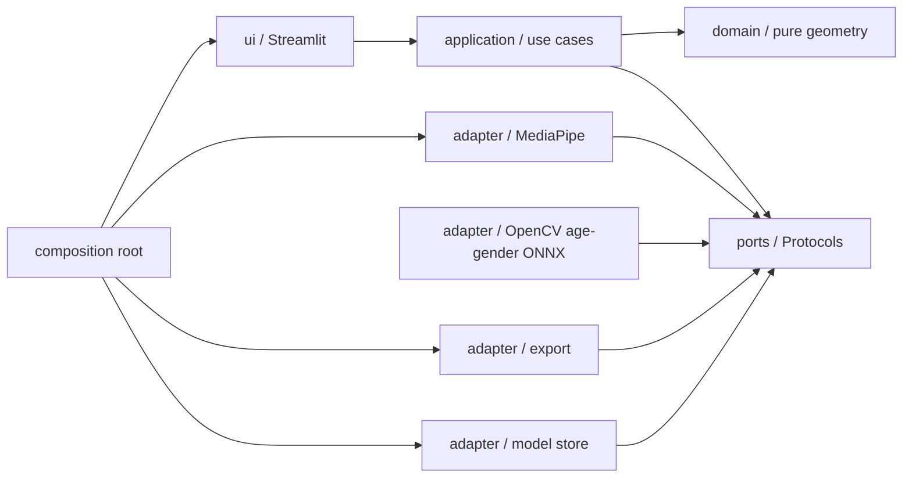
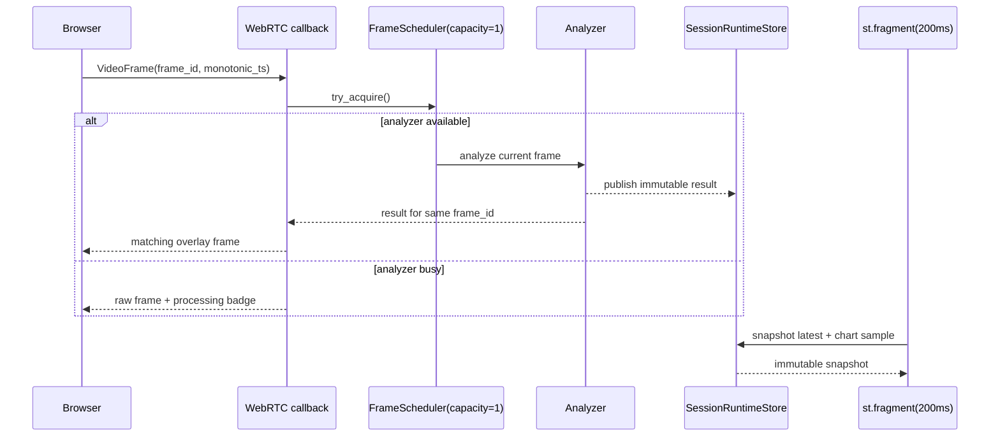

# Face Symmetry Lab

## プロダクト要件定義・技術仕様・開発ガイド v3.7

| 項目 | 内容 |
|---|---|
| ステータス | M0 未完。M1〜M3 の一部を先行実装中 |
| 版 | v3.7 |
| 更新日 | 2026-08-01 |
| 想定リポジトリ | `face-symmetry-lab` |
| 配布形態 | ローカル Streamlit アプリ |
| 基準ランタイム | Python 3.13 |
| データ方針 | Local-first / 画像非保存 / 既定オフライン |

> 本書の **MUST / SHOULD / MAY** は、それぞれ「必須 / 原則必須 / 任意」を表す。MVP のリリース判定は MUST の充足を条件とする。

---

## 0. v3.7 の設計判断

v3.0 の安全性・再現性方針を維持しつつ、創造工房セミナーの研究成果を最終アプリへ接続するため、次を変更する。

1. **プロダクトの目的を「美的評価」ではなく「撮影条件を整えた顔の左右差の可視化」に限定する。** スコアは医学的評価、魅力度、本人の価値を示さない。
2. **18〜75歳向け年齢・性別推定を独立機能として統合する。** 8年代分類は削除し、Open Model Zoo 2023.0 FP16 `age-gender-recognition-retail-0013` の連続年齢と二値確率を採用する。年齢は「モデル推定の参考年齢」、性別は「外見からのモデル推定の参考性別」と表示し、本人の自己認識・法的性別を表さない。左右差・肌表面参考値とは分離する。
3. **初回体験を要件化する。** モデル準備、プライバシー説明、カメラ許可、撮影品質調整、分析という一連の導線を定義する。
4. **分析状態と理由コードを分離する。** `HOLD` だけでなく、姿勢、距離、複数顔、低品質など「次に何を直せばよいか」を UI が説明できるようにする。
5. **スコアを版管理する。** モデルだけでなく、ランドマーク対応表、係数、重み、前処理を含む `metric_version` を結果に記録する。
6. **リアルタイム処理を latest-frame-wins にする。** 受信スレッドを重い推論で塞がず、古いフレームを溜めない。
7. **Streamlit のブロッキングループを廃止する。** UI 更新は定期再実行フラグメントで行い、推論スレッドから Streamlit API に触れない。
8. **ネットワーク境界を明示する。** localhost 実行時は STUN/TURN を使わず、モデル取得は明示操作・固定 URL・sha256 検証を必須にする。
9. **性能要件に測定条件を持たせる。** 「15fps」を単独で掲げず、入力、端末プロファイル、測定区間、パーセンタイルを定義する。
10. **要件・受け入れ基準・テストの対応を一本化する。** 各要件に ID、優先度、検証方法を付ける。
11. **リアルタイムの主要数値を映像内にも表示する。** カメラから視線を外さず撮影条件を調整できるよう、状態、全体・部位別左右差、姿勢角を高コントラストのオーバーレイで示す。同じ情報は画面テキストにも残す。
12. **映像表示と分析頻度を分離する。** WebRTC の受信・返却は各フレームで継続するが、重いランドマーク推論は既定 125ms 間隔（最大 8Hz）で最新フレームだけを処理する。複数フレームを待ってまとめる batch や待ち queue は、ライブ遅延を増やすため採用しない。
13. **既定テーマを dark にする。** Streamlit 公式 theme token で暗い背景と高コントラスト本文を定義し、映像 overlay は blue / amber の状態色を使う。生の DOM/CSS 上書きには依存しない。
14. **顔の中心線を表示設定にする。** 採点に用いる正中点の TLS 直線を顔範囲へ描画し、Camera / Image の双方で既定 ON、利用者が ON / OFF を切り替えられるようにする。中心線はランドマークと異なる色かつ5px以上とし、表示設定は採点値と `config_fingerprint` を変えない。
15. **画像由来の外観差と肌表面参考値は幾何スコアと分離する。** 顔cropへ端末内のホワイトバランス・明度正規化を適用し、頬領域の色調均一性と局所テクスチャを「撮影条件依存の肌表面参考値」として算出する。疾患、肌質、美しさ、健康を推定せず、補正量を記録し、校正完了までは4部位＋全体の幾何スコアへ混合しない。
16. **年齢・性別入力は顔 crop に限定する。** MediaPipe の単一顔 landmark bbox から余白付き crop を作り、Open Model Zoo 2023.0 FP16 `age-gender-recognition-retail-0013` へ入力する。公式XML/BINを出所の正本として固定し、再現可能な開発時変換で生成した固定ONNXを既存の `opencv-contrib-python` DNNから実行する。元assetと派生assetのsize、SHA-256、変換recipeをmanifestへ登録し、parityとslice評価はリリース条件として残す。
17. **間引き中も幾何表示を短時間保持する。** ランドマーク推論は最大8Hzのまま、直近の単一顔ランドマークと中心線を250ms以内だけプレビューへ再描画する。検出失敗、複数顔、リセット、TTL超過では即時消去し、古い結果を別の顔へ長時間重ねない。

### 0.1 現在の実装位置（2026-08-01）

| Milestone | 状態 | 現在地 |
|---|---|---|
| M0 | 未完 | OD-01、OD-02、OD-04、OD-07 と実モデル互換性確認が未完。左右差は相対比較専用 |
| M1 | 一部実装 | 静止画入力、品質判定、幾何左右差、年齢・性別境界、schema は実装中。固定評価と肌表面指標校正は未完 |
| M2 | 一部実装 | WebRTC、latest-frame-wins、短時間overlay保持、Stop、年齢・性別の独立worker（capacity 1・独自cadence・segment単位の破棄）は実装中。E2E、cleanup実測は未完 |
| M3 | 一部実装 | 同意、入力切替、CSV / JSON export は実装済み。trend、About、設定UI、A11y実機確認は未完 |
| M4 以降 | 未着手 | offline、3 OS、performance、soak、配布判定は未完 |

したがって現時点は MVP Done ではない。M0 の未決事項を残した先行実装であり、§27 の release 条件を満たしていない。

---

# Part I — Product Requirements

## 1. プロダクト概要

### 1.1 ビジョン

Face Symmetry Lab は、Web カメラまたは静止画から顔のランドマークを端末内で解析し、左右差をわかりやすく可視化する研究・セルフチェック用ツールである。

ユーザーは、画像を外部サービスへ送信せず、撮影条件が結果に与える影響を理解しながら、同一人物・同一環境内での左右差と肌表面参考値の相対的な傾向、およびモデル推定の参考年齢・参考性別を確認できる。

### 1.2 解決する課題

- 一般的な画像編集ツールでは、顔の左右差を定量的かつ再現可能に確認しづらい。
- 顔分析サービスへ画像をアップロードすることに、プライバシー上の抵抗がある。
- 姿勢、距離、照明、レンズ歪みの影響を区別せずに数値だけを見せると、結果が過度に権威的に受け取られる。
- リアルタイム顔分析の試作では、モデル、UI、スレッド、履歴が密結合し、改善や検証が難しくなりやすい。

### 1.3 プロダクト原則

- **Local first**: 画像処理は端末内で完結し、画像を外部へ送らない。
- **Guide before score**: 数値より先に、撮影品質と改善方法を示す。
- **Explain, do not judge**: 「良い／悪い」「美しい／醜い」と評価しない。
- **Relative, not absolute**: 異なる人物間の比較やランキングを行わない。
- **Separate, do not conflate**: 左右差、肌表面参考値、参考年齢、参考性別を別の出力として表示し、相関や因果を示唆しない。
- **Version everything**: モデル、計算式、設定、出力スキーマを追跡可能にする。
- **Graceful degradation**: 高負荷時は古いフレームを捨て、UI とカメラ操作を維持する。

### 1.4 成功指標

| 指標 | MVP 目標 | 測定方法 |
|---|---:|---|
| 初回分析到達率 | 90% 以上 | 5 名以上のタスクテストで、説明なしに有効スコアへ到達した割合 |
| Time to first valid result | p90 60 秒以内 | モデル準備済みの起動から最初の `OK` まで |
| 撮影条件の理解 | 80% 以上 | テスト後に「姿勢や照明で値が変わる」と回答できた割合 |
| 固定条件での表示安定性 | 標準偏差 2.0 点以下 | 同一 fixture または固定撮影で連続 10 秒の平滑化済み全体スコア |
| 年齢・性別モデルの再現性 | 年齢 MAE 6.99年、性別 accuracy 95.80% の公開値を基準に差を記録 | 採用 asset と固定評価セットで runtime parity と slice を比較 |
| 画像の外部送信・永続化 | 0 件 | ネットワーク遮断テスト、ファイル書込監査、ログ監査 |

成功指標はプロダクト評価用であり、顔対称性スコア自体の医学的・心理的妥当性を意味しない。

## 2. 対象ユーザーと利用文脈

### 2.1 主対象

1. **研究・開発者**: 顔ランドマークと幾何計算を再現可能な形で検証したい。
2. **デモ利用者**: 外部アップロードなしで、顔の左右差の可視化を試したい。
3. **同一条件で経時比較する利用者**: 同一人物・同一端末・同一照明で相対的な変化を確認したい。

### 2.2 想定しない利用

- 医療診断、治療方針、美容医療の適否判断
- 採用、保険、与信、教育、監視など人物に影響を与える意思決定
- 魅力度、人格、健康、能力の推定
- 複数人物の順位付け、異なる人物間の優劣比較
- 本人または保護者の同意がない画像の分析
- 公開環境での不特定多数向けサービス提供

## 3. スコープと優先度

### 3.1 P0 — Core MVP

- ローカル環境の事前チェックとモデル準備
- プライバシー・免責事項の初回確認
- Web カメラによるリアルタイム分析
- JPEG / PNG の静止画分析
- 単一顔ポリシー、姿勢・距離・安定性の品質ゲート
- 輪郭、目、鼻、口、全体の左右差スコア
- 18〜75歳を対象とした参考年齢と外見由来の参考性別の推定
- 撮影補正量を記録する撮影条件依存の肌表面参考値
- オーバーレイ、状態表示、改善ガイダンス
- 表示値の平滑化とセッション内トレンド
- 設定変更、停止、リセット
- CSV / JSON エクスポート
- モデル・指標・設定・スキーマの版管理
- 画像非保存、ローカル限定、匿名ログ

### 3.2 P1 — MVP 改善

- 低照度・過露出・ぼけ警告の検証と、品質ゲートへの昇格
- セッション要約と比較可能性の警告
- 追加ブラウザ・カメラを用いたリアルタイム E2E matrix
- 3D 正規化方式の評価と、2D 指標との比較レポート
- 日本語／英語 UI
- 年齢・性別モデルおよび肌表面指標の slice 評価、calibration

### 3.3 P2 — Research Extensions

- 正面判定の学習済み分類器への差し替え
- 年齢・性別モデルの別 architecture 比較、継続学習、個人化
- FastAPI アダプタ、別フロントエンド、DB、クラウド配置
- 定期再学習、自動モデル更新、オンデバイス個人化

### 3.4 非スコープ

- 顔認証、本人特定、顔埋め込みの保存
- 動画ファイル、録画、スクリーンショットの保存
- 複数顔の同時採点
- ログイン、組織管理、マルチテナント
- 自動クラウド送信、分析データ収集、テレメトリ
- 画像加工による「理想顔」生成
- 18歳未満または75歳を超える人物の年齢・性別推定

## 4. 情報設計と主要ユーザーフロー

### 4.1 画面構成

アプリは次の 4 領域で構成する。

1. **Analyze**: カメラ／静止画、品質ガイド、現在の左右差、肌表面参考値、参考年齢・参考性別
2. **Trend**: セッション内の時系列、状態別の欠測表示
3. **Session**: 件数、開始時刻、設定、エクスポート、リセット
4. **About**: 算出方法、制約、モデル・ライセンス、プライバシー

主要操作は Analyze に集約し、詳細設定はサイドバーまたは popover に置く。画面上部にはアプリ名、`Local processing` 表示、モデル／指標バージョン、停止ボタンを常時表示する。

### 4.2 初回フロー

1. 起動時に Python、依存、モデル、カメラ利用可否を確認する。
2. 不足モデルがある場合は、取得元、サイズ、ライセンス、sha256 を表示し、ユーザー操作で取得する。
3. 「画像は保存・外部送信しない」「左右差・肌表面・年齢・性別は参考値」「本人の同意がある18〜75歳の画像のみ使用」の 3 点を確認する。
4. 入力方法を Camera / Image から選択する。
5. Camera の場合はブラウザの許可を求める。拒否時は設定方法と Image への代替動線を示す。
6. 顔の位置、距離、向きが条件を満たすまで、スコアの代わりに具体的なガイドを示す。
7. 有効フレームが連続して得られたら分析結果へ切り替える。
8. 年齢・性別は左右差と別カードに「モデル推定の参考年齢」「外見からのモデル推定の参考性別」と表示し、対象年齢、信頼度と limitations へのリンクを併記する。

### 4.3 再訪フロー

- モデルが準備済みなら、既定設定で Analyze を表示する。同じブラウザセッション内の rerun だけは UI 設定を維持する。
- 前回の画像、分析履歴、推定値、カメラ許可状態をアプリ独自に永続化しない。
- 指標またはモデルが変更された場合は、変更を通知し、過去エクスポートとの単純比較を避けるよう案内する。

### 4.4 終了・プライバシーフロー

- `Stop camera` は WebRTC track と分析ワーカーを停止し、最新フレーム参照を破棄する。
- `Reset session` は履歴、EMA、エラー、設定スナップショットを初期化する。モデルキャッシュは削除しない。
- ページ離脱または接続切断時も同等のクリーンアップを行う。

## 5. UX / UI 要件

### 5.1 レイアウト

- デスクトップでは 12 カラム相当とし、カメラ 7、結果 5 の比率を基準とする。
- 狭い画面ではカメラ、状態、スコア、トレンドの順に 1 カラムへ積む。
- 重要操作をサイドバーだけに置かない。停止、入力切替、リセットは主画面から到達可能にする。
- 初期画面でスコアカードの空箱を並べず、開始方法とプライバシー境界を示す。

### 5.2 ビジュアル

- Streamlit の公式テーマ設定を用い、light / dark の両方に対応する。
- 既定は dark とし、背景・カード・本文・補助文の階調を公式 theme token で定義する。
- 生の HTML/CSS セレクタによる内部 DOM の上書きは MUST NOT。必要な独自 UI はテーマ変数に追従するコンポーネントとして隔離する。
- 色の意味を固定する: neutral=未開始、blue=処理中、amber=調整が必要、red=回復不能なエラー。スコアの高低に赤／緑の価値判断を割り当てない。
- 数値は最大 1 桁の小数で表示し、精度以上の細かさを演出しない。
- 年齢・性別推定と肌表面参考値を対称性スコアより目立たせず、各結果に関係があるような配置・文言を避ける。

### 5.3 文言

- `Score` 単独ではなく、初出で「左右差スコア（実験値）」と表示する。
- `HOLD` は内部値とし、UI では「少し右を向いてください」「顔を 10cm ほど離してください」のような行動可能な文言に変換する。
- `ERROR` は原因、影響、回復操作を示す。内部例外やスタックトレースを表示しない。
- 「完璧」「理想」「欠点」「歪み」「正常／異常」を使用しない。

### 5.4 アクセシビリティ

- 独自要素は WCAG 2.2 AA を目標とし、本文コントラスト比 4.5:1 以上を確保する。
- 色だけで状態を伝えず、アイコン、ラベル、文言を併用する。
- 全入力に可視ラベルを付け、キーボード操作とフォーカス表示を維持する。
- カメラオーバーレイと同じ情報を画面テキストでも提供する。
- チャートは要約値または表形式でも確認できるようにする。

## 6. 状態モデル

### 6.1 システム状態

| 状態 | 条件 | UI |
|---|---|---|
| `BOOTSTRAPPING` | 依存・モデルを確認中 | 進捗、現在処理、キャンセル不可の理由 |
| `READY` | 入力待ち | Camera / Image の選択 |
| `REQUESTING_PERMISSION` | カメラ許可待ち | ブラウザ操作の説明 |
| `STREAMING` | 映像受信中 | プレビュー、状態、停止操作 |
| `PAUSED` | ユーザーが停止 | 最終数値を薄く表示し「停止中」を明記 |
| `PERMISSION_DENIED` | カメラ許可が拒否された | ブラウザでの再許可手順と Image への動線 |
| `NO_DEVICE` | 利用可能なカメラがない | 接続確認と Image への動線 |
| `CONNECTION_FAILED` | WebRTC 接続を確立できない | 再接続、診断情報、Image への動線 |
| `INVALID_INPUT` | 静止画を安全にデコードできない | 上限・対応形式・再選択 |
| `FATAL_ERROR` | 継続不能 | 原因要約、再試行、診断情報のコピー |

### 6.2 分析状態

| `analysis_status` | 条件 | スコア |
|---|---|---|
| `OK` | 単一顔・品質ゲート通過・計算成功 | 新規算出する |
| `HOLD` | 顔はあるが、姿勢・距離・安定性が条件外 | 新規算出しない |
| `NO_FACE` | 対象顔がない | 新規算出しない |
| `MULTI_FACE` | 2 顔以上を検出 | 誰も算出しない |
| `ERROR` | 当該フレームの処理失敗 | 新規算出しない |

`analysis_status` と `reason_codes[]` は分離する。`HOLD` の阻害理由は複数指定できる。分析を止めない照度・ぼけ等の P0 注意は `warning_codes[]` に分ける。

### 6.3 理由コード

| コード | 意味 | 既定ガイド |
|---|---|---|
| `OFF_AXIS_YAW` | 左右方向の角度外 | 顔を中央へ向ける |
| `OFF_AXIS_PITCH` | 上下方向の角度外 | 顎を少し上げる／下げる |
| `OFF_AXIS_ROLL` | 首の傾きが大きい | 頭を水平にする |
| `TOO_CLOSE` / `TOO_FAR` | 顔領域が既定範囲外 | カメラから離れる／近づく |
| `UNSTABLE` | 有効状態が規定フレーム継続していない | そのまま静止する |
| `LOW_CONFIDENCE` | ランドマーク信頼度不足 | 明るさ、遮蔽、顔位置を確認する |
| `LOW_LIGHT` / `OVEREXPOSED` | 輝度が推奨範囲外 | P0 は warning。正面から均一な光を当てる |
| `BLUR` | 画像の鮮明度不足 | P0 は warning。カメラを固定し、レンズを確認する |
| `STALE_RESULT` | 最新結果が映像より古い | 負荷を下げる設定を案内する |

### 6.4 ヒステリシス

- `HOLD` から `OK` への遷移は、内側閾値を満たす 5 連続有効フレームを必要とする。
- `OK` から `HOLD` への遷移は、外側閾値を超えた 1 分析フレームで反映する。`MULTI_FACE` と処理例外も即時反映する。
- 内側閾値の初期候補は yaw / pitch / roll = 15° / 15° / 25°、外側閾値は 17° / 17° / 28° とし、実機評価後に固定する。
- 閾値と復帰フレーム数は固定既定値であり、手動編集UI・AI自動調整のいずれの対象にもしない（§15.2）。測定条件の一貫性を保つための、意図的な非公開化である。

## 7. 機能要件

| ID | Pri | 要件 | 受け入れ条件 |
|---|:---:|---|---|
| FR-001 | P0 | 起動時ヘルスチェック | モデルなし、破損、互換性なしを区別し、アプリ全体を例外終了させない |
| FR-002 | P0 | 明示的モデル準備 | URL、サイズ、ライセンスを表示し、同意操作後に取得して sha256 を検証する |
| FR-003 | P0 | プライバシー確認 | 初回分析前に 3 項目の説明を表示し、未確認ならカメラ・アップロードを開始しない |
| FR-004 | P0 | 入力切替 | Camera / Image を 2 操作以内で切替でき、切替時に前入力のフレーム参照と EMA を破棄する |
| FR-005 | P0 | カメラ入力 | 映像のみを取得し、音声 permission を要求しない。停止時は track を解放する |
| FR-006 | P0 | 静止画入力 | JPEG / PNG、10MB 以下、12MP 以下を受け付け、EXIF orientation を適用する |
| FR-007 | P0 | 入力検証 | 拡張子だけでなくファイル署名と画像デコードを検証し、アニメーション・破損画像を拒否する |
| FR-008 | P0 | 単一顔ポリシー | 0 顔は `NO_FACE`、2 顔以上は `MULTI_FACE` とし、最大顔を黙って採点しない |
| FR-009 | P0 | ランドマーク・姿勢 | 478 点ランドマークと yaw / pitch / roll を取得し、失敗を理由コードへ変換する |
| FR-010 | P0 | 品質ゲート | 姿勢、顔サイズ、連続安定性を必須判定し、照度・ぼけは P0 では警告、P1 で評価後にゲート化できる |
| FR-011 | P0 | 対称性指標 | §8 の手順で輪郭、目、鼻、口、全体を 0〜100 で算出し、範囲外値を拒否する |
| FR-012 | P0 | 平滑化 | 表示用全体値に EMA を適用し、生値を別保持する。リセット条件は §8.8 に従う |
| FR-013 | P0 | オーバーレイ | 顔枠、中心線、ガイド、状態、全体・部位別左右差、姿勢角をカメラ映像内に高コントラストで表示する。中心線とランドマークは独立に ON / OFF 可能とし、中心線は Camera / Image とも既定 ON、ランドマークと異なる色、5px以上にする。間引きフレームでは直近の単一顔幾何を250ms以内だけ保持し、エラー・複数顔・リセット・TTL超過で消去する。状態と全体値を大きく、部位・姿勢をその次の階層で示す。欠測は `—` とし、同じ情報を画面テキストでも提供する |
| FR-014 | P0 | 結果表示 | 全体値、4 部位、姿勢、品質状態、比較上の注意を 1 画面に表示する |
| FR-015 | P0 | トレンド | 直近 60 秒を既定表示し、欠測を 0 点として結ばず空白で表す |
| FR-016 | P0 | セッション履歴 | 上限 3,000 件のリングバッファに数値結果のみ保持し、上限到達時は古い順に破棄する |
| FR-017 | P0 | エクスポート | 1 件以上の結果がある場合のみ CSV / JSON を生成し、§9 のスキーマとメタ情報を含める |
| FR-018 | P0 | 設定 | 基本設定と Advanced を分離し、不正な重み・係数・上限を保存できないよう検証する |
| FR-019 | P0 | セッション制御 | Stop / Resume / Reset があり、結果・カメラ・モデルキャッシュへの影響を確認ダイアログで区別する |
| FR-020 | P0 | バージョン表示 | 各 `*_model_version` / `*_model_sha256`、`metric_version`、`schema_version`、設定 fingerprint を画面と出力に含める |
| FR-021 | P1 | セッション要約 | 有効率、中央値、変動幅、主な HOLD 理由を表示する。人物間比較は行わない |
| FR-022 | P0 | 年齢・性別推定 | 単一顔 landmark bbox の余白付き顔 crop を `age-gender-recognition-retail-0013` へ入力し、18〜75歳の連続年齢と二値確率を、断定ではない参考値として左右差と別区画に表示する。対象範囲外には推論を提供しない |
| FR-023 | P0 | 年齢・性別の再現性 | `demographic_model_version`、`demographic_model_sha256`、推定年齢、性別2クラス確率、観測時刻、cache 状態を結果へ含める |
| FR-024 | P0 | 年齢・性別の失敗分離 | モデルなし・不正出力・推論失敗でも左右差分析を継続し、年齢・性別区画だけに回復手順を示す |
| FR-025 | P1 | 補正後の肌表面参考値 | 顔cropへ端末内のGray-worldホワイトバランスとrobust明度正規化を適用し、頬領域の色調均一性と局所テクスチャを独立した参考値として算出する。補正係数・指標版・未校正状態を記録し、肌色、疾患、健康、美的品質を推定せず、幾何の全体スコアへ混合しない |
| FR-026 | P1 | 追跡ズーム | リアルタイムのVIDEOモードで、直前フレームの単一顔bboxを追跡し周辺を切り出して拡大した上でlandmark検出へ渡し、結果を元フレーム座標へ写像する。初回検出・顔見失い時は全体フレームへ復帰し、既定間隔ごとに全体フレームを再検査して2顔以上の出現を見逃さない |
| FR-027 | P1 | 背景の黒/白置換（表示専用） | `selfie_segmenter`による前景confidence maskを使い、表示用frameの背景だけを黒または白へ置換する。既定OFFのON/OFF切替を持ち、左右差・年齢性別・肌表面参考値のいずれの入力にも使わない。合成失敗時は元映像へfallbackし、分析を止めない |
| FR-028 | P1 | 映像の明るさ調整（表示・検出共通） | 0.25〜3.0倍のgainを映像へ乗算し、landmark検出前とdisplay出力の双方に一貫して適用する。既定gain 1.0（無調整）とし、範囲外の値は拒否する |
| FR-029 | P1 | 明るさ・追跡ズームの自動調整 | 手動スライダーは持たず、新規MLモデルを追加せず、既存のフレーム統計（フレーム平均輝度、追跡中の顔bbox面積比）から`brightness_gain`と追跡ズームpolicy（`zoom_margin_ratio`・`zoom_target_px`）をFR-028・FR-026それぞれの許容範囲内でheuristicに算出し、一定間隔で常時自動更新する。対称性・年齢性別・肌表面参考値の入力・スコア計算には一切使わない（FR-027・FR-028と同じ表示・検出補助専用の扱い） |
| FR-030 | P1 | Advanced設定 cadence・感度の自動調整 | FR-029と同じく手動UIを持たず常時、次の2系統を自動更新する。(a) scoringに影響しないcadence設定 — 直近の`processing_ms`から`analysis_interval_ms`（既定候補125/200/333msの中から選択）、それに連動する`age_interval_ms`（500〜10,000ms）、一定時間分の履歴を保つ`history_capacity`（100〜20,000件）を、config_revision・segment・EMAを変えずに継続更新する。(b) scoringに影響する`sensitivity` — 直近フレームの部位別RMS距離のばらつき（検出ノイズの指標）からheuristicに算出し、既存値との差が一定割合を超えた場合のみ、既存のAdvanced設定適用と同じ手順（config_revision・segment更新、EMA・履歴reset）で反映する。`part_weights`は固定既定値のまま変更しない。品質ゲート閾値（yaw/pitch/roll・face_area・valid_frames_to_ok・ema_tau_seconds）も固定既定値のまま、手動UI・AI調整のいずれの対象にもしない |

---

## 8. 対称性指標仕様

### 8.1 入力と座標

- 入力は EXIF 補正済みの RGB 画像とする。
- ランドマークは MediaPipe Face Landmarker の 478 点を使用する。
- 距離計算前に `x` と `y` を画像幅・高さで画素座標へ戻し、縦横比による歪みを防ぐ。
- 計算途中の座標は `float64`、出力は有限値であることを検証する。

### 8.2 品質ゲート

1. 顔数が 1 であること。
2. 顔検出または presence の信頼度が設定閾値以上であること。
3. 既定で `|yaw| ≤ 15°`、`|pitch| ≤ 15°`、`|roll| ≤ 25°` であること。
4. 顔 bbox 面積比が既定範囲内であること。初期候補はフレーム面積の 2〜55% とし、実機評価で固定する（下限は当初 12%、次に 5% だったが、いずれもPC webcamでは着席時に過剰なTOO_FAR誤拒否を招くことが利用者報告と実測で判明し、2%へ再緩和した。実機評価で再確定する）。
5. §6.4 の安定条件を満たすこと。

照度・ぼけは P0 では非ブロッキング警告とする。カメラ差が大きいため、固定 fixture と実機検証で誤拒否率を評価してから P1 でゲート昇格する。

### 8.2.1 姿勢の座標規約

- 保存・判定用の座標は非ミラー画像を基準とする。表示をミラー化しても符号を変更しない。
- MediaPipe の顔変換行列から 3×3 部分を取り出し、極分解で scale / shear を除いた回転行列を用いる。
- アプリ規約は intrinsic Y-X-Z とし、`yaw > 0` は鼻が非ミラー画像の右へ、`pitch > 0` は上へ、`roll > 0` は時計回りへ動く向きとする。
- adapter は MediaPipe 座標から上記規約への変換を 1 箇所で行う。UI の「左／右」案内だけはミラー表示の有無に合わせる。
- ±10° の単軸合成回転で符号、軸順、degree 変換を contract test する。加えて、同意を得た実写の単軸 yaw / pitch / roll 映像で表示符号を確認し、映像・landmark を保存せず集計結果だけを ADR に記録する。

変換行列の規約が採用 MediaPipe asset と合わない場合、推測で補正せず ADR と `metric_version` を更新する。

### 8.3 正規化

1. 各眼の目頭・目尻の中点を眼 anchor として算出する。視線で動く虹彩中心はスケール基準に使わない。
2. 両眼 anchor を結ぶ線が水平になるよう、全点へ 2D roll 補正を適用する。
3. 両眼 anchor 間距離を 1.0 としてスケール正規化する。距離がゼロまたは下限未満なら `LOW_CONFIDENCE` とする。
4. 両眼中点を原点へ平行移動する。

MVP は正面品質ゲートを前提とした 2D 指標とする。3D frontalization は P1 の評価対象であり、同じ `metric_version` のまま差し替えてはならない。

### 8.4 中心線

- 眉間、鼻根、鼻尖、人中、上下唇中央、顎先からなる版管理済み正中点集合を使用する。
- 中心線は通常の `x = ay + b` 回帰ではなく、**Total Least Squares（PCA による直交距離最小化）**で推定する。
- 外れ値の影響が基準を超える場合は、RANSAC 等の頑健推定を新しい `metric_version` として評価する。

### 8.5 左右差分

- `landmark_map_version` で固定した左右対応ペアを、輪郭、目、鼻、口ごとに定義する。
- 右側点を中心線に対して鏡映し、対応する左側点とのユークリッド距離を計算する。
- 部位 `p` の正規化 RMS を次で求める。

```text
d_p = sqrt(mean(||left_i - mirror(right_i)||²))
```

- 使用可能なペア数が部位ごとの最小数を下回る場合、その部位と全体スコアを欠測にし、0 点へ置換しない。

### 8.6 スコア変換

```text
score_p = clamp(100 × exp(-k_p × d_p), 0, 100)
overall = Σ(w_p × score_p),  Σw_p = 1,  w_p ≥ 0
```

- `k_p` と `w_p` は指標設定の一部として版管理する。
- MVP 初期値は部位重み各 0.25 とする。
- 感度係数 `k_p` は固定評価セットによる分布確認後に凍結する。凍結前の UI は「試験中の指標」と表示する。
- 0〜100 は理解しやすさのための変換値であり、母集団内順位、正常範囲、美的品質を意味しない。
- 数学上、全部位の正規化距離 `d_p = 0` なら各部位と全体は 100 になる。ただし、これは人物の優劣や望ましさを意味しない。実写では検出誤差、姿勢、撮影条件により、見かけ上左右対称でも landmark 距離が 0 になる保証はない。

### 8.6.1 補正後の肌表面参考値（実験値）

- RGB の顔cropに、各channel平均をそろえるGray-worldホワイトバランスと、5〜95 percentileを用いる明度正規化を端末内で適用する。channel gainは過補正を避ける範囲へclampする。
- 版管理された左右の頬landmark pair周辺を抽出し、補正後のBT.709輝度・色差の分散から色調均一性、局所勾配からテクスチャ均一性を算出する。
- patch が画像外、分散不足、欠測、不正 shape の場合は欠測とし、0 点へ置換しない。
- 出力は `skin_quality_score_raw`、`skin_tone_uniformity_raw`、`skin_texture_uniformity_raw`、補正gain、`skin_metric_version` とする。
- ソフトウェア補正はcamera固有の露出・HDR・レンズ・ISP処理を復元できず、同一人物・同一端末・近い照明での相対比較を補助するだけである。疾患、肌タイプ、肌色、清潔さ、健康、美的品質を表さない。
- OD-08 の固定評価が完了するまで `skin_quality_frozen: false` とし、幾何の `score_overall_*` へ混合しない。

### 8.7 平滑化

```text
alpha_t = 1 - exp(-delta_t / tau)
ema_t = alpha_t × raw_t + (1 - alpha_t) × ema_(t-1)
```

- フレームレート変動で平滑化の時間特性が変わらないよう、固定 `α` ではなく時間ベース EMA を用いる。
- 既定 `tau = 0.4 秒`。`delta_t` は単調時計の有効分析時刻差とする。
- UI は平滑値を主表示し、生値は詳細・エクスポートで確認可能にする。
- 部位別は P0 では生値、全体のみ EMA とする。
- 静止画は stateless とし、`score_overall_smooth = null` とする。

### 8.8 EMA のリセット

次のいずれかで EMA をリセットする。

- 入力ソースの変更
- セッションの Reset
- 指標に影響する設定の変更
- `NO_FACE` または `MULTI_FACE` が 0.5 秒以上継続
- モデルまたは `metric_version` の変更
- 処理時刻が前回結果から 2 秒以上空いた場合

顔認証は行わないため、人物の入れ替わりを推定して履歴を継続してはならない。

## 9. データ契約とエクスポート

### 9.1 データ分類

| データ | 分類 | 保持 |
|---|---|---|
| カメラフレーム、アップロード bytes | 顔画像・機微 | 処理中のメモリのみ。停止・切替・終了で参照破棄 |
| ランドマーク座標 | 顔由来データ | 計算中のみ。履歴・ログ・既定エクスポートに含めない |
| 姿勢、品質値、幾何左右差、肌表面参考値、参考年齢・参考性別 | 顔由来の派生データ | セッション内リングバッファ。明示操作時のみエクスポート |
| モデル、設定、指標バージョン | 技術メタデータ | モデルキャッシュ、履歴、エクスポート |
| エラーログ | 運用データ | ローカルで上限・世代管理。顔由来値を含めない |

「数値のみ」は匿名を意味しない。エクスポート前に、顔由来の派生データであることと共有時の注意を表示する。

### 9.2 レコードスキーマ v2.0

| フィールド | 型 | 規約 |
|---|---|---|
| `schema_version` | string | `2.0.0`。8年代分類フィールド削除を含む破壊的変更 |
| `session_id` | UUID string | 起動セッション内のランダム値。端末・人物を識別しない |
| `segment_id` | UUID string | 指標に影響する設定変更ごとに更新 |
| `frame_id` | int | セッション内で単調増加 |
| `elapsed_ms` | int | セッション開始からの相対時刻。既定の時系列軸 |
| `captured_at` | ISO 8601 UTC / null | 壁時計の出力を明示有効化した場合のみ |
| `input_mode` | `camera` / `image` | 入力元 |
| `analysis_status` | enum | `OK` / `HOLD` / `NO_FACE` / `MULTI_FACE` / `ERROR` |
| `reason_codes` | array[string] | CSV では `;` 区切り |
| `warning_codes` | array[string] | 非ブロッキング注意。CSV では `;` 区切り |
| `face_count` | int / null | 検出顔数 |
| `yaw_deg` / `pitch_deg` / `roll_deg` | float / null | 有限値、度 |
| `face_area_ratio` | float / null | 0〜1 |
| `quality_score` | float / null | P1。0〜1、指標本体とは分離 |
| `score_contour_raw` | float / null | `OK` のみ、0〜100 |
| `score_eyes_raw` | float / null | `OK` のみ、0〜100 |
| `score_nose_raw` | float / null | `OK` のみ、0〜100 |
| `score_mouth_raw` | float / null | `OK` のみ、0〜100 |
| `score_overall_raw` | float / null | `OK` のみ、0〜100 |
| `score_overall_smooth` | float / null | EMA 初期化後のみ |
| `distance_contour_raw` / `distance_eyes_raw` / `distance_nose_raw` / `distance_mouth_raw` | float / null | `OK` のみ。§8.5 の正規化 RMS。校正可能性のため保持し、landmark 座標は含めない |
| `skin_quality_score_raw` | float / null | §8.6.1 の独立した暫定0〜100参考値。幾何全体へ混合しない |
| `skin_tone_uniformity_raw` / `skin_texture_uniformity_raw` | float / null | 補正後の頬patchから得た0〜100の構成値 |
| `skin_correction_gain_r` / `skin_correction_gain_g` / `skin_correction_gain_b` | float / null | Gray-world補正gain |
| `skin_metric_version` | string / null | 肌表面参考指標と補正処理の版 |
| `skin_quality_frozen` | bool / null | 固定評価で係数が凍結済みか |
| `estimated_age_years` | float / null | 18〜75のモデル推定参考年齢。断定年齢ではない |
| `gender_label` | `female` / `male` / null | 外見由来の二値モデル出力。本人の自己認識や法的性別ではない |
| `gender_confidence` | float / null | 選択クラスのモデル確率。精度や正しさそのものではない |
| `gender_prob_female` / `gender_prob_male` | float / null | 2クラス確率。存在時は合計1 |
| `demographic_observed_elapsed_ms` | int / null | 当該推論のセッション相対時刻 |
| `demographic_is_cached` | bool / null | 現フレームで推論した値か、同一segment内の再表示か |
| `demographic_model_version` | string / null | 年齢・性別推論モデルの版 |
| `demographic_model_sha256` | string / null | モデルgraphとweightsを組み合わせたhash |
| `landmark_model_version` | string | ランドマーク推論モデルの版 |
| `landmark_model_sha256` | string | 使用バイナリの hash |
| `metric_version` | string | 前処理、対応表、式、係数、重みの版 |
| `app_version` | string | 実行アプリの版 |
| `lock_digest` | string | `uv.lock` の sha256 |
| `config_revision` | int | セッション内設定版 |
| `config_fingerprint` | string | 正規化設定 JSON の sha256 |
| `processing_ms` | float | 当該分析の処理時間 |
| `pipeline_latency_ms` | float | capture から結果 publish まで。UI の stale 表示時間とは分離 |

- 欠測は `null` とし、空文字、0、前値補完を用いない。
- JSON に `NaN` / `Infinity`、CSV にそれらの文字列表現を出力しない。
- 浮動値は保存時に小数 3 桁へ丸めるが、計算中は丸めない。
- 最終正常値を表示する場合は、現在レコードとは別に `last_valid_result` と取得経過時間を UI へ表示し、現在値としてエクスポートしない。

### 9.3 JSON 形式

```json
{
  "manifest": {
    "schema_version": "2.0.0",
    "app_version": "0.1.0",
    "lock_digest": "...",
    "session_id": "uuid",
    "started_at": null,
    "models": [
      {"name": "face_landmarker", "version": "...", "sha256": "..."},
      {"name": "age_gender", "version": "...", "sha256": "..."}
    ],
    "metric_version": "symmetry-2d/1.0.0",
    "config_revisions": [
      {"revision": 1, "fingerprint": "...", "settings": {}}
    ]
  },
  "records": []
}
```

`started_at` は「絶対時刻を含める」を有効にした場合のみ出力する。ホスト名、ユーザー名、元ファイル名、ファイルパス、EXIF、端末シリアルを含めない。

### 9.4 CSV 形式

- 1 行目をヘッダーとし、§9.2 の列を持つ。
- 再現性に必要な版と fingerprint は各行に含める。
- 完全な設定値が必要な場合は JSON を案内する。暗黙に sidecar を生成しない。
- ファイル名は `face-symmetry-session_<session-short-id>.csv|json` とし、人物名・時刻を既定で含めない。

## 10. データ・プライバシー・AI 安全

### 10.1 データフロー



画像、映像、ランドマークを `A` から外部へ送る経路を持たない。モデル準備以外の外向き通信は P0 で禁止する。

### 10.2 通信許可表

| 場面 | 接続先 | 送信情報 | 既定 | P0 |
|---|---|---|:---:|:---:|
| localhost UI / WebRTC | `127.0.0.1` | 映像、UI イベント | ON | 許可 |
| モデル準備 | manifest の許可済み HTTPS host | HTTP メタデータ | 手動 | 許可 |
| STUN | 外部 ICE server | IP 関連メタデータ | OFF | 禁止 |
| TURN | 外部 relay | 映像を含み得る | OFF | 禁止 |
| Streamlit 利用統計 | Streamlit | 利用統計 | OFF | 禁止 |
| 自動モデル更新確認 | model host | バージョン照会 | OFF | 禁止 |
| アプリ独自テレメトリ | 外部分析基盤 | 利用データ | 実装なし | 禁止 |

リモート配備は別の脅威モデル、同意、TLS、認証、STUN/TURN、データ処理契約を必要とし、本書の P0 をそのまま流用してはならない。

### 10.3 ローカルアクセス境界

- Streamlit は `127.0.0.1` のみに bind する。
- CORS と XSRF protection を有効に保つ。
- LAN 用 URL を公開・案内しない。
- Community Cloud、tunnel、reverse proxy での起動を P0 のサポート外とする。
- 認証なしでの利用は loopback 限定でのみ許容する。

### 10.4 保持と消去

- アプリは画像、映像、ランドマークを意図的にファイルへ書き込まない。
- アップロード後は EXIF orientation だけを適用し、その他のメタデータと元ファイル名を引き継がない。
- Stop、Reset、入力切替、接続切断で、track、frame queue、upload bytes、ResultStore、EMA を適切に解放する。
- `@st.cache_data` で画像・ランドマーク・結果をキャッシュしない。
- OS の swap、ブラウザ内部キャッシュ、クラッシュダンプまで完全に制御できないことは About に明示する。

### 10.5 ログ

- ログに画像bytes、base64、ランドマーク配列、元ファイル名、EXIF、顔埋め込み、年齢・性別推定、肌表面参考値、スコアを含めない。
- `event_code`、例外種別、匿名 session short ID、処理時間、モデル版のみを許可する。
- ローカルログは 5MB × 3 世代を上限とする。既定レベルは WARNING。
- UI にはスタックトレースを出さず、診断用 event ID と回復手順を表示する。

### 10.6 モデル供給網

- モデル manifest に `name`、`version`、`url`、`size`、`sha256`、`license`、`input_contract` を固定する。
- ローカル派生assetは取得URLの代わりに、元asset名、変換script・tool版、変換contract、size、sha256を固定する。派生assetをnetworkから取得せず、検証済み元assetから明示操作でだけ生成する。
- HTTPS と許可ドメインを必須とし、任意 URL 入力を提供しない。
- 一時ファイルへ取得し、hash 検証成功後に atomic rename する。
- 1 byte でも異なるモデルはロードしない。失敗時は旧検証済み版を保持する。
- 起動時の黙示ダウンロード、黙示更新、自動切替を禁止する。
- モデル更新時は変更点と容量を表示し、履歴を新しい segment に分ける。

### 10.7 禁止用途と表示ガードレール

- 医療、採用、保険、教育、監視、本人確認、人物評価への利用禁止を About と初回確認に明記する。
- スコアの高低を感情的に祝福・警告しない。
- 人物間比較、平均顔との比較、ランキング、SNS 向け競争機能を実装しない。
- 画像は本人、または明示的な権限・同意を得た人物のものに限定する。
- 未成年者を対象とする利用は P0 の想定外とし、専用の同意・保護設計なしに推奨しない。

### 10.8 年齢・性別推定の追加条件

年齢・性別推定は最終アプリの正式機能とするが、次をすべて満たす。

1. 左右差機能と表示・失敗・履歴を分離し、一方の失敗で他方を停止しない。
2. 対象が18〜75歳であること、目的、連続年齢と性別2クラス確率、評価指標、既知の偏りを説明し、分析前に明示同意を得る。
3. 年齢は「モデル推定の参考年齢」、性別は「外見からのモデル推定の参考性別」とし、自己認識・法的性別・人物評価・本人確認に用いない。
4. `demographic_observed_elapsed_ms`、`demographic_is_cached`、モデル版、モデルhashを表示・出力する。
5. 肌色、年齢、眼鏡、髭、頭部被覆、照明、camera等のslice評価とlimitationsをモデルカードで開示する。
6. 顔埋め込みを生成・保持せず、推論に必要な顔領域だけをメモリ上で扱う。
7. モデルと学習データのライセンスが想定用途を許可し、配布可否を model card と NOTICE に記録する。
8. 年齢MAE、性別accuracyだけでなく、年齢・性別・肌色・撮影条件のslice誤差を継続監視する。

採用モデルはOpen Model Zoo 2023.0 FP16 `age-gender-recognition-retail-0013` とする。入力はBGR 62×62、出力は年齢を100で除した値と `[female, male]` の2クラス確率である。公開対象は18〜75歳、公開値は年齢平均誤差6.99年、性別accuracy 95.80%だが、内部validation datasetであり、本アプリの実利用精度を保証しない。

モデルはOpenVINO IRのXMLとBINの組で提供される。採用元assetはIntel公式storageの`2023.0/models_bin/1/.../FP16/`にあるXML 62,543 bytes（SHA-256 `2de3182a773f31d2c2ed91197ee069feae340a505add157a4a92067d333cf067`）とBIN 4,276,038 bytes（SHA-256 `7c6e3da30e369fd870f6d208fc6b08f7cc15a137c1c9c1030b911a5fad31da13`）へ固定する。PyPIのOpenCV wheelはOpenVINO backendを含まないため、検証済みXML/BINから開発用scriptで決定的に生成したONNXを実行assetとする。ONNXの変換recipe、size、SHA-256、元asset名をmanifestへ固定し、結果には実行したONNXのSHA-256を記録する。既存の`opencv-contrib-python` DNN adapterからCPU推論し、別の`cv2` provider、OpenVINO、ONNX Runtime、PyTorch、torchvision、InsightFaceをruntime lockへ追加しない。

## 11. 非機能要件

### 11.1 測定プロファイル

| Profile | OS / Arch | Browser | 用途 |
|---|---|---|---|
| R1 | macOS 14+ / Apple Silicon | Chrome current / previous | 主基準 |
| R2 | Windows 11 / x64 | Edge current / previous | 主基準 |
| R3 | Ubuntu 22.04+ / x64 | Chrome current / previous | CI・互換性 |

入力は 1280×720、映像のみ、モデル準備済み、30 秒 warm-up 後、5 分間を測定する。CPU、メモリ、温度、電源モードを結果に記録する。macOS Intel は現行 MediaPipe wheel の対象外であるため P0 非対応とする。

### 11.2 要件一覧

| ID | 分類 | MUST 条件 |
|---|---|---|
| NFR-001 | 表示性能 | R1/R2 で表示映像 p50 15fps 以上 |
| NFR-002 | 分析性能 | R1/R2 で有効分析 p50 8fps 以上、capture から結果確定まで p95 300ms 以下 |
| NFR-003 | UI 更新 | 結果パネルは 4〜5Hz。映像 fps、分析 fps、UI Hz を別々に計測する |
| NFR-004 | 静止画 | warm 状態の 12MP 以下入力を p95 2 秒以内に処理する |
| NFR-005 | 起動 | モデル準備済みで READY まで p95 10 秒以内 |
| NFR-006 | メモリ | 30 分 soak 後の RSS 1.5GB 以下、warm-up 後の増加 10% 以下、無制限 queue なし |
| NFR-007 | スレッド安全 | 推論器・履歴・EMA・設定・ResultStore をセッション間で共有しない。共有資源は immutable または明示 lock 付き |
| NFR-008 | セッション隔離 | 2 タブ同時利用で frame ID、履歴、設定、状態、エクスポートが混在しない |
| NFR-009 | ローカル限定 | `127.0.0.1` 以外に listen せず、同一 LAN の別端末から接続できない |
| NFR-010 | オフライン | モデル準備後、非 loopback DNS/TCP/UDP 通信 0 件で全 P0 フローが完走する |
| NFR-011 | 入力安全 | 偽装、破損、巨大、アニメーション画像をプロセス継続可能な形で拒否する |
| NFR-012 | 再現性 | lock、model hash、metric version、config fingerprint から結果条件を特定できる |
| NFR-013 | 数値安全 | NaN/Inf、zero eye distance、不正係数・重みを UI と出力へ流さない |
| NFR-014 | 品質 | `domain` 90%、全体 80% 以上の line coverage。分岐とプロパティテストを重視する |
| NFR-015 | 型 | アプリコードで strict 型チェック。未型付け外部 module の ignore は module 別 override のみ |
| NFR-016 | アクセシビリティ | §5.4 を満たし、主要フローをキーボードで完了できる |
| NFR-017 | 可用性 | 単一フレーム失敗で stream を停止せず、連続 3 回失敗時に回復操作を提示する |
| NFR-018 | 依存安全 | lock 更新は専用 PR とし、OS matrix、実モデル smoke、脆弱性・ライセンス確認を通す |
| NFR-019 | 終了処理 | Stop / disconnect 後 2 秒以内に track と worker が停止し、残留 thread がない |
| NFR-020 | 後方互換 | `schema_version` の破壊的変更は major、追加互換は minor、修正は patch を上げる |
| NFR-021 | 年齢・性別推論 | critical path と capacity 1 worker を分離し、R1/R2 で推論 p95 500ms 以下。未準備・失敗時も左右差 UI を操作できる |

## 12. 受け入れ基準

### 12.1 機能・UX

- **AC-FLOW-01**: 新規ユーザーが、プライバシー確認から Camera または Image の有効結果まで到達できる。
- **AC-STATE-01**: 0 顔、1 顔、2 顔、姿勢外、安定待ち、正常、処理失敗の系列が仕様どおり遷移し、各理由コードが行動可能な UI 文言に対応する。
- **AC-FACE-01**: 2 顔以上では誰のスコアも表示せず、履歴と EMA を継続しない。
- **AC-INPUT-01**: 偽装拡張子、巨大画像、animated 画像、truncate JPEG、壊れた PNG を安全に拒否し、その後の正常分析が継続できる。
- **AC-EXPORT-01**: CSV と JSON の同一レコードが同じ意味を持ち、各行から model、metric、config、segment を特定できる。
- **AC-AGE-01**: 固定評価セットで派生ONNXと公式IRの参照runtimeとの年齢出力差が0.1年以内、性別確率差が`1e-4`以内で、出力順`[female, male]`が一致する。年齢MAEと性別accuracyをslice別に記録する。
- **AC-AGE-02**: 元XML/BINの一方なし・hash不一致、派生ONNXなし・hash不一致、不正shape、18〜75外、NaN/Inf、推論例外の各場合に年齢・性別を表示せず、左右差分析は継続する。
- **AC-A11Y-01**: キーボードのみで同意、入力選択、分析開始、停止、リセット、エクスポートを完了できる。
- **AC-ZOOM-01**: リアルタイムの追跡ズームは、単一顔のbboxを追跡して検出入力を拡大しつつ、既定`zoom_recheck_interval_ms`ごとに全体フレームを再検査する。再検査で2顔以上を検出した場合は追跡状態を破棄して`MULTI_FACE`を報告し、顔を見失った場合は次フレームで全体フレーム検索へ復帰する。
- **AC-DISPLAY-01**: 背景の黒/白置換はON/OFF切替可能で既定OFF、失敗時は元映像へfallbackし左右差・年齢性別・肌表面参考値の分析を止めない。明るさgainは検出入力とdisplay出力の両方へ一貫して適用され、範囲外の値は保存前に拒否される。
- **AC-AUTOTUNE-01**: `brightness_gain`はFR-028の0.25〜3.0倍、追跡ズームpolicyはFR-026の各範囲を超えて算出されない。算出に使う統計取得や計算が失敗しても既存gain/policyを維持し、フレーム処理・対称性分析を止めない（NFR-017と同じ1フレーム失敗許容）。手動での編集UIは持たない。
- **AC-AUTOTUNE-02**: cadence設定（`analysis_interval_ms`・`age_interval_ms`・`history_capacity`）の自動更新はscoringに影響しないため、`config_revision`・`segment_id`・EMAを変更しない。`sensitivity`の自動更新は、直近算出値との差が一定割合を超えた場合だけ適用され、適用のたびに既存のAdvanced設定適用（§15.2末尾）と同じく`config_revision`・`segment_id`を更新しEMA・履歴をリセットする。`part_weights`と品質ゲート閾値（yaw/pitch/roll・face_area・valid_frames_to_ok・ema_tau_seconds）は固定既定値のまま、手動UI・AI調整のいずれの対象にもしない。

### 12.2 プライバシー・セキュリティ

- **AC-PRIV-01**: 明示同意前にカメラ track を要求せず、Stop / Reset / disconnect で指定メモリ参照を解放する。
- **AC-PRIV-02**: モデル準備後に外向き通信を遮断し、Camera、Image、分析、エクスポートを完走する。非 loopback 通信は 0 件。
- **AC-SEC-01**: 同一 LAN の別端末から接続できず、CORS / XSRF が有効である。
- **AC-LOG-01**: 正常、破損画像、推論例外のログに §10.5 の禁止データがない。
- **AC-MODEL-01**: 1 byte 改変モデルは hash 不一致でロードされず、部分取得ファイルを正式版として扱わない。
- **AC-MODEL-02**: 起動だけでは更新確認・取得を行わず、切替失敗時に旧版を維持する。
- **AC-SESSION-01**: 2 タブで異なる入力・設定を同時使用しても状態と履歴が混在しない。

### 12.3 指標・性能

- **AC-SCORE-01**: 完全対称な合成点群は許容差内で 100、単一部位の摂動は当該部位値を単調に低下させる。
- **AC-SCORE-02**: 平行移動、一様 scale、roll、鏡映に対する不変性が `1e-6` の許容差内で成立する。
- **AC-SCORE-03**: zero eye distance、欠損、NaN/Inf、範囲外点ではスコアを出さない。
- **AC-SCORE-04**: 固定評価セットで感度係数を凍結し、根拠と分布をモデル／指標カードに記録する。
- **AC-APPEARANCE-01**: 合成color castの補正後はchannel平均との差が減少し、均一な頬textureは高い参考値、局所変化では値が低下する。いずれも幾何の全体値は変化せず、照明差・camera差の固定評価前は`skin_quality_frozen: false`とする。
- **AC-PERF-01**: §11 の基準で fps、遅延、静止画時間、メモリの全条件を満たす。
- **AC-SOAK-01**: 30 分連続稼働後に queue の増大、track 残留、worker 残留、顕著な memory leak がない。

---

# Part II — Technical Design

## 13. 技術方針

### 13.1 採用スタック

| 区分 | P0 採用 | 方針 |
|---|---|---|
| Runtime | Python 3.13.x | `.python-version` と `requires-python` を一致させる |
| Package / build | uv + `uv_build` | `uv.lock` を正本とし、日常的な一括 upgrade はしない |
| UI | Streamlit | native layout、theme、status、fragment を優先 |
| Camera | streamlit-webrtc | 映像のみ、loopback、外部 ICE なし |
| Landmark | MediaPipe Tasks Face Landmarker | 478 点、CPU、モデル manifest 固定 |
| 背景segmentation | MediaPipe Tasks Image Segmenter（selfie_segmenter） | 表示専用、CPU、モデル manifest 固定、スコア計算に不使用 |
| Age / gender | OpenCV DNN + Open Model Zoo由来ONNX | 18〜75歳、BGR 62×62、CPU、公式XML/BINと派生ONNXをmanifest固定 |
| Image | OpenCV contrib + Pillow | `cv2` provider は 1 distribution のみ、OpenCV 5 は検証まで除外 |
| Models / config | Pydantic v2 + pydantic-settings | 境界の検証と immutable revision |
| Numeric / export | NumPy + Pandas | domain の幾何と CSV 生成 |
| Quality | Ruff, mypy, pytest, Hypothesis, pytest-cov | lint、strict 型、例・性質ベーステスト |
| Security | pip-audit 相当 + SBOM / license inventory | 更新 PR の gate |

バージョン範囲は互換性 spike で決め、正確な解決版は `uv.lock` のみを正本とする。2026-07 の候補は Streamlit 1.x、streamlit-webrtc 0.75 系、MediaPipe 0.10.35 系、OpenCV 4.x である。0.x 依存は minor 変更をまたぐ無制限な下限指定を避ける。

### 13.2 対応環境

- MUST: macOS 14+ / Apple Silicon、Windows 11 / x64、Ubuntu 22.04+ / x64
- MAY: Windows 11 / ARM64（実機試験後）
- 非対応: macOS Intel、32-bit OS、Python 3.12 以下／3.14 以上、モバイルブラウザでのカメラ分析

`[tool.uv].required-environments` で、サポート対象に wheel がない解決を lock 時に失敗させる。OS 対応は「ライブラリが公称している」だけでなく、CI とリリース前実機試験の通過を条件とする。

### 13.3 依存の重要判断

1. MediaPipe の現行 Python 依存は `opencv-contrib-python` を要求する。
2. OpenCV の各 wheel は同じ `cv2` namespace を提供するため、複数 flavor を同一環境へ入れない。
3. アプリ runtime から InsightFace を外すことで、`opencv-python` との二重導入と非商用モデル問題を回避する。
4. OpenCV 5 系は MediaPipe 0.10.35 と Python 3.13 の compatibility smoke を通した lock 版だけを採用し、次 minor への自動更新はしない。
5. NumPy を「resolver 任せ」にせず、lock 更新 PR でサポート OS とモデル推論を検証する。

### 13.4 キャッシュとセッション

- Face Landmarker のような可変・thread safety 未保証の推論器は、session scope で生成し、終了時に `close()` する。
- process global で共有してよいのは、immutable な manifest、検証済み model path、明示的に thread-safe と確認した資源のみ。
- 履歴、EMA、frame ID、設定、ResultStore、worker、状態機械は session scope とする。
- UI 層の composition root だけが Streamlit cache API を使用し、domain / application / adapter へ Streamlit を import しない。

## 14. アーキテクチャ

### 14.1 スタイル

古典的 MVC の対応付けではなく、軽量な Ports and Adapters を採用する。



依存は内側へ向ける。`application` はMediaPipe、OpenCV、Streamlitの具象型ではなく、`LandmarkProvider`、`DemographicEstimator`、`ModelStore`、`Exporter`等の`Protocol`に依存する。

FastAPI 化では domain / application と adapter の一部を再利用できるが、transport、resource lifecycle、session、認証、入力制限は別設計とする。「UI を差し替えるだけ」とは扱わない。

### 14.2 コンポーネント責務

| コンポーネント | 責務 | 禁止 |
|---|---|---|
| `domain.geometry` | 座標正規化、鏡映、TLS 中心線 | I/O、モデル、Streamlit import |
| `domain.symmetry` | RMS、スコア、重み統合、EMA | global state、時刻取得 |
| `domain.skin_quality` | bounded撮影補正、頬patchの肌表面参考値 | 医学・美的判定、I/O |
| `application.analyzer` | 1 入力の品質判定と分析 orchestration | UI 描画、モデル自動取得 |
| `application.session` | 状態遷移、segment、履歴、reset | `st.session_state` 直接操作 |
| `ports` | 外部境界の `Protocol` / DTO | 具象ライブラリ依存 |
| `adapters.mediapipe` | RGB→MediaPipe、姿勢、landmark DTO | スコア計算、UI 文言 |
| `adapters.mediapipe_segmenter` | RGB→前景confidence mask | スコア計算、UI 文言、maskの保存 |
| `adapters.opencv_demographic` | face crop→BGR 62×62→連続年齢・性別2確率 | 顔埋め込み、モデル自動取得、断定表現 |
| `adapters.model_store` | manifest、取得、hash、atomic install | 任意 URL、黙示更新 |
| `adapters.export` | JSON / CSV schema | 画像・landmark の出力 |
| `ui` | 入力、表示、theme、ユーザー操作 | 幾何計算、推論の実装 |

cross-thread DTO は immutable とし、Pydantic の `frozen=True`、`extra="forbid"`、有限値検証、または frozen dataclass を用いる。hot path での不要な再検証は benchmark 後に避ける。

### 14.3 リアルタイム処理



要件:

- WebRTC callback は別スレッドで動作し、`st.*` と `st.session_state` に触れない。
- 同時 in-flight 分析はセッションあたり 1。待ち queue を作らず、処理中に来たフレームは分析を省略する。
- callback は各映像フレームを返す一方、推論開始は `analysis_interval_ms` ごとに 1 回までとする。間のフレームは最新の数値サンプルを「直近サンプル」と明記し、直近の単一顔landmark幾何を最大250msだけ表示保持する。
- 複数フレームを蓄積してからまとめて推論する batch は、ライブ表示の遅延とメモリを増やすため採用しない。
- bbox、landmark、中心線は同じ分析結果から生成し、間引きフレームへの再描画は250ms以内に限定する。検出失敗、複数顔、reset、入力切替、TTL超過でcacheを消去する。
- `SessionRuntimeStore` は lock で最新結果と bounded history を保護する。UI は immutable snapshot だけを読む。
- UI は `st.fragment(run_every="200ms")` 相当で更新し、`while ctx.state.playing` でメイン実行を占有しない。
- MediaPipe は realtime で `RunningMode.VIDEO` + 単調増加 timestamp + `detect_for_video` を用いる。`LIVE_STREAM.detect_async` の二重非同期化は P0 で採用しない。
- 静止画は別の `RunningMode.IMAGE` instance + `detect` を用いる。異なる running mode の instance を兼用しない。
- `on_video_ended` は thread-safe な終了 signal を発行し、frame 参照と store を破棄する。そこで Streamlit API を呼ばない。

年齢・性別推定は critical path から分離した capacity 1 の worker とし、フレーム数ではなく `demographic_interval_ms` で制御する。対象 segment / ephemeral track が一致しない結果は破棄する。静止画 M1 では同一の検証済み face crop に対し同期実行してよい。

#### 14.3a 追跡ズーム（FR-026, AC-ZOOM-01）

PCのwebcamは、電話の自撮りより顔がフレームに占める面積比が小さくなりやすい（OD-05）。品質ゲートの下限緩和だけに頼らず、`LandmarkProvider`をラップする追跡ズームで検出入力自体の実効解像度を確保する。

- 直前フレームで単一顔が確定した場合、そのbboxへ余白(`zoom_margin_ratio`)を加えた矩形を次フレームの切り出し窓とする。窓は`zoom_min_window`未満に縮まない（ジッターで過剰倍率にならないための下限）。
- 切り出した画像は、長辺が`zoom_target_px`へ届くまで等方拡大する。ただし倍率は`zoom_max_scale`を超えない（ノイズを偽の精度として拡大しない）。
- 検出結果のlandmark座標は、切り出し窓の位置・サイズを使って元フレームの正規化座標へ写像してから返す。品質ゲート、対称性指標、overlay描画は追跡ズームの有無を意識しない。
- 初回検出時、または直前フレームで顔を見失った（`NO_FACE` / `MULTI_FACE`）場合は、次フレームを全体フレームで検索する。
- 追跡ズーム中でも、`zoom_recheck_interval_ms`ごとに全体フレームでの検査を強制する。切り出し窓の外に第2の顔が入ってきても見逃さないため（FR-008は最大顔を黙って採点することを禁止する）。全体再検査で2顔以上が見つかれば追跡状態を破棄し`MULTI_FACE`を報告する。

#### 14.3b 明るさ調整と背景置換（FR-027, FR-028, AC-DISPLAY-01）

いずれも表示専用または検出補助専用であり、左右差・年齢性別推定・肌表面参考値のスコア計算入力を変えない。

- 明るさ調整は`domain.frame_adjustments.apply_brightness_gain`で実装する純粋関数で、landmark検出directlyへ渡す前のframeとdisplay出力の両方に同じgainを適用する。既定1.0（無調整）。暗い部屋での検出補助を目的とするため、検出入力にも適用する点が背景置換と異なる。
- 背景置換は`selfie_segmenter`（`adapters.inference.mediapipe_segmenter.MediaPipeSegmenter`）による前景confidence maskを`domain.frame_adjustments.composite_background`で合成し、**display出力にだけ**適用する。landmark検出、品質ゲート、対称性指標、年齢・性別推定、肌表面参考値のいずれの入力にもならない。
- 背景置換はON/OFF切替可能で既定OFF。モデル未配置・sha256不一致・推論失敗のいずれでも、その旨をUIへ表示しつつ元映像へfallbackし、左右差分析は継続する（NFR-017と同じ「1フレーム失敗でstreamを止めない」方針の適用）。

#### 14.3c 明るさ・追跡ズームの自動調整（FR-029, AC-AUTOTUNE-01）

`brightness_gain`・追跡ズームpolicyは手動UIを持たず、次のheuristicで常時自動更新する。新規MLモデルは追加しない（不変条件7・10）。既存の`domain.frame_adjustments`・`domain.tracking_zoom`が扱う値域をそのまま再利用する。

- `domain.auto_tuning.recommend_brightness_gain`は、直近フレームのRGB平均輝度（`domain.frame_adjustments.mean_luminance`）と現在のgainから、目標輝度へ近づける新しいgainを算出し、`MIN_BRIGHTNESS_GAIN`〜`MAX_BRIGHTNESS_GAIN`（FR-028と同じ0.25〜3.0）へclampする。適用先はFR-028と同じ、検出入力とdisplay出力の両方。
- `domain.auto_tuning.recommend_zoom_policy`は、直近フレームで確定した単一顔のbbox面積比（`LandmarkFrame.face_area_ratio`）から、顔が小さいほど`zoom_target_px`と`zoom_margin_ratio`を大きくする`TrackingZoomPolicy`を算出し、`TrackingZoomPolicy`が既に強制する範囲（FR-026と同じ）へ収まる。単一顔が確定していないフレームでは前回のpolicyを維持する。
- どちらも解析cadence（`analysis_interval_ms`）より粗い既定1秒間隔で自動更新し、`apply_advanced_settings`が行うEMA・履歴・segmentのresetは発生させない（明るさ・ズームは表示・検出補助専用であり、スコア計算条件ではないため）。この間隔は`apply_brightness_gain`が同一gain値ごとに保持するlookup tableのcache有効性のために存在する。`brightness_gain`は`_apply_brightness`を通じて解析cadenceとは無関係に映像fps相当（間引きなし）で毎フレーム適用されるため、値が毎フレーム違えばcacheが効かず、暗い室内などgainが1.0から外れ続ける状況で映像表示に目に見える遅延を生む（実測、旧float64実装で720pあたり約8ms/フレーム）。そのため実際の適用は`domain.frame_adjustments`側でgain値ごとにlookup tableをcacheし、AI側の再評価は1秒間隔に抑えてcache有効性を保つ。
- 自動調整中も、統計取得や算出に失敗した1フレームは既存値を維持して継続する（NFR-017）。

#### 14.3d cadence・感度の自動調整（FR-030, AC-AUTOTUNE-02）

14.3cに加えて次の2系統も常時自動更新する。品質ゲート閾値と`part_weights`はどちらの系統にも含めず、固定値のまま手動UIもAI調整も持たない（前者は測定条件そのものを緩めてしまうため、後者は最適化すべき正解が無く「AIが部位の重要度を判断した」という誤った印象を与えるため）。

- **cadence（scoringに影響しない）**: 直近`processing_ms`の移動平均から`domain.auto_tuning.recommend_analysis_interval_ms`が既定候補（125/200/333ms）の中から選び、`RealtimeLandmarkPipeline._set_analysis_interval_ms`で即時反映する。同じ値から`recommend_age_interval_ms`・`recommend_history_capacity`を導出し、`DemographicWorker.set_interval_ms`・`SessionRecorder.resize_history_capacity`（履歴を消さずに上限だけ変える、`reset`とは別の非破壊API）へ渡す。数秒間隔で再評価し、config_revision・segment・EMAには触れない。
- **感度（scoringに影響する）**: 直近フレームの部位別RMS距離（`SymmetryResult.distances`、sensitivity適用前の生値）の平均・標準偏差から`domain.auto_tuning.recommend_sensitivity`が部位ごとに新しい`sensitivity`を算出する。既存値との相対差が閾値を超える部位がある場合だけ、`domain.metrics.with_tunables`で`part_weights`は変えずに`sensitivity`だけを差し替えた`MetricConfig`を作り、既存の`RealtimeLandmarkPipeline.apply_advanced_settings`を（現在の`thresholds`・`tau_seconds`・zoom policyをそのまま渡して）呼ぶ。§15.2既存規約どおりconfig_revision・segmentが進み、EMA・履歴がresetされる。差が閾値以下ならresetは発生しない。
- どちらの系統も、統計取得・算出・適用のいずれかに失敗した場合は例外を握りつぶし、既存値を維持してフレーム処理を継続する（NFR-017、AC-AUTOTUNE-02）。

### 14.4 エラーと回復

- adapter 例外は `AnalysisFailure(code, recoverable, event_id)` へ変換し、domain へ例外型を漏らさない。
- 単一フレーム失敗は `analysis_status=ERROR` と null score を publish し、stream を継続する。
- 連続 3 回失敗したら circuit breaker を開き、再接続／画像モード／モデル再検証を案内する。
- Out-of-order timestamp は処理せず `FRAME_ORDER_ERROR` として計数する。
- 設定 revision は 1 分析の開始時に 1 回だけ snapshot し、途中変更を同じ結果へ混在させない。

## 15. 設定仕様

### 15.1 ユーザー向け設定

| 設定 | 既定 | 範囲 / 動作 |
|---|---:|---|
| 入力 | Camera | Camera / Image |
| 表示ミラー | ON | 表示だけ反転。分析座標は常に非ミラー |
| landmark 表示 | OFF | bbox、中心線は ON |
| 年齢・性別表示 | ON | 18〜75歳本人の明示同意後のみ推論。結果は左右差・肌表面参考値と別区画 |
| trend window | 60 秒 | 15 / 30 / 60 / 120 秒 |
| 壁時計を export | OFF | ON 時だけ `captured_at` を出力 |

### 15.2 Advanced 設定

Advanced設定に手動編集UIは存在しない。品質ゲート閾値と`part_weights`は固定既定値（コード定数）とし、それ以外はFR-029・FR-030のAIが常時自動算出する。いずれもUIの`st.slider`等では公開せず、`ui/camera.py`は現在値を読み取り専用で表示するだけである。

| 設定 | 既定 / 初期候補 | 検証・値域 | 決定方法 |
|---|---:|---|---|
| `yaw_inner_deg` / `yaw_outer_deg` | 15 / 17 | `0 < inner < outer ≤ 45` | 固定既定値（コード定数、UI非公開） |
| `pitch_inner_deg` / `pitch_outer_deg` | 15 / 17 | `0 < inner < outer ≤ 45` | 固定既定値（同上） |
| `roll_inner_deg` / `roll_outer_deg` | 25 / 28 | `0 < inner < outer ≤ 45` | 固定既定値（同上） |
| `valid_frames_to_ok` | 5 | 1〜30 | 固定既定値（同上） |
| `face_area_min` / `max` | 0.02 / 0.55 | `0 < min < max < 1` | 固定既定値（同上） |
| `ema_tau_seconds` | 0.4 | 0.05〜5.0 | 固定既定値（同上） |
| `part_weights` | 各 0.25 | 各 0 以上、合計 1 を許容差 `1e-9` で検証 | 固定既定値（frozen bundle、コード定数、UI非公開）。FR-030でAI調整の対象外と明記 |
| `history_capacity` | 3,000 | 100〜20,000 | AIが常時自動算出（FR-030, §14.3d）。UIは読み取り専用表示のみ |
| `age_interval_ms` | 1,000 | 500〜10,000。左右差分析頻度とは独立 | AIが常時自動算出（同上） |
| `analysis_interval_ms` | 125 | 125 / 200 / 333ms。映像fpsとは独立し、待ちqueueを作らない | AIが常時自動算出（同上） |
| `sensitivity` | 指標 bundle 値 | 各正数 | AIが常時自動算出（FR-030, §14.3d）。変化が閾値を超えた場合のみ適用し`config_revision`・`segment_id`を更新、EMA・履歴をreset |
| `zoom_margin_ratio` | 0.6 | 0〜3.0（FR-026） | AIが常時自動算出（FR-029, §14.3c）。UIは読み取り専用表示のみ |
| `zoom_min_window` | 0.18 | 0 超〜1.0（同上） | 固定既定値（AIはmargin_ratio/target_pxのみ算出。同上） |
| `zoom_recheck_interval_ms` | 1,000 | 0 以上（同上） | 固定既定値（同上） |
| `zoom_target_px` | 480 | 正の整数（同上） | AIが常時自動算出（同上） |
| `zoom_max_scale` | 4.0 | 1.0 以上（同上） | 固定既定値（同上） |
| `brightness_gain` | 1.0 | 0.25〜3.0（FR-028） | AIが常時自動算出（FR-029, §14.3c）。UIは読み取り専用表示のみ |
| `background_mode` | OFF | OFF / BLACK / WHITE（FR-027） | 基本UI（常時表示のラジオボタン、モデル未配置時は無効）。表示専用の二値選択でAI調整の対象外 |

- `sensitivity`の変更のみ`config_revision`と`segment_id`を更新し、EMAをresetする（scoringに影響するため）。`RealtimeLandmarkPipeline`が自身の`_maybe_auto_tune_sensitivity`から`apply_advanced_settings`を（現在の`thresholds`・`tau_seconds`・zoom policyをそのまま渡して）呼び、`FrameAnalyzer.update`・`SessionRecorder.reset`・`TrackingZoomLandmarker.update_policy`をまとめて実行する。cadence（`history_capacity`・`age_interval_ms`・`analysis_interval_ms`）・`brightness_gain`・追跡ズームpolicyの自動更新はこの経路を使わず、`config_revision`・`segment_id`・EMAを変更しない非破壊な更新（`_set_analysis_interval_ms`・`DemographicWorker.set_interval_ms`・`SessionRecorder.resize_history_capacity`・`TrackingZoomLandmarker.update_policy`の直接呼び出し）で行う。
- 基本ユーザーには検出信頼度、角度閾値、係数、model path を表示しない。`background_mode`のみ、幾何・スコア計算に影響しない表示専用設定として常時表示する。
- 設定モデルは immutable。`sensitivity`の自動更新は`domain.metrics.with_tunables`で凍結bundleから新しい`MetricConfig`を導出し（`part_weights`は変更しない）、結果は常に`sensitivity_frozen=False`として記録する。

## 16. リポジトリ構成

```text
face-symmetry-lab/
├── AGENTS.md
├── STRUCTURE.md
├── testbox.md
├── .python-version
├── .streamlit/
│   └── config.toml
├── pyproject.toml
├── uv.lock
├── README.md
├── LICENSE
├── NOTICE
├── configs/
│   ├── model-manifest.json
│   └── metrics/
│       └── symmetry-2d-v1.json
├── docs/
│   ├── requirements.md
│   ├── technical-design.md
│   ├── development-guide.md
│   ├── model-lifecycle.md
│   ├── threat-model.md
│   └── adr/
├── scripts/
│   ├── bootstrap_models.py
│   ├── generate_structure.py
│   ├── verify.py
│   └── verify_offline.py
├── src/face_symmetry_lab/
│   ├── __init__.py
│   ├── domain/
│   │   ├── demographics.py
│   │   ├── skin_quality.py
│   │   ├── models.py
│   │   ├── landmarks.py
│   │   ├── geometry.py
│   │   └── symmetry.py
│   ├── application/
│   │   ├── ports.py
│   │   ├── analyzer.py
│   │   ├── state_machine.py
│   │   └── session.py
│   ├── adapters/
│   │   ├── inference/mediapipe_landmarker.py
│   │   ├── inference/opencv_demographic_estimator.py
│   │   ├── io/model_store.py
│   │   └── export/session_exporter.py
│   ├── runtime/
│   │   ├── frame_scheduler.py
│   │   └── session_store.py
│   └── ui/
│       ├── app.py
│       ├── composition.py
│       ├── camera.py
│       ├── components.py
│       └── copy.py
└── tests/
    ├── unit/
    ├── property/
    ├── contract/
    ├── integration/
    ├── e2e/
    ├── performance/
    └── fixtures/
        ├── synthetic/
        └── licensed/
```

本書は移行用の一体版である。リポジトリでは PRD、技術設計、開発手順、モデル運用、脅威モデルを上記のとおり分割し、同じ要件を複数ファイルへコピーせず ID で参照する。

## 17. プロジェクト設定例

以下は互換性 spike の出発点であり、採用前に全 target environment で lock と smoke test を行う。

```toml
[project]
name = "face-symmetry-lab"
version = "0.1.0"
description = "Local-first facial landmark symmetry explorer"
readme = "README.md"
requires-python = ">=3.13,<3.14"
dependencies = [
  "streamlit>=1.58,<2",
  "streamlit-webrtc>=0.75,<0.76",
  "mediapipe>=0.10.35,<0.11",
  "onnxruntime>=1.27,<2",
  "opencv-contrib-python>=5.0,<5.1",
  "pydantic>=2.11,<3",
  "pydantic-settings>=2.9,<3",
  "numpy>=2,<3",
  "pandas>=2.2,<3",
  "pillow>=11,<13",
]

[dependency-groups]
dev = [
  "ruff>=0.12,<1",
  "mypy>=1.16,<2",
  "pytest>=8,<9",
  "pytest-cov>=6,<7",
  "hypothesis>=6,<7",
  "pytest-benchmark>=5,<6",
  "pip-audit>=2,<3",
]

[build-system]
requires = ["uv_build>=0.11.28,<0.12"]
build-backend = "uv_build"

[tool.uv]
required-environments = [
  "sys_platform == 'darwin' and platform_machine == 'arm64'",
  "sys_platform == 'win32' and platform_machine == 'AMD64'",
  "sys_platform == 'linux' and platform_machine == 'x86_64'",
]

[tool.ruff]
line-length = 100
target-version = "py313"

[tool.ruff.lint]
select = ["E", "F", "I", "UP", "B", "SIM", "N", "RUF"]

[tool.mypy]
python_version = "3.13"
strict = true
plugins = ["pydantic.mypy"]

[[tool.mypy.overrides]]
module = ["cv2.*", "mediapipe.*", "streamlit_webrtc.*"]
ignore_missing_imports = true

[tool.pytest.ini_options]
testpaths = ["tests"]
markers = [
  "model: fixed real-model test",
  "e2e: browser or media-track integration",
  "performance: reference-device benchmark",
]
```

`uv.lock` が exact version の正本である。上記下限が実際にサポート可能かは lowest-direct test または明示的な互換性試験で確認する。

## 18. Streamlit ローカル設定

リポジトリへ `.streamlit/config.toml` を含める。

```toml
[server]
address = "127.0.0.1"
enableCORS = true
enableXsrfProtection = true
maxUploadSize = 10
enableStaticServing = false
disconnectedSessionTTL = 30

[browser]
serverAddress = "localhost"
gatherUsageStats = false

[client]
showErrorDetails = "none"
toolbarMode = "minimal"

[theme]
baseRadius = "medium"
buttonRadius = "full"
showWidgetBorder = true
```

light / dark の色 token は `.streamlit/config.toml` の theme table で追加定義し、独自コンポーネントは theme CSS variables を利用する。

---

# Part III — Delivery & Operations

## 19. 開発開始手順

uv 自体は公式手順で導入済みであることを前提とする。シェルへ直接流し込む install command は本書へ複製せず、公式手順を参照する。

```bash
uv init --package face-symmetry-lab
cd face-symmetry-lab
uv python pin 3.12

uv add "streamlit>=1.58,<2" "streamlit-webrtc>=0.75,<0.76" \
  "mediapipe>=0.10.35,<0.11" "opencv-contrib-python>=4.12,<5" \
  "pydantic>=2.11,<3" "pydantic-settings>=2.9,<3" \
  "numpy>=2,<3" "pandas>=2.2,<3" "pillow>=11,<13"

uv add --dev ruff mypy pytest pytest-cov hypothesis pytest-benchmark pip-audit
uv sync --frozen
uv run python scripts/bootstrap_models.py --verify
uv run streamlit run src/face_symmetry_lab/ui/app.py
```

モデル bootstrap は、manifest を表示してユーザー確認を得る対話モードと、CI 用の `--accept-manifest` を持つ。どちらも hash 検証を省略できない。

## 20. 日常コマンドと依存更新

```bash
uv sync --frozen
uv run ruff format --check .
uv run ruff check .
uv run mypy src tests
uv run pytest -m "not model and not e2e and not performance"
uv run pytest -m model
uv run pip-audit
uv build
```

依存更新は専用 branch / PR で 1 パッケージ群ずつ行う。

```bash
uv lock --upgrade-package <package-name>
uv sync --frozen
```

一括 `uv lock --upgrade` を日常手順に含めない。更新 PR は lock diff、release notes、脆弱性、ライセンス、3 OS smoke、モデル推論、OpenCV provider 数を確認し、問題時は前 lock へ戻せるようにする。

## 21. テスト戦略

### 21.1 テスト層

| 層 | 常時 CI | 内容 |
|---|:---:|---|
| Unit | Yes | 式、validation、状態遷移、export formatting |
| Property | Yes | 変換不変性、単調性、有限値、左右 map の整合 |
| Adapter contract | Yes | RGB/BGR、pose 符号、model manifest、schema |
| Integration / golden | Yes | 固定 asset と許諾 fixture の推論、許容差比較 |
| Model smoke | Main / scheduled | 正式 OS で load + 1 image + hash verification |
| E2E | Main / release | synthetic media track、開始、HOLD、OK、Stop、解放 |
| Privacy / security | Main / release | offline、listen address、malformed image、log scan |
| Performance / soak | Release | §11 の参照端末、5 分測定、30 分 soak |

### 21.2 Domain テスト

- 合成完全対称点群が許容差内で 100 になる。
- 片側の口点だけを段階的にずらすと、mouth が単調低下し、他部位への影響が規定範囲内である。
- 平行移動、roll、一様 scale、鏡映で結果が許容差内に保たれる。
- 左右対応 map に重複、自己対応、範囲外 index がない。
- midline を動かした合成点群で、TLS が本来の非対称を過度に吸収しないことを確認する。
- zero eye distance、欠損、NaN/Inf、極端座標、負の係数、不正 weight を拒否する。
- OS をまたぐ数値比較は bit 完全一致ではなく `pytest.approx` と事前定義した `atol` / `rtol` を用いる。

### 21.3 状態・並行性テスト

- `HOLD → 5 valid → OK → 1 outer-invalid → HOLD` の系列。
- NO_FACE、MULTI_FACE、ERROR、入力切替、設定更新、時間切れで EMA と segment が正しく reset される。
- out-of-order frame、scheduler busy、history overflow で上限を超えない。
- 2 タブ、並列 callback、設定更新中の分析で snapshot が混ざらない。
- Stop、disconnect、再開で model instance、worker、track が規定どおり close / recreate される。

### 21.4 Fixture 方針

- repo 内の既定 fixture は合成 landmark と、再配布可能な synthetic image を優先する。
- 実在人物由来の画像・landmark は顔由来データとして扱い、同意、用途、保存期間、再配布ライセンスを `tests/fixtures/licensed/README.md` に記録する。
- 実在 fixture を public repo へ置くことを既定にしない。

### 21.5 CI

- Pull request: Ubuntu / Python 3.13 で format、lint、type、unit、property、contract、build。
- Main: macOS arm64、Windows x64、Linux x64 で `uv sync --frozen` と model smoke。
- Scheduled: 固定 model URL / hash、offline integration、脆弱性、SBOM、license inventory。
- Release: R1 / R2 実機 E2E、アクセシビリティ、性能、soak、外向き通信 0 件。

`model` マーカーを通常 CI から除外するだけで終わらせず、main または scheduled job で必ず実行する。

## 22. モデルライフサイクル

### 22.1 P0 推論 asset

- アプリ repository の manifest と hash を信頼の起点とする。
- model asset、landmark map、metric config は独立に version を持つ。
- セッション中の hot swap は行わず、更新は次回セッションから反映する。
- 更新は opt-in、atomic install、旧版保持、rollback 可能を条件とする。

### 22.2 学習コードの分離

学習が必要になった場合は `face-symmetry-lab-training` 等の別 repository、または依存を分離した uv workspace を用いる。学習環境はモデルに応じて CPU / GPU を選び、アプリの lock に PyTorch / CUDA を混入させない。

アプリへ渡す成果物は次に限定する。

- ONNX または採用 runtime のモデルファイル
- model card JSON
- sha256 または署名付き manifest
- 固定評価レポート
- 入力・前処理 contract と golden vector

### 22.3 Model card 必須項目

- name、version、created_at、owner、intended use、prohibited use
- dataset provenance、license、同意根拠、保持・削除方針
- subject-disjoint train / validation / test split
- 入力 shape、dtype、color order、normalization、landmark / feature version
- 全体指標と slice 指標、信頼区間、採用 threshold
- known limitations、OOD behavior、fallback、revocation、rollback
- export opset、runtime version、provider、model sha256

### 22.4 正面判定モデル

正面判定モデルは P2 とし、ルールベースを fallback として残す。

- ラベルは「対称性分析に足る正面か」を複数評価者が判定し、一致率と解決手順を記録する。
- yaw / pitch の現行閾値だけから作ったラベルで現行ルールを模倣しない。
- 同一人物の連続 frame を異なる split へ入れない。
- 対称性スコアや左右差特徴を入力に使わない。非対称な顔を HOLD にして見かけのスコアを上げる target leakage を避ける。
- F1 だけでなく、false-OK、false-HOLD、OK 復帰時間、1 分あたり状態反転数、確率校正、p95 latency を gate にする。
- 低信頼・OOD は `HOLD` に倒す。

## 23. 実装マイルストーン

| M | 内容 | Exit criteria |
|---|---|---|
| M0 | Compatibility & metric spike | 3 OS lock、model hash、OpenCV 1 provider、age/gender IR parity、pose 規約、metric 係数案、正式対応環境を確認 |
| M1 | Static core | Image入力、18〜75歳の年齢・性別、補正後の肌表面参考値、品質判定、4部位＋全体、schema、unit/property testが完成 |
| M2 | Realtime | WebRTC、session runtime、年齢・性別の独立worker、状態機械、overlay、Stop/cleanup、E2Eが完成 |
| M3 | Product UI | 初回フロー、responsive layout、trend、settings、export、About、A11y が完成 |
| M4 | Release hardening | offline、security、3 OS、performance、soak、license/SBOM、user test が合格 |
| M5 | P1 quality | 照度・ぼけ gate、session summary、3D 正規化評価、日本語／英語 |
| M6 | Research extension | 正面分類器、年齢・性別の別architecture比較、slice改善 |

M0 の完了前に UI 本実装へ進まない。特に感度係数が未校正のまま 0〜100 を製品表示しない。

## 24. リスク登録簿

| ID | リスク | P/I | Trigger | 対策 | Owner |
|---|---|---|---|---|---|
| R-01 | スコアが美的・医学的評価と誤解される | H/H | ユーザーテストで誤答 | 中立文言、禁止用途、品質値分離、比較機能禁止 | Product |
| R-02 | 姿勢・照明・camera 差が顔差より大きい | H/H | 再撮影差が目標超過 | 品質 gate、校正 fixture、metric version、相対比較限定 | ML/QA |
| R-03 | TLS 中心線が非対称を吸収する | M/H | synthetic 検証で感度低下 | 中心線点と robust 法を比較し指標版更新 | ML |
| R-04 | MediaPipe / OpenCV wheel 非互換 | M/H | lock / import failure | upper bound、required-environments、3 OS smoke | Eng |
| R-05 | `cv2` provider 二重導入 | M/H | dependency inventory で 2 件 | Core から InsightFace 除外、CI gate | Eng |
| R-06 | WebRTC 0.x API 変更 | M/M | minor update | narrow range、adapter 封じ込め、更新 PR | Eng |
| R-07 | LAN へ誤公開 | L/H | bind address 変更 | committed config、startup assertion、AC-SEC-01 | Security |
| R-08 | model 取得元改ざん・停止 | M/H | hash mismatch / timeout | pinned URL/hash、atomic install、mirror を ADR 管理 | Security |
| R-09 | 複数顔・人物交代で履歴混在 | M/H | face count 変化 | multi-face stop、reset、segment | Product/Eng |
| R-10 | CPU 過負荷・thermal throttling | M/M | p95 / soak 未達 | drop frames、480p fallback、thread 数固定 | Eng/QA |
| R-11 | 年齢・性別推定の偏り・誤認・license違反 | H/H | slice指標悪化、断定表現、配布条件不明 | 参考値、対象年齢、別同意、slice評価、model card、legal gate | Product/Legal |
| R-12 | 実在 fixture の無断保持 | L/H | provenance 不明 | synthetic 優先、licensed inventory、削除手順 | QA/Privacy |

P/I は Probability / Impact の Low, Medium, High。各 Owner は実チームの担当者名へ置き換える。

## 25. リリース前の未決事項

| ID | 決定事項 | 期限 | 完了条件 |
|---|---|---|---|
| OD-01 | 部位別感度係数と calibration set | M0 | 分布、感度、再撮影差を評価し `symmetry-2d-v1.json` を凍結 |
| OD-02 | R1 / R2 の実機型番 | M0 | 調達可能な端末を固定し benchmark 手順へ記録 |
| OD-03 | MediaPipe asset の version / license / hash | M0 | manifest、NOTICE、取得元を review（`face_landmarker`、`selfie_segmenter`の両方が対象） |
| OD-04 | pose 行列変換と符号 | M0 | ADR、合成回転 contract test、同意済み実写の単軸 yaw / pitch / roll 確認結果が承認済み |
| OD-05 | bbox 面積、照度、ぼけ threshold | M1 / M5 | 誤拒否率と見逃し率を固定評価で確認。`face_area_min`はPC webcamでの過剰なTOO_FAR誤拒否を受け0.12→0.05→0.02へ段階的に暫定緩和済み（§8.2）だが、実機評価による最終確定は未完。小さい顔面積での landmark 精度低下（ノイズ増）とのtrade-offも未評価 |
| OD-06 | 一般ユーザー向け配布の対象範囲 | M3 | 成人本人利用、研究者利用、社内利用のいずれかを明文化 |
| OD-07 | 年齢・性別モデルのリリース検証 | M0 | manifest固定済み公式XML/BINと派生ONNXについてruntime parity、3 OS smoke、model card、年齢/性別slice評価が承認済み。固定入力parityは`scripts/verify_openvino_parity.py`で実測済み（年齢差最大0.205年、性別確率差最大5.88×10⁻³）だが目標gate（0.1年 / `1e-4`）未達のため、gate値の承認または変換改善が完了条件に残る（model card参照）。変換recipeは重複ONNX node名のbugを修正済み（v1→v2、onnxruntimeがload不能だった問題、数値には影響なし）。`scripts/verify_onnx_runtime_agreement.py`によるonnxruntimeとの三者比較で、gapが変換recipeのbugではなくOpenVINO CPU実行の特性である可能性が高いという証拠を得たが、gate値の最終決定は未承認 |
| OD-08 | 肌表面参考指標のcalibration set | M1 / M5 | 照明、影、化粧、髭、眼鏡、camera、再撮影差と補正gainを評価し、係数と利用範囲を指標カードへ記録 |

## 26. トレーサビリティ

| Product goal | Requirements | Acceptance / test |
|---|---|---|
| 外部送信なし | FR-002, FR-003, NFR-009, NFR-010 | AC-PRIV-01, AC-PRIV-02, AC-SEC-01 |
| 初見で結果へ到達 | FR-001〜010, UX §4〜6 | AC-FLOW-01, user task test |
| 誤帰属を防ぐ | FR-008, §6, §8.8 | AC-FACE-01, AC-SESSION-01 |
| 指標を再現できる | FR-011, FR-020, FR-025, §8, §9 | AC-SCORE-01〜04, AC-APPEARANCE-01, AC-EXPORT-01 |
| 年齢・性別モデルをアプリへ接続 | FR-022〜024, §10.8, NFR-021 | AC-AGE-01, AC-AGE-02 |
| リアルタイムで安定 | FR-012〜016, FR-026, NFR-001〜006 | AC-PERF-01, AC-SOAK-01, AC-ZOOM-01 |
| 表示調整はスコアへ混入しない | FR-027, FR-028, FR-029 | AC-DISPLAY-01, AC-AUTOTUNE-01 |
| Advanced設定の自動調整はcadence/感度の境界を守る | FR-030 | AC-AUTOTUNE-02 |
| 安全な入力 | FR-006, FR-007, NFR-011 | AC-INPUT-01 |
| 中立でアクセス可能 | UX §5, §10.7, NFR-016 | AC-A11Y-01, copy review |
| supply chain を固定 | FR-002, FR-020, §10.6 | AC-MODEL-01, AC-MODEL-02 |

## 27. Done の定義

MVP は次をすべて満たしたときのみ Done とする。

- P0 の FR / NFR / AC がすべて合格している。
- OD-01〜08 が解決され、ADR または設定 bundle に反映されている。
- R1 / R2 で性能・soak、3 OS で lock・model smoke が合格している。
- 外向き通信 0、loopback 限定、画像非永続化、ログ非保持を検証している。
- model / metric / schema / config / app / lock の版を結果から追跡できる。
- ユーザーテストで成功指標を満たし、結果の意味を誤解させない。
- README、NOTICE、model card、threat model、操作説明が実装と一致している。

---

## 参考一次資料

- [Streamlit `st.fragment`](https://docs.streamlit.io/develop/api-reference/execution-flow/st.fragment)
- [Streamlit `st.cache_resource`](https://docs.streamlit.io/develop/api-reference/caching-and-state/st.cache_resource)
- [Streamlit `config.toml`](https://docs.streamlit.io/develop/api-reference/configuration/config.toml)
- [Streamlit theming](https://docs.streamlit.io/develop/concepts/configuration/theming)
- [streamlit-webrtc repository and threading notes](https://github.com/whitphx/streamlit-webrtc)
- [MediaPipe Face Landmarker Python API](https://ai.google.dev/edge/api/mediapipe/python/mp/tasks/vision/FaceLandmarker)
- [MediaPipe package metadata / wheels](https://pypi.org/project/mediapipe/)
- [MediaPipe Python requirements](https://raw.githubusercontent.com/google-ai-edge/mediapipe/master/requirements.txt)
- [OpenCV Python wheel selection notes](https://pypi.org/project/opencv-contrib-python/)
- [InsightFace Python package and model license](https://github.com/deepinsight/insightface/blob/master/python-package/README.md)
- [InsightFace package dependency metadata](https://raw.githubusercontent.com/deepinsight/insightface/master/python-package/setup.py)
- [uv project initialization](https://docs.astral.sh/uv/concepts/projects/init/)
- [uv build backend](https://docs.astral.sh/uv/concepts/build-backend/)
- [uv resolution and required environments](https://docs.astral.sh/uv/concepts/resolution/)
