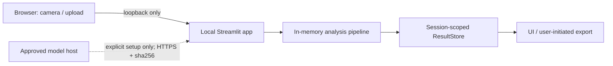
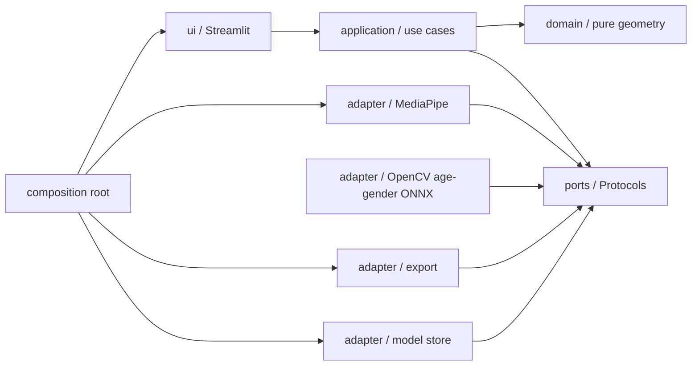
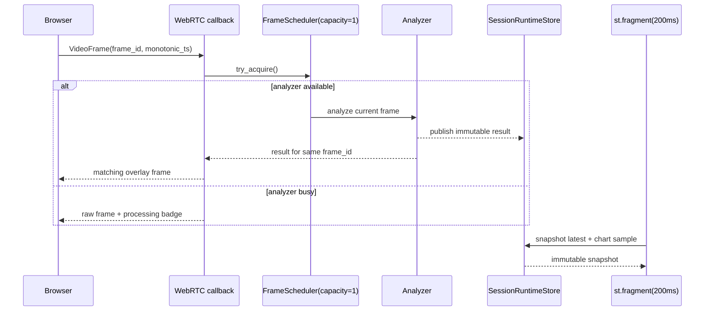

# Face Symmetry Lab

## プロダクト要件定義・技術仕様・開発ガイド v3.7

| 項目 | 内容 |
|---|---|
| ステータス | M0 未完。M1〜M3 の一部を先行実装中 |
| 版 | v3.7 |
| 更新日 | 2026-08-01 |
| 想定リポジトリ | `face-symmetry-lab` |
| 配布形態 | ローカル Streamlit アプリ |
| 基準ランタイム | Python 3.13 |
| データ方針 | Local-first / 画像非保存 / 既定オフライン |

> 本書の **MUST / SHOULD / MAY** は、それぞれ「必須 / 原則必須 / 任意」を表す。MVP のリリース判定は MUST の充足を条件とする。

---

## 0. v3.7 の設計判断

v3.0 の安全性・再現性方針を維持しつつ、創造工房セミナーの研究成果を最終アプリへ接続するため、次を変更する。

1. **プロダクトの目的を「美的評価」ではなく「撮影条件を整えた顔の左右差の可視化」に限定する。** スコアは医学的評価、魅力度、本人の価値を示さない。
2. **18〜75歳向け年齢・性別推定を独立機能として統合する。** 8年代分類は削除し、Open Model Zoo 2023.0 FP16 `age-gender-recognition-retail-0013` の連続年齢と二値確率を採用する。年齢は「モデル推定の参考年齢」、性別は「外見からのモデル推定の参考性別」と表示し、本人の自己認識・法的性別を表さない。左右差・肌表面参考値とは分離する。
3. **初回体験を要件化する。** モデル準備、プライバシー説明、カメラ許可、撮影品質調整、分析という一連の導線を定義する。
4. **分析状態と理由コードを分離する。** `HOLD` だけでなく、姿勢、距離、複数顔、低品質など「次に何を直せばよいか」を UI が説明できるようにする。
5. **指標を版管理する。** モデルだけでなく、ランドマーク対応表、計算式、前処理を含む `metric_version` を結果に記録する。
6. **リアルタイム処理を latest-frame-wins にする。** 受信スレッドを重い推論で塞がず、古いフレームを溜めない。
7. **Streamlit のブロッキングループを廃止する。** UI 更新は定期再実行フラグメントで行い、推論スレッドから Streamlit API に触れない。
8. **ネットワーク境界を明示する。** localhost 実行時は STUN/TURN を使わず、モデル取得は明示操作・固定 URL・sha256 検証を必須にする。
9. **性能要件に測定条件を持たせる。** 「15fps」を単独で掲げず、入力、端末プロファイル、測定区間、パーセンタイルを定義する。
10. **要件・受け入れ基準・テストの対応を一本化する。** 各要件に ID、優先度、検証方法を付ける。
11. **リアルタイムの主要数値を映像内にも表示する。** カメラから視線を外さず撮影条件を調整できるよう、状態、全体・部位別左右差、姿勢角を高コントラストのオーバーレイで示す。同じ情報は画面テキストにも残す。
12. **映像表示と分析頻度を分離する。** WebRTC の受信・返却は各フレームで継続するが、重いランドマーク推論は既定 125ms 間隔（最大 8Hz）で最新フレームだけを処理する。複数フレームを待ってまとめる batch や待ち queue は、ライブ遅延を増やすため採用しない。
13. **既定テーマを dark にする。** Streamlit 公式 theme token で暗い背景と高コントラスト本文を定義し、映像 overlay は blue / amber の状態色を使う。生の DOM/CSS 上書きには依存しない。
14. **顔の中心線を表示設定にする。** 採点に用いる正中点の TLS 直線を顔範囲へ描画し、Camera / Image の双方で既定 ON、利用者が ON / OFF を切り替えられるようにする。中心線はランドマークと異なる色かつ5px以上とし、表示設定は採点値と `config_fingerprint` を変えない。
15. **画像由来の外観差と肌表面参考値は幾何スコアと分離する。** 顔cropへ端末内のホワイトバランス・明度正規化を適用し、頬領域の色調均一性と局所テクスチャを「撮影条件依存の肌表面参考値」として算出する。疾患、肌質、美しさ、健康を推定せず、補正量を記録し、校正完了までは4部位＋全体の幾何スコアへ混合しない。
16. **年齢・性別入力は顔 crop に限定する。** MediaPipe の単一顔 landmark bbox から余白付き crop を作り、Open Model Zoo 2023.0 FP16 `age-gender-recognition-retail-0013` へ入力する。公式XML/BINを出所の正本として固定し、再現可能な開発時変換で生成した固定ONNXを既存の `opencv-contrib-python` DNNから実行する。元assetと派生assetのsize、SHA-256、変換recipeをmanifestへ登録し、parityとslice評価はリリース条件として残す。
17. **リアルタイム映像には幾何だけを重ねる。** 映像へ描くのはランドマークと中心線に限り（実測約1ms/フレーム）、数値パネルは映像へ描かず隣のパネルが担う（従来18.6ms/フレームを要し遅延として現れたため）。間引きフレームでは直近の幾何と背景置換maskを既定250ms（`analysis_interval_ms`の自動調整でこれを上回る場合は2倍を上限に延長）まで再利用し、検出失敗・複数顔・リセット・TTL超過では即時消去して古い結果を別の顔へ長時間重ねない。
18. **0〜100 スコアを廃止し、距離をそのまま出力する。** `exp` 変換の感度係数 `k_p` と部位重み `w_p` は固定評価セットで較正されておらず、恣意的な重み付けを結果へ持ち込むため削除した。部位別は正規化 RMS 距離、全体は全対応ペアを 1 つの集合としてプールし正中線で 1 回だけ折りたたんだ RMS 距離とする。各対応点が等しく 1 票となり、自由パラメータは残らない（§8.6）。
19. **主表示を「対称度」にする。** 利用者が読む値は `100% - ずれ%` とし、「どれだけずれているか」ではなく「どれだけ対称か」を示す。線形・可逆・無パラメータの表示専用変換であり、指標本体、`metric_version`、エクスポート列は変えない（§8.6.3）。
20. **左右差を「形」で示す。** 正中線で折りたたんだ中点からなる対称化点群を実測点と重ねて描き、ズレを線分で可視化する。リアルタイムには載せず、明示的なキャプチャ操作からの一発処理として実行する。対称化した顔を「理想」「正解」として提示しない（§8.6.2、FR-034）。
21. **3D object symmetry 指標を、現行 2D 指標と並走させて算出する。** 実写測定により、現行 2D 指標は部位によって応答の符号が逆になることが確定した（目のゲイン 0、鼻のゲイン −0.472、§8.6.6）。原因は正中線あてはめと眼アンカーという 2 つの構造にあり、較正では直らない。折る平面を先に決めず、鏡映してペア名を入れ替えた配置を Procrustes 重ね合わせる object symmetry 解析（§8.5.1）を、新しい `metric_version` `symmetry-3d/1.0.0` として追加する。3D 指標は §8.7 の EMA と `AnalysisOutcome` まで接続する（FR-036）。**どちらを主指標にするかは決着し、3D を採用した**（§8.6.5、OD-09）。
22. **表示とエクスポートを 3D 指標へ切り替える。** 画面に出る全体・部位別の対称度は `symmetry-3d/1.0.0` の `d_3d` / `d_3d,p` から作る（§8.6.3）。§8.6.5 の `s_3d`（部位を 1 票ずつ数える総合量）から表示専用の値を新設し、全体の対称度（対応点を 1 票ずつ数える `d_3d`）とは重みだけが異なる並列の値として表示する（表示名は項目 23 で「全体のスコア」に確定）。`symmetry-2d/2.0.0` は画面から外れ、エクスポートには `distance_*_raw` として診断目的でのみ残る。レコードスキーマは v4.0 とし、3D の `distance3d_*` 列（部位別・全体・平滑値・`s_3d`）を追加し、2D の EMA 列 `distance_overall_smooth` を削除する。`metric_version` は主指標 `symmetry-3d/1.0.0` を指し、2D の版は行ごとの `metric_version_2d` で追跡する（§9.2）。
23. **見出しの構成を、左右差 2 つ・参考値 2 つの 2 行に分け、「全体のスコア」を見出しへ出す。** 項目 22 で新設した §8.6.5 の `s_3d` の表示名を「部位平均の対称度」から**「全体のスコア」**へ改める（計算・欠測条件・EMA 対象外という扱いは変えない、表示名だけの変更）。この「スコア」は §8.6 が禁じる較正されていない自由パラメータを伴わない表示語であり、v1.0.0 で廃止した採点とは別物であることを §8.6.3 へ明記した。見出しは、映像／画像のすぐ隣で「全体の対称度・全体のスコア」（左右差、1 行目）と「参考性別・参考年齢」（参考値、2 行目）の 2 行 2 列へ分ける。1 行に 3〜4 項目を並べるより行を分けるほうが、不変条件 5（参考年齢・参考性別と左右差を別々の結果として扱う）に忠実であるための変更である（§5.1）。詳細タブに重複して出ていた「全体のスコア」相当の表示（旧称「部位平均の対称度」）は見出しへ移したため取り除く。部位別 4 つと部位別の揺れ幅の注記は詳細タブに残る。
24. **HUD を「ライブ解析」パネルの内容へ拡張し、部位別距離にも時間ベース EMA を適用する（2026-08-11、H1）。** 映像上の HUD（§14.3e）を、全体の対称度・全体のスコア・部位別 4 つ・参考年齢・参考性別を表示する吹き出しへ拡張し、直近の推移を示す inline SVG の折れ線グラフ（輪郭・目・鼻・口・全体の 5 系列）を追加する。部位別を平滑値としてグラフ化するため、§8.7 を改訂し `symmetry-3d/1.0.0` の部位別距離 `d_3d,p` にも `d_3d` と同じ `tau`・同じ式の、部位ごとに独立した時間ベース EMA を適用する（新しい自由パラメータは導入しない、§8.6 の原則）。reset 条件は `reset()`・Advanced 設定変更・顔喪失のいずれでも全体値と完全に同じタイミングで適用し、部位が欠測のフレームではその部位の EMA を更新しない（0 で埋めない、不変条件 11）。エクスポートは変更しない（`distance3d_*_raw` は生値のまま、v4.0 のスキーマへ列を追加しない）。グラフの系列は page realm の in-memory リングバッファに保持し、`localStorage` を含むいかなる storage へも書かない（§3.4）。世代識別子には既存の `segment_id` を流用し、値が変わると系列を破棄する。
25. **画像アップロードの年齢・性別推定を自動実行にし、「全体のスコア」の計算過程を開示する（2026-08-11、H2）。** Image フローの年齢・性別推定から手動ボタンを廃止し、単一顔を検出できた時点で自動的に推定する（Camera 側は既存の独立 worker が既に同様の自動推論を行っており、両者の挙動を揃える）。同一のアップロード画像（bytes の同一性）に対しては 1 度だけ推論し、以後の再実行はセッション状態のキャッシュを表示する（`IMAGE_RECORDED_INPUT_KEY` の landmark 記録と同じ fingerprint 方式）。推定の失敗・モデル未配置・対象範囲外はいずれも年齢・性別区画だけに影響し、左右差の見出し・詳細パネルは描画を続ける（不変条件 12、FR-024）。あわせて詳細結果へ、「全体のスコア」（§8.6.5 の `s_3d`）を画面表示中の実数値で組み立てる計算過程を折りたたみ表示で追加した。開示するのは「ずれ」の定義、部位別対称度（詳細タブの主表示 `resolve_part_distance_3d` と同じ値）を代入した式、全体の対称度（対応点を 1 票ずつ数える `d_3d`）との重みの違い、対称な成人の左右差が両眼間隔のおよそ 1〜2% であるためこの式が高い数値になりやすいという事実、および `docs/symmetry-metric-measurements.md` §12.0・§12.1 に基づく実測レンジと文献上の対称/非対称群差である。`s_3d` が部位欠測で欠測のときは数値を当てはめず、古い値や 0 も表示しない（不変条件 11）。文言は §5.3 の禁止語に加え、母集団の分布を持たないため「◯% 以上なら対称」のような基準値も用いない。

26. **Camera の数値表示を映像上の HUD へ一本化する（2026-08-12、H3）。** 映像の隣に置いていた「ライブ解析」パネル（全体の対称度・全体のスコア・参考性別・参考年齢の 2 行見出し、追跡状態、位置誘導）を削除する。項目 24（H1）で HUD が同じ内容を吹き出しとして表示するようになり、同一の測定値が画面上の 2 か所へ並んで出ていたためである。あわせて詳細結果タブからも、HUD と重複する部位別 4 つのメトリクスと生値の併記を取り除く。詳細結果タブに残すのは HUD が持たないもの——「全体のスコア」の計算過程（項目 25）、姿勢、肌表面参考値、品質ゲートが閉じている間の状態文言と理由（§6.3）、指標の版、および §5.3 が義務付ける注記（部位別の揺れ幅・距離の単位・中立文言）——だけとする。パネルの削除に伴い、その配置プリセット（FR-032 の右・左・下）も削除し、映像は画面幅いっぱいを使う。HUD の位置プリセットは残る。**この変更は Camera だけに適用し、Image（静止画）の見出し結果と詳細結果は変更しない。** Image に HUD は無く、削除すると数値を読む場所が無くなるためである。§5.4 の「色だけで状態を伝えない」は、枠色に対するテキストの併記を、(a) 品質ゲートが閉じている間に詳細結果タブへ出る状態文言と理由、(b) ゲートが閉じると HUD と詳細結果の数値が `—` へ変わること（値の有無という色以外の経路）の 2 つで満たす。

27. **「全体のスコア」の計算過程を初学者向けの 3 ステップへ組み直し、UI 層を責務ごとに分割する（2026-08-12、H4）。** 項目 25（H2）で追加した計算過程は、式・途中経過・目盛りの読み替えを 1 つの塊で示していた。これを「4 部位のずれを読む → 1 つにまとめる → 点へ置き換える」の 3 ステップに分け、各ステップへ平叙文の説明と実数値の代入を対にして置く（§8.6.3）。ステップの区切りは表示の構造であり、`s_3d` の定義（§8.6.5）も表示スケール（§8.6.7）も `metric_version` もエクスポート列も変えない。§5.2 が禁じる進捗バー・ゲージ・達成度の演出は用いず、目盛りの端点は数値と文章で示す。計算過程の算術は新設の `domain.score_explanation` が immutable DTO として返し、`ui` は整形して並べるだけにする。あわせて、責務が混ざっていた `ui` 層を分割する——表示値の解決と整形を `ui.readings` へ、HUD のブラウザ資産（CSS・実行時 JS）を `ui.hud_assets` へ、Camera と Image に重複していた対称化パネルを `ui.symmetrization_panel` へ、Image 入力モード一式を `ui.image_section` へ移す。いずれも表示専用の再配置であり、測定値・`config_fingerprint`・エクスポート列・要件のいずれも変えない。

### 0.1 現在の実装位置（2026-08-01）

| Milestone | 状態 | 現在地 |
|---|---|---|
| M0 | 未完 | OD-02、OD-04、OD-07 と実モデル互換性確認が未完。左右差は相対比較専用（OD-01 は §8.6 のスコア変換廃止により解消） |
| M1 | 一部実装 | 静止画入力、品質判定、幾何左右差、年齢・性別境界、schema は実装中。固定評価と肌表面指標校正は未完 |
| M2 | 一部実装 | WebRTC、latest-frame-wins、短時間overlay保持、Stop、年齢・性別の独立worker（capacity 1・独自cadence・segment単位の破棄）は実装中。E2E、cleanup実測は未完 |
| M3 | 一部実装 | 同意、入力切替、CSV / JSON export、About は実装済み。trend、Session、設定UI、A11y実機確認は未完 |
| M4 以降 | 未着手 | offline、3 OS、performance、soak、配布判定は未完 |

したがって現時点は MVP Done ではない。M0 の未決事項を残した先行実装であり、§27 の release 条件を満たしていない。

---

# Part I — Product Requirements

## 1. プロダクト概要

### 1.1 ビジョン

Face Symmetry Lab は、Web カメラまたは静止画から顔のランドマークを端末内で解析し、左右差をわかりやすく可視化する研究・セルフチェック用ツールである。

ユーザーは、画像を外部サービスへ送信せず、撮影条件が結果に与える影響を理解しながら、同一人物・同一環境内での左右差と肌表面参考値の相対的な傾向、およびモデル推定の参考年齢・参考性別を確認できる。

### 1.2 解決する課題

- 一般的な画像編集ツールでは、顔の左右差を定量的かつ再現可能に確認しづらい。
- 顔分析サービスへ画像をアップロードすることに、プライバシー上の抵抗がある。
- 姿勢、距離、照明、レンズ歪みの影響を区別せずに数値だけを見せると、結果が過度に権威的に受け取られる。
- リアルタイム顔分析の試作では、モデル、UI、スレッド、履歴が密結合し、改善や検証が難しくなりやすい。

### 1.3 プロダクト原則

- **Local first**: 画像処理は端末内で完結し、画像を外部へ送らない。
- **Guide before score**: 数値より先に、撮影品質と改善方法を示す。
- **Explain, do not judge**: 「良い／悪い」「美しい／醜い」と評価しない。
- **Relative, not absolute**: 異なる人物間の比較やランキングを行わない。
- **Separate, do not conflate**: 左右差、肌表面参考値、参考年齢、参考性別を別の出力として表示し、相関や因果を示唆しない。
- **Version everything**: モデル、計算式、設定、出力スキーマを追跡可能にする。
- **Graceful degradation**: 高負荷時は古いフレームを捨て、UI とカメラ操作を維持する。

### 1.3.1 不変条件

**この一覧が不変条件の唯一の正本であり、番号はこのリストが定義する。** 本書・`CLAUDE.md`・コード内コメントが「不変条件 N」と参照する場合、N は常にこの番号を指す。変更するときは実装より先に本書のこの節を更新し、判断を `docs/adr/` へ残すこと（`CLAUDE.md` §5 と同じ規律）。

1. 顔の画像・映像・ランドマーク・およびそれらの派生値は端末内に閉じ、外部送信と暗黙のファイル保存を行わない（§10.1・§10.4）。
2. Streamlit は `127.0.0.1` のみで待ち受け、利用統計・STUN・TURN を既定無効にする（§10.2・§10.3・§18）。
3. 同意を得てから画像 upload と camera permission を開始する（§4.2・§7 の FR-003・§12.2 の AC-PRIV-01）。
4. 年齢は断定年齢ではなく「モデル推定の参考年齢」として表示する（§9.2・§10.8）。
5. 参考年齢・参考性別と左右差は別々の結果として扱い、相関・因果・人物の価値を示唆しない（§1.3・§5.2・§10.8）。
6. モデルは版と SHA-256 を追跡し、暗黙に取得・更新・切替しない（§10.6）。
7. 顔埋め込みと新規 ML モデルを追加しない（§3.4・§7 の FR-029・§10.8）。
8. 対称度は「試験中の指標」、対称化画像は「加工画像」であることを UI に明記する（§5.3）。
9. `cv2` provider は `opencv-contrib-python` 1 distribution に限定する（§13.1・§13.3）。
10. 採点に影響する自動調整を持たない（§12.1 の AC-AUTOTUNE-02・§14.3d）。
11. 欠測・NaN・Inf・不正 shape を 0 やその他の値で埋めず、結果や UI へ流さない（§8.1.1・§9.2・§11.2 の NFR-013）。
12. ある推論の失敗が、他の分析・表示・エクスポートを止めない（失敗分離、§8.1.1・§10.8・§11.2 の NFR-017）。

### 1.4 成功指標

| 指標 | MVP 目標 | 測定方法 |
|---|---:|---|
| 初回分析到達率 | 90% 以上 | 5 名以上のタスクテストで、説明なしに有効な左右差結果へ到達した割合 |
| Time to first valid result | p90 60 秒以内 | モデル準備済みの起動から最初の `OK` まで |
| 撮影条件の理解 | 80% 以上 | テスト後に「姿勢や照明で値が変わる」と回答できた割合 |
| 固定条件での表示安定性 | 変動係数 0.10 以下 | 同一 fixture または固定撮影で連続 10 秒の平滑化済み全体距離 |
| 年齢・性別モデルの再現性 | 年齢 MAE 6.99年、性別 accuracy 95.80% の公開値を基準に差を記録 | 採用 asset と固定評価セットで runtime parity と slice を比較 |
| 画像の外部送信・永続化 | 0 件 | ネットワーク遮断テスト、ファイル書込監査、ログ監査 |

成功指標はプロダクト評価用であり、顔対称性スコア自体の医学的・心理的妥当性を意味しない。

## 2. 対象ユーザーと利用文脈

### 2.1 主対象

1. **研究・開発者**: 顔ランドマークと幾何計算を再現可能な形で検証したい。
2. **デモ利用者**: 外部アップロードなしで、顔の左右差の可視化を試したい。
3. **同一条件で経時比較する利用者**: 同一人物・同一端末・同一照明で相対的な変化を確認したい。

### 2.2 想定しない利用

- 医療診断、治療方針、美容医療の適否判断
- 採用、保険、与信、教育、監視など人物に影響を与える意思決定
- 魅力度、人格、健康、能力の推定
- 複数人物の順位付け、異なる人物間の優劣比較
- 本人または保護者の同意がない画像の分析
- 公開環境での不特定多数向けサービス提供

## 3. スコープと優先度

### 3.1 P0 — Core MVP

- ローカル環境の事前チェックとモデル準備
- プライバシー・免責事項の初回確認
- Web カメラによるリアルタイム分析
- JPEG / PNG の静止画分析
- 単一顔ポリシー、姿勢・距離・安定性の品質ゲート
- 輪郭、目、鼻、口、全体の対称度スコア
- 18〜75歳を対象とした参考年齢と外見由来の参考性別の推定
- 撮影補正量を記録する撮影条件依存の肌表面参考値
- オーバーレイ、状態表示、改善ガイダンス
- 表示値の平滑化とセッション内トレンド
- 設定変更、停止、リセット
- CSV / JSON エクスポート
- モデル・指標・設定・スキーマの版管理
- 画像非保存、ローカル限定、匿名ログ

### 3.2 P1 — MVP 改善

- 低照度・過露出・ぼけ警告の検証と、品質ゲートへの昇格
- セッション要約と比較可能性の警告
- 追加ブラウザ・カメラを用いたリアルタイム E2E matrix
- 3D 正規化方式の評価と、2D 指標との比較レポート
- 日本語／英語 UI
- 年齢・性別モデルおよび肌表面指標の slice 評価、calibration

### 3.3 P2 — Research Extensions

- 正面判定の学習済み分類器への差し替え
- 対称化画像のピクセルワーピング生成（FR-035、§8.6.4）
- 年齢・性別モデルの別 architecture 比較、継続学習、個人化
- FastAPI アダプタ、別フロントエンド、DB、クラウド配置
- 定期再学習、自動モデル更新、オンデバイス個人化

### 3.4 非スコープ

- 顔認証、本人特定、顔埋め込みの保存
- 動画ファイル、録画、スクリーンショットの保存
- 複数顔の同時採点
- ログイン、組織管理、マルチテナント
- 自動クラウド送信、分析データ収集、テレメトリ
- 画像加工による「理想顔」生成
- 18歳未満または75歳を超える人物の年齢・性別推定
- **セッション間比較機能を実装しない。** 過去のセッションの結果を保持して「前回と比べてどう変わったか」を示す機能を持たず、主表示は同一セッション内で完結する。理由は次の 2 点である。(a) §4.3 のとおり分析履歴・推定値を永続化しないため、比較に使う「前回値」自体を保持できない。(b) アプリは顔埋め込みを持たないため（不変条件 7）前回値が同一人物のものかを確認できず、確認しないまま比較すると §10.7 が禁じる人物間比較が成立しうる
- **派生値のセッションを跨いだ永続化を行わない。** 左右差・肌表面参考値・参考年齢・参考性別のいずれも、ブラウザ storage・ローカルファイルのどちらへも保存しない。§14.3e で `localStorage` に保持している HUD 位置は顔由来データではなく、この禁止の対象外である。**§14.3e の HUD 折れ線グラフが保持する系列は、左右差の派生値そのものであり、この禁止の対象内である。** page realm のメモリ（`window.__fslHudSeries` 相当）だけに置き、`localStorage` を含むいかなる storage へも書かない

## 4. 情報設計と主要ユーザーフロー

### 4.1 画面構成

アプリは次の 4 領域で構成する。

1. **Analyze**: カメラ／静止画、品質ガイド、現在の左右差、肌表面参考値、参考年齢・参考性別（実装済み）
2. **Trend**: セッション内の時系列、状態別の欠測表示（未実装）
3. **Session**: 件数、開始時刻、設定、エクスポート、リセット（未実装。エクスポートと入力切替・リセット自体は Analyze 内に実装済み）
4. **About**: 算出方法、制約、モデル・ライセンス、プライバシー（実装済み）

Analyze と About は Streamlit の `st.navigation` / `st.Page` による multipage 構成の別ページとし、Trend・Session は独立ページを持たない。主要操作は Analyze に集約し、詳細設定はサイドバーまたは popover に置く。画面上部にはアプリ名、`Local processing` 表示を両ページ共通で表示する。モデル／指標バージョン、停止ボタンは Analyze ページ内に置く。

### 4.2 初回フロー

1. 起動時に Python、依存、モデル、カメラ利用可否を確認する。
2. 不足モデルがある場合は、取得元、サイズ、ライセンス、sha256 を表示し、ユーザー操作で取得する。
3. 「画像は保存・外部送信しない」「左右差・肌表面・年齢・性別は参考値」「本人の同意がある18〜75歳の画像のみ使用」の 3 点を確認する。
4. 入力方法を Camera / Image から選択する。
5. Camera の場合はブラウザの許可を求める。拒否時は設定方法と Image への代替動線を示す。
6. 顔の位置、距離、向きが条件を満たすまで、スコアの代わりに具体的なガイドを示す。
7. 有効フレームが連続して得られたら分析結果へ切り替える。
8. 年齢・性別は左右差と別カードに「モデル推定の参考年齢」「外見からのモデル推定の参考性別」と表示し、対象年齢、信頼度と limitations へのリンクを併記する。

### 4.3 再訪フロー

- モデルが準備済みなら、既定設定で Analyze を表示する。同じブラウザセッション内の rerun だけは UI 設定を維持する。
- 前回の画像、分析履歴、推定値、カメラ許可状態をアプリ独自に永続化しない。
- 指標またはモデルが変更された場合は、変更を通知し、過去エクスポートとの単純比較を避けるよう案内する。

### 4.4 終了・プライバシーフロー

- `Stop camera` は WebRTC track と分析ワーカーを停止し、最新フレーム参照を破棄する。
- `Reset session` は履歴、EMA、エラー、設定スナップショットを初期化する。モデルキャッシュは削除しない。
- ページ離脱または接続切断時も同等のクリーンアップを行う。

## 5. UX / UI 要件

### 5.1 レイアウト

- Analyze ページの操作順は、利用前の同意 → 入力方法選択（Camera / Image）→ 選択した入力のプレビューと結果、の順に上から下へ並べる。アプリ説明文はページ最下部に要約と About ページへの導線だけを置き、算出方法の詳細は About ページへ分離する。
- **Image でも見出し結果の区画を持たない（2026-08-12）。** 画像に隣接して数値を出すのは**画像上の吹き出し**（§14.3e）だけとし、画像は画面幅いっぱいを使う。吹き出しは Camera の HUD と同じ内容（全体の対称度・全体のスコア・部位別 4 つ・参考年齢・参考性別）を同じフォーマッタで表示し、**折れ線グラフは持たない**（静止画は時系列を持たないため、描く系列が存在しない）。吹き出しの中でも左右差（全体の対称度・全体のスコア・部位別）と参考値（参考年齢・参考性別）は別の行に置き、混在させない。この行分けは、不変条件 5（§1.3.1）が「参考年齢・参考性別と左右差を別々の結果として扱い、相関・因果・人物の価値を示唆しない」と定めることに基づく。吹き出しが持たない値（「全体のスコア」の計算過程・姿勢・肌表面参考値・状態文言と理由・指標の版・§5.3 の注記）は、画像の下へ画面幅いっぱいで表示する（FR-014, AC-LAYOUT-01）。
- **Camera では見出し結果の区画を持たない（項目 26、H3）。** 映像に隣接して数値を出すのは映像上の HUD（§14.3e）だけとし、映像は画面幅いっぱいを使う。HUD と同じ内容を隣のパネルにも並べない。HUD が持たない値（「全体のスコア」の計算過程・姿勢・肌表面参考値・状態文言と理由・指標の版）は、映像の下のタブへ画面幅いっぱいで表示する（FR-013, AC-LAYOUT-01）。
- Camera と Image は同一の順序（同意 → 入力方法選択 → 映像／画像 → 詳細結果）に揃え、Image 側だけ異なる並びにしない。**どちらも映像／画像の隣に見出し結果の区画を持たず、その役割は映像上の HUD と画像上の吹き出しが担う**（項目 26、2026-08-12）。
- **Camera では映像をセクション最上部に置き、常に画面内へ収まるようにする。** 表示設定、詳細結果、対称化、エクスポートは映像より下に置き、`st.tabs` で 1 つずつ表示して縦方向の総量を抑える。どのタブを選んでも映像は同じ位置に留まり、再生は継続する。表示設定を映像より上に積み上げて映像を画面外へ押し出してはならない。
- タブは表示専用の切り替えであり、スコア計算、`config_revision`、WebRTC の再生状態に影響しない。タブ内の widget は毎回描画されるため、選択中でないタブの設定値も保持される。
- 通常表示では位置固定のために生の CSS（`position: sticky` 等）を用いない（§5.2）。映像を上に置きページ丈を抑えることで達成する。
- 映像上の HUD（全体の対称度・全体のスコア・部位別 4 つ・参考年齢・参考性別、および折れ線グラフ）と品質ゲート枠色は、映像 pixel ではなく DOM レイヤーへ重ねる（§5.2 の例外、§14.3e）。HUD は `pointer-events: none` とし、`STOP` などの操作を塞がない。
- 擬似全画面中は映像と HUD、および「全画面を終了」操作だけを表示し、下部のタブは描画しない。全画面を解除する操作を常に画面内へ出すこと。
- 狭い画面では映像／画像、詳細結果、トレンドの順に 1 カラムへ積む。
- 重要操作をサイドバーだけに置かない。停止、入力切替、リセットは主画面から到達可能にする。
- 初期画面でスコアカードの空箱を並べず、開始方法とプライバシー境界を示す。
- `layout="wide"` を用い、主要な画像・映像・結果パネルは画面幅いっぱいを使う。固定の狭い `st.container` へ主要コンテンツを収めない。

### 5.2 ビジュアル

- Streamlit の公式テーマ設定を用い、light / dark の両方に対応する。
- 既定は dark とし、背景・カード・本文・補助文の階調を公式 theme token で定義する。
- 生の HTML/CSS セレクタによる内部 DOM の上書きは原則 MUST NOT。必要な独自 UI はテーマ変数に追従するコンポーネントとして隔離する。
- **例外（表示専用オーバーレイに限る）**: 映像上の HUD、品質ゲート枠色、擬似全画面（§14.3e）は、映像 pixel へ描き込まずに映像へ情報を重ねる唯一の手段であり、DOM レイヤーへの CSS 注入を許容する。適用条件は次のすべてを満たすこと。
  - フレーム処理経路（`build_video_frame_callback`・`RealtimeLandmarkPipeline.process_with_analysis`・`domain.overlay`）を一切変更せず、`processing_ms` を増やさない。
  - 測定値、`metric_version`、エクスポート列、`config_fingerprint` に影響しない表示専用であること。
  - 要素の特定は `st.container(key=...)` が生成する `.st-key-<key>`、および `.stSidebar` / `.stAppHeader` のような Streamlit の意味的クラス名に限る。emotion のハッシュ class、`nth-child` など構造依存のセレクタ、`data-testid` は使わない（`data-testid` はバージョン間で変わり、実際に全画面が無言で機能しなくなった）。
  - HUD の移動やスタッキング制御に JS を用いる場合、実行コードは**ページ側の realm** へ注入する。`components.v1.html` の iframe は再実行のたびに破棄され、そこで定義した timer callback や closure は id だけ残して停止する。
  - スタイルシートは初回に一度だけ設置し、以後は class の切り替えだけで状態を変える。5Hz で `<style>` を送り直すと文書全体の style 再計算が毎秒 5 回走り、映像が実際にカクつく。
  - 映像の上に `backdrop-filter` を置かない。更新頻度ではなく**映像フレームごと**に再合成され、遅延の原因になる。
  - 色だけで状態を伝えない（§5.4）。同じ情報をテキストでも併記する。
- 色の意味を固定する: neutral=未開始、blue=処理中、amber=調整が必要、red=回復不能なエラー。左右差の大小に赤／緑の価値判断を割り当てない。
- 主表示は**対称度**（`100% - ずれ%`、§8.6.3）とし、小数 2 桁までで表示して精度以上の細かさを演出しない。ずれの百分率も併記し、どちらの向きでも読めるようにする。
- 対称度が高いことを称賛せず、低いことを警告しない。色、絵文字、進捗バーで「達成度」として演出しない。
- 対称化ビジュアライゼーションでは、実測点と対称化点を色で区別し、どちらかを「正しい側」として強調しない。
- 年齢・性別推定と肌表面参考値を対称性の結果より目立たせず、各結果に関係があるような配置・文言を避ける。

### 5.3 文言

- `Score` 単独ではなく、初出で「対称度（実験値・両眼距離比）」と表示する。値が高いほど対応点のズレが小さいことだけを意味し、「高得点／低得点」「良い／悪い」と呼ばない。
- **例外**: 見出しの「全体のスコア」（§8.6.5 の `s_3d` を §8.6.3 の変換で読んだ対称度）は、上の禁止の対象外としてこの語を使ってよい表示名である。実体・許容根拠・help での明示義務は §8.6.3「表示語としてのスコア」を参照。「高得点／低得点」「良い／悪い」と呼ばないことは他の値と同様に適用する。
- 対称度には必ず「ずれ X%」を併記し、100% が数学上の上限であって目標値ではないことを添える。
- 対称度は実写のテイク内でも数パーセントポイントの狭い範囲に集まりやすい（`docs/symmetry-metric-measurements.md` §12.1）。100% が目標値ではないという既存の注意文の延長として、その狭い範囲の中の違いを対称・非対称の判定として読ませない注意文を添える。
- 部位別の対称度は、同一条件で撮り直すだけでも動く幅がある（同docs §14.7）。撮影のたびに動く幅より小さい変化は部位別の値だけでは左右差の変化として読み取れないことを注記する。この注記は 4 部位に等しく適用し、特定の部位（鼻など）だけを名指しで「使えない」と述べない。部位別ゲインの個人差は被写体 1 名の測定であり未検証である（OD-09）。
- 対称化ビジュアライゼーションは「左右対称にそろえた位置」と説明し、「理想」「正解」「補正後」「あるべき顔」と呼ばない。
- 対称化画像（FR-035）は「左右対称にそろえた画像（幾何変形）」と説明し、加工画像であることと、無加工の写真として提示・共有しないことを明示する。before/after、美化、補正という枠組みで見せない。
- `HOLD` は内部値とし、UI では「少し右を向いてください」「顔を 10cm ほど離してください」のような行動可能な文言に変換する。
- `ERROR` は原因、影響、回復操作を示す。内部例外やスタックトレースを表示しない。
- 「完璧」「理想」「欠点」「歪み」「正常／異常」を使用しない。
- **計算過程の開示（§8.6.3、H2）を含め、数値の求め方を説明する文言も上の禁止語に従う。** 加えて、母集団の分布を持たないため「◯% 以上なら対称」のような基準値を提示しない。

### 5.4 アクセシビリティ

- 独自要素は WCAG 2.2 AA を目標とし、本文コントラスト比 4.5:1 以上を確保する。
- 色だけで状態を伝えず、アイコン、ラベル、文言を併用する。
- 全入力に可視ラベルを付け、キーボード操作とフォーカス表示を維持する。
- カメラオーバーレイの情報は、色以外の経路でも読み取れるようにする。数値は HUD 自身がテキストとして表示する。品質ゲートの状態（枠色）は、(a) ゲートが閉じている間に詳細結果タブへ出る状態文言と理由（§6.3）、(b) ゲートが閉じると HUD と詳細結果の数値が `—` へ変わること（値の有無）で併せて示し、枠色を状態の唯一の手掛かりにしない（項目 26、§14.3e）。
- チャートは要約値または表形式でも確認できるようにする。

## 6. 状態モデル

### 6.1 システム状態

| 状態 | 条件 | UI |
|---|---|---|
| `BOOTSTRAPPING` | 依存・モデルを確認中 | 進捗、現在処理、キャンセル不可の理由 |
| `READY` | 入力待ち | Camera / Image の選択 |
| `REQUESTING_PERMISSION` | カメラ許可待ち | ブラウザ操作の説明 |
| `STREAMING` | 映像受信中 | プレビュー、状態、停止操作 |
| `PAUSED` | ユーザーが停止 | 最終数値を薄く表示し「停止中」を明記 |
| `PERMISSION_DENIED` | カメラ許可が拒否された | ブラウザでの再許可手順と Image への動線 |
| `NO_DEVICE` | 利用可能なカメラがない | 接続確認と Image への動線 |
| `CONNECTION_FAILED` | WebRTC 接続を確立できない | 再接続、診断情報、Image への動線 |
| `INVALID_INPUT` | 静止画を安全にデコードできない | 上限・対応形式・再選択 |
| `FATAL_ERROR` | 継続不能 | 原因要約、再試行、診断情報のコピー |

### 6.2 分析状態

| `analysis_status` | 条件 | スコア |
|---|---|---|
| `OK` | 単一顔・品質ゲート通過・計算成功 | 新規算出する |
| `HOLD` | 顔はあるが、姿勢・距離・安定性が条件外 | 新規算出しない |
| `NO_FACE` | 対象顔がない | 新規算出しない |
| `MULTI_FACE` | 2 顔以上を検出 | 誰も算出しない |
| `ERROR` | 当該フレームの処理失敗 | 新規算出しない |

`analysis_status` と `reason_codes[]` は分離する。`HOLD` の阻害理由は複数指定できる。分析を止めない照度・ぼけ等の P0 注意は `warning_codes[]` に分ける。

### 6.3 理由コード

| コード | 意味 | 既定ガイド |
|---|---|---|
| `OFF_AXIS_YAW` | 左右方向の角度外 | 顔を中央へ向ける |
| `OFF_AXIS_PITCH` | 上下方向の角度外 | 顎を少し上げる／下げる |
| `OFF_AXIS_ROLL` | 首の傾きが大きい | 頭を水平にする |
| `TOO_CLOSE` / `TOO_FAR` | 顔領域が既定範囲外 | カメラから離れる／近づく |
| `UNSTABLE` | 有効状態が規定フレーム継続していない | そのまま静止する |
| `LOW_CONFIDENCE` | ランドマーク信頼度不足 | 明るさ、遮蔽、顔位置を確認する |
| `LOW_LIGHT` / `OVEREXPOSED` | 輝度が推奨範囲外 | P0 は warning。正面から均一な光を当てる |
| `BLUR` | 画像の鮮明度不足 | P0 は warning。カメラを固定し、レンズを確認する |
| `STALE_RESULT` | 最新結果が映像より古い | 負荷を下げる設定を案内する |

### 6.4 ヒステリシス

- `HOLD` から `OK` への遷移は、内側閾値を満たす 5 連続有効フレームを必要とする。
- `OK` から `HOLD` への遷移は、外側閾値を超えた 1 分析フレームで反映する。`MULTI_FACE` と処理例外も即時反映する。
- 内側閾値の初期候補は yaw / pitch / roll = 15° / 15° / 25°、外側閾値は 17° / 17° / 28° とし、実機評価後に固定する。
- 閾値と復帰フレーム数は固定既定値であり、手動編集UI・AI自動調整のいずれの対象にもしない（§15.2）。測定条件の一貫性を保つための、意図的な非公開化である。

## 7. 機能要件

| ID | Pri | 要件 | 受け入れ条件 |
|---|:---:|---|---|
| FR-001 | P0 | 起動時ヘルスチェック | モデルなし、破損、互換性なしを区別し、アプリ全体を例外終了させない |
| FR-002 | P0 | 明示的モデル準備 | URL、サイズ、ライセンスを表示し、同意操作後に取得して sha256 を検証する |
| FR-003 | P0 | プライバシー確認 | 初回分析前に 3 項目の説明を表示し、未確認ならカメラ・アップロードを開始しない |
| FR-004 | P0 | 入力切替 | Camera / Image を 2 操作以内で切替でき、切替時に前入力のフレーム参照と EMA を破棄する。選択 UI は各入力が何をするかを選ぶ前に読み取れる形（アイコン付きの選択と、各入力の説明カード、現在の選択の明示）で提示する。キーボードだけで選択でき（AC-A11Y-01）、選択解除状態を許さず常にどちらか一方が有効である |
| FR-005 | P0 | カメラ入力 | 映像のみを取得し、音声 permission を要求しない。停止時は track を解放する |
| FR-006 | P0 | 静止画入力 | JPEG / PNG、10MB 以下、12MP 以下を受け付け、EXIF orientation を適用する |
| FR-007 | P0 | 入力検証 | 拡張子だけでなくファイル署名と画像デコードを検証し、アニメーション・破損画像を拒否する |
| FR-008 | P0 | 単一顔ポリシー | 0 顔は `NO_FACE`、2 顔以上は `MULTI_FACE` とし、最大顔を黙って採点しない |
| FR-009 | P0 | ランドマーク・姿勢 | 478 点ランドマークと yaw / pitch / roll を取得し、失敗を理由コードへ変換する。ランドマークは §8.1.1 の奥行き `z` を併せて取得し、取得できない場合は欠測として扱い、xy による分析を止めない。`z` は §8.1.1 のとおり、`symmetry-3d/1.0.0`（FR-036）だけが参照し、`symmetry-2d/2.0.0` の指標・表示・エクスポートのいずれにも用いない |
| FR-010 | P0 | 品質ゲート | 姿勢、顔サイズ、連続安定性を必須判定し、照度・ぼけは P0 では警告、P1 で評価後にゲート化できる |
| FR-011 | P0 | 対称性指標 | §8 の手順で輪郭、目、鼻、口の部位別正規化 RMS 距離と、全対応ペアをプールした全体距離を算出する。いずれも 0 以上の有限値で、非有限値・負値を拒否する。全体距離は部位別の加重合成ではない（§8.6） |
| FR-012 | P0 | 平滑化 | 表示用全体値に EMA を適用し、生値を別保持する。リセット条件は §8.8 に従う |
| FR-013 | P0 | 結果オーバーレイ | **Camera**: 映像には478点ランドマークとTLS中心線だけを重ねる（実測0.99ms/フレーム、720p/30fpsの1フレーム予算33msの約3%）。中心線はON/OFFを切り替えられ既定ON、ランドマークと異なる色・5px以上とする。数値パネルは映像へ描画しない（従来のPILパネル描画は18.6ms/フレームを要し遅延の主因だったため）。間引きフレームでは直近の単一顔幾何を既定250ms（`analysis_interval_ms`自動調整時は`max(250ms, analysis_interval_ms×2)`）だけ再描画し、エラー・複数顔・リセット・TTL超過で消去する。**数値で映像に隣接するのは映像上のHUD**（§14.3e、DOMレイヤー）**だけとし、§11 NFR-003の4〜5Hzで更新する。** HUDが表示するのは全体の対称度・全体のスコア・部位別4つ・参考年齢・参考性別と折れ線グラフである。**映像の隣に「ライブ解析」パネルを置かない（項目26、H3）。** 同じ測定値をHUDと隣のパネルへ二重に並べないためであり、映像は画面幅いっぱいを使う。映像はセクション最上部に置き、常に画面内へ収まるようにする。HUDが持たない値——「全体のスコア」の計算過程、姿勢、肌表面参考値、年齢性別詳細、品質ゲートが閉じている間の状態文言と理由、指標の版——と、表示設定、対称化、エクスポートは映像より下の`st.tabs`へ集約し、画面幅いっぱいで1つずつ表示する（§5.1）。**詳細タブはHUDが既に表示している値（部位別4つ、全体の対称度の生値）を重複して表示しない。** **Image**: 静止画も同様にランドマークと中心線をプレビューへ重ね、全体の対称度・全体のスコア・参考性別・参考年齢と状態を写真の隣に2行の見出しとして、部位別を含む残りの数値をその下に画面幅いっぱいで表示する。**HUDが無いため、Imageの見出しと部位別は項目26（H3）の削除対象ではない。** いずれも欠測は `—` とする。**映像上の HUD**（全体の対称度・全体のスコア・部位別4つ・参考年齢・参考性別、および折れ線グラフ）と品質ゲート枠色は、映像 pixel へ描かず DOM レイヤーへ重ねる表示専用機構として追加してよい（§5.2 の例外、§14.3e）。フレーム処理経路を変更せず `processing_ms` を増やさないことが条件で、増える場合は採用しない |
| FR-014 | P0 | 結果表示 | 全体値、4 部位、姿勢、品質状態、比較上の注意を 1 画面に表示する |
| FR-015 | P0 | トレンド | 直近 60 秒を既定表示し、欠測を 0 点として結ばず空白で表す |
| FR-016 | P0 | セッション履歴 | 上限 3,000 件のリングバッファに数値結果のみ保持し、上限到達時は古い順に破棄する |
| FR-017 | P0 | エクスポート | 1 件以上の結果がある場合のみ CSV / JSON を生成し、§9 のスキーマとメタ情報を含める |
| FR-018 | P0 | 設定 | 基本設定と Advanced を分離し、不正な対応マップ・閾値・上限を保存できないよう検証する |
| FR-019 | P0 | セッション制御 | Stop / Resume / Reset があり、結果・カメラ・モデルキャッシュへの影響を確認ダイアログで区別する |
| FR-020 | P0 | バージョン表示 | 各 `*_model_version` / `*_model_sha256`、`metric_version`、`schema_version`、設定 fingerprint を画面と出力に含める |
| FR-021 | P1 | セッション要約 | 有効率、中央値、変動幅、主な HOLD 理由を表示する。人物間比較は行わない |
| FR-022 | P0 | 年齢・性別推定 | 単一顔 landmark bbox の余白付き顔 crop を `age-gender-recognition-retail-0013` へ入力し、18〜75歳の連続年齢と二値確率を、断定ではない参考値として左右差と別区画に表示する。対象範囲外には推論を提供しない。Image フローは単一顔を検出できた時点でボタン操作なしに自動推定し、同一のアップロード画像（bytes の同一性）に対しては 1 度だけ推論してセッション状態のキャッシュを再表示する（Camera 側は既存の独立 worker が同様に自動推論する、§14.3） |
| FR-023 | P0 | 年齢・性別の再現性 | `demographic_model_version`、`demographic_model_sha256`、推定年齢、性別2クラス確率、観測時刻、cache 状態を結果へ含める |
| FR-024 | P0 | 年齢・性別の失敗分離 | モデルなし・不正出力・推論失敗でも左右差分析を継続し、年齢・性別区画だけに回復手順を示す |
| FR-025 | P1 | 補正後の肌表面参考値 | 顔cropへ端末内のGray-worldホワイトバランスとrobust明度正規化を適用し、頬領域の色調均一性と局所テクスチャを独立した参考値として算出する。補正係数・指標版・未校正状態を記録し、肌色、疾患、健康、美的品質を推定せず、幾何の全体の対称度へ混合しない |
| FR-026 | P1 | 追跡ズーム | リアルタイムのVIDEOモードで、直前フレームの単一顔bboxを追跡し周辺を切り出して拡大した上でlandmark検出へ渡し、結果を元フレーム座標へ写像する。初回検出・顔見失い時は全体フレームへ復帰し、既定間隔ごとに全体フレームを再検査して2顔以上の出現を見逃さない |
| FR-027 | P1 | 背景の黒/白置換（表示専用） | `selfie_segmenter`による前景confidence maskを使い、表示用frameの背景だけを黒または白へ置換する。既定OFFのON/OFF切替を持ち、左右差・年齢性別・肌表面参考値のいずれの入力にも使わない。合成失敗時は元映像へfallbackし、分析を止めない |
| FR-028 | P1 | 映像の明るさ調整（検出専用、非表示） | 0.25〜3.0倍のgainを、landmark検出directlyへ渡すframeにだけ乗算する。display出力（ユーザーに見える映像）には適用せず、常にカメラの生映像を表示する。既定gain 1.0（無調整）とし、範囲外の値は拒否する。AIによる検出補助が画面へ視覚的に現れないようにするための意図的な分離であり、遅延低減も兼ねる（毎映像フレームではなく解析cadenceの頻度でしか演算しなくなるため） |
| FR-029 | P1 | 明るさ・追跡ズームの自動調整 | 手動スライダーは持たず、新規MLモデルを追加せず、既存のフレーム統計（フレーム平均輝度、追跡中の顔bbox面積比）から`brightness_gain`と追跡ズームpolicy（`zoom_margin_ratio`・`zoom_target_px`）をFR-028・FR-026それぞれの許容範囲内でheuristicに算出し、一定間隔で常時自動更新する。対称性・年齢性別・肌表面参考値の入力・スコア計算には一切使わない（FR-027・FR-028と同じ表示・検出補助専用の扱い） |
| FR-030 | P1 | Advanced設定 cadenceの自動調整 | FR-029と同じく手動UIを持たず常時、scoringに影響しないcadence設定を自動更新する。直近の`processing_ms`から`analysis_interval_ms`（既定候補125/200/333msの中から選択）、それに連動する`age_interval_ms`（500〜10,000ms）、一定時間分の履歴を保つ`history_capacity`（100〜20,000件）を、config_revision・segment・EMAを変えずに継続更新する。**scoringに影響する自動調整は持たない**。§8.6で感度係数`k_p`と部位重み`w_p`を廃止したため、AIが調整しうる採点パラメータ自体が存在しない。品質ゲート閾値（yaw/pitch/roll・face_area・valid_frames_to_ok・ema_tau_seconds）も固定既定値のまま、手動UI・AI調整のいずれの対象にもしない |
| FR-031 | P1 | 位置誘導 | 品質ゲートが算出済みの理由コード（`ReasonCode`: `NO_FACE`・`MULTIPLE_FACES`・`OFF_AXIS_YAW`・`OFF_AXIS_PITCH`・`OFF_AXIS_ROLL`・`TOO_CLOSE`・`TOO_FAR`・`LOW_CONFIDENCE`・`UNSTABLE`等）を、新たな判定ロジックを追加せずに日本語の短い指示文へ変換して表示する。**表示先は詳細結果の状態表示**（`ui.scores.render_guidance`、Camera と Image で共通）で、§6.3 の同じ表（`ui.guidance.REASON_GUIDANCE`）から引く。品質ゲートを満たしている間は指示文を表示せず、代わりに測定値を表示する。**映像の隣の「ライブ解析」パネルへ`AnalysisState.reason`を1件だけ表示する経路は、パネルごと削除した（項目26、H3）。** カメラ映像pixelへの直接描画は行わない（FR-013の遅延要件、および PIL 既定bitmapフォントに日本語グリフが無く文字化けするため。§14.3e） |
| FR-032 | P1 | 映像上 HUD の位置選択 | 映像へ重ねる HUD（§14.3e）の位置を、プリセット（左上・右上・左下・右下・非表示）から利用者がその場で選べる。選択UIは「表示設定」タブへ置き、映像より上に積み上げない（§5.1）。選択は距離計算・分析結果に影響しない表示専用設定で、既定は左上。映像 pixel へは何も描画しない。**「ライブ解析」パネルとその配置プリセット（動画の右・左・下）は項目26（H3）で削除した。** 詳細数値（計算過程・姿勢・肌表面参考値・状態文言・指標の版）は常に動画の下のタブへ画面幅いっぱいで表示する |
| FR-034 | P1 | 対称化ビジュアライゼーション | §8.6.2 の対称化点群を算出し、実測ランドマークと色を分けて重ね、対応ペアごとのズレを線分で示す。Camera では「この瞬間を対称化して見る」操作で直近の解析成功フレームを 1 枚だけ取り出して静的に処理し、Image では表示中の写真に対して処理する。いずれも EMA・履歴を持たない stateless な一発処理で、リアルタイムの連続分析・映像描画を停止も変更もしない。キャプチャした映像と対称化結果は Streamlit セッション内のメモリだけに保持し、ディスク保存・外部送信を行わない。セッションのリセットでキャプチャ内容も破棄する。「理想」「正解」「補正後」といった価値判断を含む文言を使わない（§10.7） |
| FR-035 | P2 | 対称化画像の生成（ピクセルワーピング） | §8.6.4 の手順で、実測ランドマークから対称化ランドマークへ Delaunay 三角形分割＋区分アフィン変換により画素を変形し、左右対称にそろえた顔画像を生成する。既定 OFF の明示操作でのみ実行し、リアルタイム映像には組み込まない。画像の四隅・辺中点を固定アンカーとし、変位が両眼間隔の既定25%を超える場合・退化三角形・変形元と変形先で向きが反転した三角形・座標解決不能な三角形は安全側へ倒す（全体中止または当該三角形の読み飛ばし）。失敗してもFR-034の点による可視化は継続する。生成物は幾何変形された合成画像であり、無加工の写真として提示せず、「理想」「正解」「補正後」「美化」と呼ばない。端末内メモリにのみ保持し、暗黙保存・外部送信を行わない |
| FR-036 | P1 | 3D object symmetry 指標（主指標） | §8.5.1 の手順で、版管理された 63 組の対応ペア（126 点）の 3D 座標から `d_3d` を算出する。折る平面を先に決めず、鏡映してペア名を入れ替えた配置を並進と回転だけで元の配置へ Procrustes 重ね合わせし、残差の RMS を距離とする。正規化スケールは §8.5.1 のとおり **3D の両眼 anchor 間距離**とし、2D 投影距離を使ってはならない。出力は総合値 `d_3d`、部位別 `d_3d,p`（並列の診断値で総合値へ寄与しない）、残差の xy / z 分解、および部位を等しく 1 票として扱う総合量 `s_3d`（§8.6.5）とする。`z` が欠測のフレームでは `d_3d` と `s_3d` を含む 3D 一式を欠測とし、0 へ置換しない。**`FrameAnalyzer` の §8.7 EMA と `AnalysisOutcome` へ接続し（`overall_distance_3d_smooth`）、表示（全体の対称度・部位別の対称度・全体のスコア）とエクスポート（レコードスキーマ v4.0 の `distance3d_*` 列）へも接続する。** `symmetry-2d/2.0.0` は画面から外れ、エクスポートには `distance_*_raw` として診断目的で残る。3D の算出失敗はそのフレームの 3D 側だけを欠測にし、2D の状態・距離・EMA・品質ゲート・肌表面参考値のいずれも変えない（不変条件 12）。`symmetry-2d/2.0.0` の算出結果そのものは本要件によって変化しない |
| ~~FR-033~~ | — | ~~全画面表示でも参照値が分かる~~ | **撤回**。ブラウザの動画全画面は`<video>`要素だけを拡大するため、全画面時にも数値を見せるには映像pixelへ焼き込むほかないが、その描画コストが遅延の主因であることが実測で判明した（FR-013）。遅延ゼロを優先し、映像pixelへは数値を焼き込まない。全画面中の数値はDOMレイヤーのHUDが担い（§14.3e）、それ以外の詳細は全画面を解除した通常表示の詳細結果タブで確認する |

---

## 8. 対称性指標仕様

### 8.1 入力と座標

- 入力は EXIF 補正済みの RGB 画像とする。
- ランドマークは MediaPipe Face Landmarker の 478 点を使用する。
- 距離計算前に `x` と `y` を画像幅・高さで画素座標へ戻し、縦横比による歪みを防ぐ。
- 計算途中の座標は `float64`、出力は有限値であることを検証する。

### 8.1.1 奥行き座標 `z` の取り扱い

MediaPipe Face Landmarker は 478 点それぞれへ `z` を返す。本節はその保持と単位だけを定める。**`z` を参照するのは `symmetry-3d/1.0.0`（§8.5.1、FR-036）だけであり、`symmetry-2d/2.0.0` の指標・表示・エクスポートは `z` を一切参照しない。**

**由来** — `z` は**モデルが推定した相対奥行きであり、実測値ではない**。原点は頭部中心付近に置かれた相対量で、絶対距離としての較正を持たない。単眼画像からの推定であるため、xy と同じ精度を仮定してはならない。

**スケール規約** — MediaPipe は `x` を画像幅、`y` を画像高さで正規化し、`z` は「`x` とおよそ同じスケール」と規定する。したがって画素相当へ戻すときは、**`z` にも `x` と同じ係数 —— 画像の *幅* —— を掛ける**。高さを掛けるのは `y` だけである。これで 3 軸が同じ長さの単位に揃い、§8.1 の xy 画素変換とも一致する。

**欠測** — 検出器が `z` を返さない場合、または非有限値を含む場合、そのフレームの `z` を**まとめて欠測**とする。0 やその他の値で埋めない（§1.3、不変条件 11）。`z` の欠測は xy による分析・表示・エクスポートを一切停止させない。`z` が欠測のフレームでは `symmetry-3d/1.0.0` の `d_3d` を欠測とし、`symmetry-2d/2.0.0` の出力は影響を受けない（不変条件 12 と同じ形の失敗分離である）。

**追跡ズーム（§14.3a）の写像** — 切り出し窓を基準に正規化された `z` は、**窓の幅比を掛けて**全フレーム比へ戻す。xy の写像が平行移動を伴うのに対し `z` は倍率だけであり、これは「`z` は画像幅で正規化される」という上のスケール規約から従う（`z` の原点は画像の端ではなく頭部中心付近であるため、平行移動項を持たない）。拡大率は切り出しと結果の双方へ等しく効くので写像には現れない。

**適用範囲** — §8.3 の正規化、§8.4 の中心線、§8.5 の左右差分、§8.6 の出力値はすべて xy のみで定義され、`z` の有無で値が変わってはならない。これは `symmetry-2d/2.0.0` の定義であり、並走する `symmetry-3d/1.0.0` が `z` を使うようになっても変わらない。

`z` を算入する指標は、§8.3〜§8.6 を改訂するのではなく**別の `metric_version` として起こす**。`docs/symmetry-metric-measurements.md` §4〜§7 が測定した 3D object symmetry を §8.5.1 / §8.6.5 に定義し、`symmetry-3d/1.0.0` として追加した。両 bundle は同じ `landmark_map_version` と同じ対応ペア表を共有し、距離の定義だけが異なる。

### 8.2 品質ゲート

1. 顔数が 1 であること。
2. 顔検出または presence の信頼度が設定閾値以上であること。
3. 既定で `|yaw| ≤ 15°`、`|pitch| ≤ 15°`、`|roll| ≤ 25°` であること。
4. 顔 bbox 面積比が既定範囲内であること。初期候補はフレーム面積の 2〜55% とし、実機評価で固定する（下限は当初 12%、次に 5% だったが、いずれもPC webcamでは着席時に過剰なTOO_FAR誤拒否を招くことが利用者報告と実測で判明し、2%へ再緩和した。実機評価で再確定する）。
5. §6.4 の安定条件を満たすこと。

照度・ぼけは P0 では非ブロッキング警告とする。カメラ差が大きいため、固定 fixture と実機検証で誤拒否率を評価してから P1 でゲート昇格する。

### 8.2.1 姿勢の座標規約

- 保存・判定用の座標は非ミラー画像を基準とする。表示をミラー化しても符号を変更しない。
- MediaPipe の顔変換行列から 3×3 部分を取り出し、極分解で scale / shear を除いた回転行列を用いる。
- アプリ規約は intrinsic Y-X-Z とし、`yaw > 0` は鼻が非ミラー画像の右へ、`pitch > 0` は上へ、`roll > 0` は時計回りへ動く向きとする。
- adapter は MediaPipe 座標から上記規約への変換を 1 箇所で行う。UI の「左／右」案内だけはミラー表示の有無に合わせる。
- ±10° の単軸合成回転で符号、軸順、degree 変換を contract test する。加えて、同意を得た実写の単軸 yaw / pitch / roll 映像で表示符号を確認し、映像・landmark を保存せず集計結果だけを ADR に記録する。

変換行列の規約が採用 MediaPipe asset と合わない場合、推測で補正せず ADR と `metric_version` を更新する。

### 8.3 正規化

1. 各眼の目頭・目尻の中点を眼 anchor として算出する。視線で動く虹彩中心はスケール基準に使わない。
2. 両眼 anchor を結ぶ線が水平になるよう、全点へ 2D roll 補正を適用する。
3. 両眼 anchor 間距離を 1.0 としてスケール正規化する。距離がゼロまたは下限未満なら `LOW_CONFIDENCE` とする。
4. 両眼中点を原点へ平行移動する。

MVP は正面品質ゲートを前提とした 2D 指標とする。3D frontalization は P1 の評価対象であり、同じ `metric_version` のまま差し替えてはならない。

### 8.4 中心線

- 眉間、鼻根、鼻尖、人中、上下唇中央、顎先からなる版管理済み正中点集合を使用する。
- 中心線は通常の `x = ay + b` 回帰ではなく、**Total Least Squares（PCA による直交距離最小化）**で推定する。
- 外れ値の影響が基準を超える場合は、RANSAC 等の頑健推定を新しい `metric_version` として評価する。

**適用範囲** — 本節は `symmetry-2d/2.0.0` の定義であり、同 bundle が現行の表示・エクスポートを担う間は有効である。**`symmetry-3d/1.0.0` は中心線を推定せず、正中点 27 点を一切参照しない**（§8.5.1）。object symmetry 解析は「どの平面で折るか」を先に決めず、重ね合わせが最適な折り方を自動で決めるため、あてはめる基準線そのものが存在しない。両 bundle が同じ `landmark_map_version` を共有する都合上、`symmetry-3d` の bundle にも `midline_indices` は列として残るが、距離の算出には使わない。

この違いは 3D 化の副次効果ではなく主目的の 1 つである。中心線は 27 点の正中点から推定されるが、**その 27 点自体は距離として測られていない**。測られていない点の変位があてはめ直線を動かし、測られている全部位の残差を動かすため、鼻周辺へ非対称を入れると総合値が下がりうる（§8.6.6）。基準線を持たない定義はこの経路を構造的に持たない。

### 8.5 左右差分

- `landmark_map_version` で固定した左右対応ペアを、輪郭、目、鼻、口ごとに定義する。
- 右側点を中心線に対して鏡映し、対応する左側点とのユークリッド距離を計算する。
- 部位 `p` の正規化 RMS を次で求める。

```text
d_p = sqrt(mean(||left_i - mirror(right_i)||²))
```

- 使用可能なペア数が部位ごとの最小数を下回る場合、その部位を欠測にし、0 へ置換しない。部位の欠測は全体値を欠測にしない（全体値は §8.6 のとおり部位から合成しないため）。

本節は `symmetry-2d/2.0.0` の定義である。並走する 3D 指標の距離は §8.5.1 が定める。

### 8.5.1 3D object symmetry 解析（`symmetry-3d/1.0.0`）

中心線で折るのではなく、**鏡映してペア名を入れ替えた配置を、元の配置へ剛体で重ね合わせる**。折る平面を先に決めないので、§8.4 の中心線あてはめも、§8.3 の眼 anchor を基準に取り直す面内の向きも、距離へ入らない。形態計測学の object symmetry 解析であり、本アプリが新しく考案した量ではない。

**入力** — §8.1.1 の 3 軸そろった画素相当座標 `(x·W, y·H, z·W)` とする。`z` が欠測のフレームでは `d_3d` を算出せず、欠測とする。

**手順**

1. `landmark_map_version` が固定した全対応ペア（63 組 = 126 点）の 3D 座標を取り出す。**正中点 27 点は使わない**（§8.4）。
2. `x` の符号を反転して鏡映する。
3. 鏡映後の点へ、対応ペア表そのものである置換 `σ` を適用して左右の名前を入れ替える。`σ` はペア表から一意に決まり、ここで新しい対応を推測しない（ペア表は「鏡映後の相互最近傍が 4 通りの描画で一致したもの」として導出されている）。
4. 得られた配置を、元の配置へ最小二乗で重ね合わせる（Procrustes 重ね合わせ）。**並進と回転だけを許し、スケールは合わせない。** スケールを自由にすると、大きさの違いを非対称として測らない代わりに、非対称の大きさそのものが吸収されてしまう。回転が鏡映（行列式が負）になる場合は、特異値分解の最後の列の符号を反転して真の回転へ落とす。
5. 重ねきれずに残った残差ベクトルの RMS を距離とする。

```text
X       = 対応ペア 126 点の 3D 座標
M(X)    = σ( mirror_x(X) )
R, t    = argmin ||X - (M(X)·R + t)||²      （R は回転、スケール自由度なし）
d_3d    = sqrt( mean_i ||X_i - (M(X)·R + t)_i||² )
```

`X` を剛体で動かすと `M(X)` も同じだけ動くので、`d_3d` は頭部の並進・回転（yaw / pitch / roll のすべて）に対して不変である。姿勢ゲート（§8.2）はフレーム採否の条件として残るが、`d_3d` の値そのものは姿勢に依存しない。

**正規化スケールの規約** — `d_3d` は両眼 anchor 間距離を 1.0 とした無次元量とする。ここで割るのは **3 次元で測った両眼 anchor 間距離**であり、§8.3 が使う 2D 投影距離ではない。

- 重ね合わせが並進と回転を吸収するので、正規化のうち `d_3d` の値へ効くのは**スケールだけ**である。原点の取り方（両眼 anchor 中点、`z` も同じ 4 点から取る）と面内回転（roll 補正）は 3D の剛体変換であり、残差を変えない。
- **2D 投影距離を使ってはならない。** yaw が `θ` のとき投影された両眼間距離は `cos θ` 倍に縮むので、それで割ると `d_3d` が `1/cos θ` 倍に膨らむ。剛体不変性で表口から追い出した姿勢依存が、正規化という裏口から戻ってくる。`docs/symmetry-metric-measurements.md` §4 でこの効果を実測している。`θ = 0` では両者は一致するため、合成した正面顔だけを見ていると発見できない。
- `z` は MediaPipe の推定奥行きであり、`x` と同じ係数（画像の**幅**）で画素相当へ戻したうえで 3 軸に同じスケールを掛ける（§8.1.1）。3 軸で単位が揃っていないと、Procrustes の回転が軸ごとに違う長さを混ぜることになり、残差が意味を持たなくなる。

**欠測** — 使用可能な対応ペアの総数が `Σ_p min_pairs_p` を下回る場合、重ね合わせ自体を行わず、総合値・部位別値のすべてを欠測とする。0 へ置換しない。部位別値は §8.6.5 のとおり単一の重ね合わせの残差から集計されるため、重ね合わせが成立しなければ部位別値も定義されない。ここが §8.5 との違いであり、2D では部位別距離が総合値と独立に定義できるのに対し、3D では両者が同じ 1 回の重ね合わせを共有する。

### 8.6 出力値

全体値は部位別値の加重合成ではなく、**全部位の対応ペアを 1 つの集合へプールし、正中線で 1 回だけ折りたたんだ正規化 RMS 距離**とする。

```text
P_all   = contour ∪ eyes ∪ nose ∪ mouth      （版管理された全対応ペア）
d_all   = sqrt(mean_{i ∈ P_all}(||left_i - mirror(right_i)||²))
```

- 出力は `d_p`（部位別）と `d_all`（全体）であり、いずれも両眼 anchor 間距離を 1.0 とした無次元の距離とする。`exp` 変換による 0〜100 スコア、感度係数 `k_p`、部位重み `w_p` は**持たない**。いずれも固定評価セットで較正されていない自由パラメータであり、恣意的な重み付けを結果へ持ち込むため廃止した。
- `d_all` は各対応点を等しく 1 票として扱う。部位ごとのペア数の違いがそのまま寄与の違いになるが、これは「点が多い部位ほど形状情報が多い」という測定上の事実であり、重要度の判断ではない。
- 全部位のペアが使用可能な場合に限り、`d_all = sqrt(Σ_p n_p·d_p² / Σ_p n_p)`（`n_p` は部位 `p` の使用ペア数）が恒等的に成り立つ。これはプール計算の帰結であって設定可能な重みではなく、`n_p` は版管理された対応マップから一意に決まる。部位が欠測しても `d_all` は残りのペアだけで定義できるため、プール式を primitive とする。
- `d_p` と `d_all` は**並列の独立した出力**とする。`d_p` は「どこにズレが集中しているか」を見る診断値であり、`d_all` の計算には一切関与しない。
- `d_all` に使用可能なペア総数が `Σ_p min_pairs_p`（部位ごとの最小ペア数の合計）を下回る場合、`d_all` を欠測にし、0 へ置換しない。
- 値は 0 が下限で上限を持たない。小さいほど対応点のズレが小さいことだけを意味し、母集団内順位、正常範囲、美的品質、人物の優劣や望ましさを意味しない。
- 数学上、対応点距離がすべて 0 なら `d_p = d_all = 0` になる。実写では検出誤差、姿勢、撮影条件により、見かけ上左右対称でも 0 になる保証はない。
- UI は絶対値ではなく同一人物・同一環境内の相対変化を参照するよう注意を表示する。
- **本節が禁じる部位重み `w_p` は、固定評価セットで較正されていない自由パラメータを指す。** §8.6.5 が定義する `s_3d`（3D、並走指標）は部位を等しく 1 票として扱うが、重みは全部位について 1 に固定され調整の余地を持たないため、ここでの禁止の対象ではない。

### 8.6.1 補正後の肌表面参考値（実験値）

- RGB の顔cropに、各channel平均をそろえるGray-worldホワイトバランスと、5〜95 percentileを用いる明度正規化を端末内で適用する。channel gainは過補正を避ける範囲へclampする。
- 版管理された左右の頬landmark pair周辺を抽出し、補正後のBT.709輝度・色差の分散から色調均一性、局所勾配からテクスチャ均一性を算出する。
- patch が画像外、分散不足、欠測、不正 shape の場合は欠測とし、0 点へ置換しない。
- 出力は `skin_quality_score_raw`、`skin_tone_uniformity_raw`、`skin_texture_uniformity_raw`、補正gain、`skin_metric_version` とする。
- ソフトウェア補正はcamera固有の露出・HDR・レンズ・ISP処理を復元できず、同一人物・同一端末・近い照明での相対比較を補助するだけである。疾患、肌タイプ、肌色、清潔さ、健康、美的品質を表さない。
- OD-08 の固定評価が完了するまで `skin_quality_frozen: false` とし、幾何の `distance_overall_*` へ混合しない。

### 8.6.2 対称化ビジュアライゼーション（FR-034）

左右差を「数値」ではなく「形」で示すため、正中線で折りたたんだ際の中点からなる**対称化点群**を算出し、実測点との差を重ねて表示できる。

- 対応ペア `(l, r)` の対称化点は `mid_l = (left_l + mirror(right_r)) / 2`、`mid_r = mirror(mid_l)` とする。
- 正中点集合の点は `(p + mirror(p)) / 2`、すなわち正中線への直交射影とする。ペアの中点と同じ式であり、規則を 1 つに保つ。
- 対応ペアが定義されていない点（478 点のうち 63 組 = 126 点と正中点以外）は**対称化対象外**とし、実座標のまま残す。推測で対応を補わない。
- 表示は §8.3 の正規化を逆変換して元の画素座標へ戻したうえで行う。逆変換は正規化の厳密な逆（平行移動・回転・スケール）とする。
- この可視化は「対称化した顔の方が良い」という価値判断を含意しない。文言は §5.3 と §10.7 に従い、対称化点を「理想」「正解」「補正後」と呼ばない。
- 数値的には対称化点と実測点の距離は §8.5 の `||left_i - mirror(right_i)||` の 1/2 であり、新しい指標を導入しない。
- リアルタイム映像へは組み込まない。1 回きりの静的処理として、静止画分析と同じ stateless な一発処理パスで実行する（§14.3g）。

### 8.6.3 対称度としての表示（表示専用）

利用者が読む主表示は「どれだけずれているか」ではなく「どれだけ対称か」とする。

```text
symmetry_percent = clamp(100 × (1 - d), 0, 100)
```

- **表示専用の変換であり、指標そのものではない。** `d` 自体の定義は変えない。同じ測定値を別の向きで読ませているにすぎない。
- 変換は線形・可逆で、**自由パラメータを持たない**。`symmetry_percent = 100 - deviation_percent` であり、利用者はどちらの向きへも暗算で戻せる。v1.0.0 で廃止した `100 × exp(-k_p × d_p)` のような較正されていない係数は導入しない。
- `d > 1`（対応点のずれが両眼間隔を超える、検出破綻に相当する状態）では 0% で下げ止まる。この clamp は表示上の下限であり、`d` 自体は上限なく記録される。
- 100% は対応点距離がすべて 0 になった場合の数学上の上限であり、望ましさ、正常性、美的品質、人物の優劣を意味しない。実写で 100% になることは保証しない。
- **画面に出る対称度 % は、すべてこの同じ変換を通す（`symmetry-3d/1.0.0`、§8.5.1・§8.6.5）。**
  - **全体の対称度** = `clamp(100 × (1 - d_3d), 0, 100)`。§8.7 の平滑値 `overall_distance_3d_smooth` を主表示し、生値を併記する（平滑値を主表示し生値を併記する構成そのものは変えない）。
  - **部位別の対称度** = `clamp(100 × (1 - d_3d,p), 0, 100)`（4 部位）。§8.7 改訂により `d_3d,p` にも部位ごとに独立した同じ時間ベース EMA を適用する。**主表示はこの部位別平滑値であり、詳細タブは生値を併記する**（全体の対称度と同じ「平滑値を主表示し生値を併記する」構成）。
- **「全体のスコア」だけは本節の変換を通さず、§8.6.7 の表示スケール（`display-scale/1.0.0`）で 0〜100 の「点」として表示する。** 元になる量は §8.6.5 の `s_3d`（部位等重み距離。部位を 1 票ずつ数える総合量）で変わらず、生値のみである（`s_3d` は EMA の対象に含めない、§8.6.5・§8.7）。本節の変換をそのまま適用すると実測値が 98% 前後の 2〜3pt 幅へ潰れ、目盛りとして機能しないためである（理由と実測値は §8.6.7）。表示名の由来は次の段落を参照。
- 部位別対称度から全体対称度は再構成できない（全体はプールした残差から 1 回で決まる量であり、部位別の合成ではないため）。UI はこの点を明示する。
- **全体のスコアは全体の対称度と一致しない。** `s_3d`（部位を 1 票ずつ数える）は部位別 `d_3d,p` から明示的に組み立てる別の総合量であり、`d_3d`（対応点を 1 票ずつ数える）とは重みだけが異なる（§8.6.5）。部位のペア数が異なる限り両者は通常異なる値になる。§8.6.7 により両者は目盛りも異なる（点 と %）ため、**数字の大小を直接比べてはならない**。
- **「スコア」という表示語について。** 「全体のスコア」の「スコア」は、§8.6 が禁じる較正されていない自由パラメータ（v1.0.0 で廃止した `100 × exp(-k_p × d_p)` の感度係数 `k_p`、部位重み `w_p`）を伴う採点を指すのではない。実体は `s_3d` であり、その重みは全部位について 1 に固定され調整の余地を持たない（§8.6.5 がこの重みを §8.6 の禁止の対象外と定める理由と同じ）。§8.6.7 の表示スケールも距離そのものを変えず、線形・可逆な目盛りの読み替えに留まる。したがって「スコア」を表示名に用いても §8.6 の禁止には触れない。ただし較正済みの採点や品質評価を意味させてはならず、help・説明文では常に「部位を 1 票ずつ数えた対称度を目盛り直したもの」であることと採点ではないことを明示する（§5.3、`ui.scores.PART_EQUAL_WEIGHT_HELP`）。
- `symmetry-2d/2.0.0` の `d` / `d_p` は画面には出さない。エクスポートには `distance_*_raw` として診断目的でのみ残る（§8.6.6、§9.2）。
- 表示の向きを変えただけで「高いほど良い」と読ませないよう、§5.2 と §5.3 の中立文言・非演出規定を併せて適用する。実写では表示値が狭い範囲に集まりやすいことにも §5.3 の注意文で触れる。
- **計算過程の開示（2026-08-11 に H2 で追加、2026-08-12 に H4 でステップ構成へ改訂）。** `ui.scores.render_score_details` は、詳細タブの部位別対称度（主表示、`resolve_part_distance_3d` が解決する値）を使って「全体のスコア」（`s_3d`）を実際に組み立てる計算過程を、折りたたみ表示（`st.expander`）で提供する。計算過程が使う部位別の値は、同じ関数が描画する部位別メトリクスの表示値と常に一致させる（生値と平滑値という 2 つの表示規則を作らない）。
- **開示は、初学者が 1 つずつ追える 3 つのステップとして提示する（H4）。** 式を 1 つの塊として見せると、記号の意味・途中経過・目盛りの読み替えが同時に押し寄せて追えない。各ステップは「何をするか」の平叙文を先に置き、そのあとに実数値を代入した計算を続ける。**ステップの区切りは表示の構造であり、計算そのものは変えない。** 3 ステップを通した結果は §8.6.5 の `s_3d` と §8.6.7 の `score_points` に一致する。
  1. **ステップ 1「4 つの部位それぞれのずれを読む」。** 「ずれ」の定義（両眼間隔を 100% とした、左右で対応する点どうしの離れ具合）と、両眼間隔 6cm ならずれ 1% がおよそ 0.6mm にあたるという実寸の目安を述べる。画面に表示中の部位別 4 つの実数値と、次のステップで使う二乗値を、部位ごとに 1 行ずつ並べて示す。
  2. **ステップ 2「4 つのずれを 1 つにまとめる」。** 二乗して平均し平方根を取る（二乗平均平方根）ことと、単純平均ではなくこの形を採る理由——1 か所だけ大きいずれが他の 3 部位に薄められないため——を述べる。実数値を代入した途中経過（二乗の和、4 で割った平均、平方根）と、結果が `s_3d` そのものであることを示す。
  3. **ステップ 3「まとめたずれを点へ置き換える」。** §8.6.7 のアンカー 2 点（ずれ 1.0% = 100 点、ずれ 5.0% = 0 点）を数値として明示し、そこへ当てはめて点へ換算する式と実数値を示す。あわせて `score_points = 25 × (symmetry_percent - 95)` の帰結として**ずれが 1 ポイント動くと点が 25 点動く**ことを述べ、点の細かさが測定の細かさではないことを次の注記へ橋渡しする。
- 3 ステップの後には、次の 4 点を注記として続ける。ステップの中へ混ぜない（手順と、手順の読み方に対する留保は別のものである）。
  1. 全体の対称度（対応点を 1 票ずつ数える `d_3d`）との重みの違い。
  2. 対称と判定された成人の左右差が両眼間隔のおよそ 1〜2% であること。§8.6.7 の目盛りはこの範囲を読むために引き伸ばしてあり、点数が母集団内の順位ではないという注記を伴う。
  3. `docs/symmetry-metric-measurements.md` §12.1・§14.4 に基づく実測レンジ（被写体 1 名の撮り直しでの表示値の分布）を点へ換算した幅と、文献上の対称/非対称群差。
  4. 「採点ではない」「順位ではない」というアンカー付きの help（`ui.scores.PART_EQUAL_WEIGHT_HELP`）。
- **ステップ表示に進捗バー・ゲージ・達成度の演出を用いない（§5.2）。** 目盛りの端点は数値と文章で示す。点数の位置をバーの長さや色で表すと、§8.6.7 のアンカーが母集団の分位であるかのように読まれる。
- **計算過程の算術は `domain` に置く（H4）。** `domain.score_explanation` が部位別の値から二乗・平均・平方根・点への換算までを 1 つの immutable DTO として返し、`ui` はそれを整形して並べるだけにする。`ui` に式を書くと、画面表示のためだけの 2 つ目の計算経路ができる（CLAUDE.md §5「`ui` に推論式・幾何計算を実装しない」）。DTO の値は §8.6.5 の `equal_weight_distance_from_parts` と §8.6.7 の `score_points` を経由し、独自の再実装を持たない。
- **`s_3d` が部位の欠測により欠測のときは、計算過程に数値を代入しない。** 式の形だけを示すか節を隠すかのいずれでもよいが、古い値や 0 は表示しない（不変条件 11）。文言は §5.3 の禁止語に加え、母集団の分布を持たないため「◯% 以上なら対称」のような基準値も用いない。

### 8.6.4 ピクセルワーピングによる対称化画像（FR-035）

§8.6.2 が点で示すズレを、画像そのものの変形として示す。**新しい指標は導入せず**、§8.6.2 が算出済みの対称化点群を変形先として使うだけである。

- Delaunay 三角形分割と区分アフィン変換（piecewise affine warp）で、実測ランドマーク位置から対称化ランドマーク位置へ画素を写す。
- **境界アンカー**: 画像の四隅と各辺の中点を、変形前後で同一座標の固定点として点集合へ加える。これによりランドマークが覆わない領域（耳、髪、首、背景）の外周が固定され、三角形分割が画像全体を隙間なく覆う。アンカーの内側は連続的に補間されるため、髪や耳は顔の変形量に応じて緩やかに追従する。
- **対応ペアが未定義の点は変形先＝実測位置**（§8.6.2）であり、そのままアンカーとして働く。推測で動かさない。
- 三角形分割は変形先の点集合に対して行い、同じ index 三つ組を変形元にも用いる。これにより出力側が重なりも隙間もなく敷き詰められる。
- **破綻防止**:
  - 変位ガード: いずれかの点の変位が両眼間隔の既定 25% を超える場合、ワーピング全体を実行せず失敗として扱う。検出破綻時に人物として成立しない画像を生成しないための安全境界であり、較正された指標パラメータではない。
  - 退化三角形（面積が下限未満）は個別に読み飛ばし、その領域は元画素のまま残す。
  - **向きの反転**: 三角形の符号付き面積が変形元と変形先で符号を変える場合、その三角形を個別に読み飛ばす。裏返った三角形は逆向きのアフィン写像で画素を転送し、その領域の像を局所的に破綻させるためである。これは変位ガードとは独立の条件である。変位ガードは 1 点の**絶対**変位の上限だが、裏返りは隣接点の**相対**変位が点間隔を超えるかで決まり、前者は後者を含意しない。対称化変位は各ペアの実測ズレの半分で決まるので、隣り合うランドマークが別々のズレを持てば相対変位が生じ、点間隔が数画素しかない密な領域ではガード内でも符号が反転する。面積の絶対値は縮まないため、退化三角形の判定では検出できない。
  - 点は画像範囲へ clamp し、重複座標に解決できない三角形は読み飛ばす。
  - いずれの失敗も §8.6.2 のフェーズ1結果を無効にしない（fail-soft）。理由を表示し、点の可視化は継続する。
- 実行はフェーズ1と同じ一発処理パス（§14.3g）で、リアルタイム映像には組み込まない。全画素の再構成を伴うため既定 OFF の明示操作とし、有効化していない間は一切実行しない。
- **生成物は幾何変形された合成画像である。** 「理想」「正解」「補正後」「美化」と呼ばず、無加工の写真として提示・共有しないよう表示する（§5.3、§10.7）。端末内メモリにのみ保持し、暗黙保存・外部送信を行わない（不変条件 1）。

### 8.6.5 3D object symmetry の出力値（`symmetry-3d/1.0.0`）

§8.5.1 の重ね合わせから、次の 3 つを出力する。いずれも両眼 anchor 間距離を 1.0 とした無次元量である。

```text
d_3d      = sqrt( mean_{i ∈ 126 点}( ||r_i||² ) )              総合値
d_3d,p    = sqrt( mean_{i ∈ 部位 p の点}( ||r_i||² ) )          部位別（診断）
xy_p      = sqrt( mean_{i ∈ 部位 p の点}( r_i,x² + r_i,y² ) )   面内成分
z_p       = sqrt( mean_{i ∈ 部位 p の点}( r_i,z² ) )            奥行き成分
```

`r_i` は §8.5.1 の手順 5 の残差ベクトルである。

- **部位別は単一の重ね合わせから集計する。** 部位ごとに Procrustes を走らせ直すのではなく、**全 126 点で 1 回だけ重ね合わせ、その残差を部位ごとに読む**。理由は 4 つある。
  1. §8.6 の既存方針と一致する。部位別は「ズレがどこに集中しているか」を見る並列の診断出力であり、総合値へ寄与しない。同じ残差の行を分けて読むだけなら、部位別は別の測定ではなく総合値の読み方になる。
  2. 部位ごとに重ね合わせると、部位ごとに異なる剛体変換で最適化されるため、部位間でも総合値とも比較できない量になる。「鼻の 0.05 と口の 0.24」が別々の座標系の残差では、大小を語れない。
  3. 3D の剛体変換は 6 自由度ある。少ない点で 6 自由度を消費すると残差が構造的に小さくなるため、ペア数の少ない部位（鼻 7 組）ほど値が下がる。部位間の差が「その部位の非対称さ」ではなく「ペア数」を反映してしまう。
  4. 下の恒等式が成立するのは、総合値と部位別値が同じ 1 つの残差から来る場合だけである。
- **xy / z 分解は厳密な恒等式である。** 残差はベクトルなので面内成分と奥行き成分へ直交分解でき、`d_3d² = xy² + z²` が総合値についても各部位についても恒等的に成り立つ。これは新しい指標ではなく、`d_3d` を軸方向へ読み替えたものである。分解も部位別と同じく並列の診断出力であり、総合値へ寄与しない。
- 全部位が使用可能な場合に限り `d_3d² = Σ_p m_p·d_3d,p² / Σ_p m_p`（`m_p` は部位 `p` の使用点数）が恒等的に成り立つ。§8.6 の 2D と同じく、これは残差の行を分けたことの帰結であって設定可能な重みではない。
- 値は 0 が下限で上限を持たない。`exp` 変換、感度係数、部位重みは持たない。§8.6 が廃止した自由パラメータを、新しい bundle で復活させない。
- 欠測の扱いは §8.5.1 に従う。重ね合わせが成立しなければ総合値・部位別値・分解のすべてが欠測になり、0 へ置換しない。

**部位等重み距離 `s_3d`** — 上の `d_3d` と並ぶ、もう 1 つの総合量を追加する。

```text
s_3d = sqrt( Σ_p d_3d,p² / P )        P = 部位数（現行は 4）
```

既存の恒等式と並べると、違いは重みだけである。

```text
d_3d²  = Σ_p m_p · d_3d,p² / Σ_p m_p     m_p = 部位 p の使用点数   （点を 1 票）
s_3d²  = Σ_p       d_3d,p² / P                                    （部位を 1 票）
```

- `d_3d` は対応点をそれぞれ 1 票として数えるため、ペア数が多い部位（目 26 組）ほど総合値への寄与が大きい。`s_3d` は部位をそれぞれ 1 票として数えるため、部位間のペア数の違いを均す。
- **これは較正された重みではない。** §8.6 が廃止した部位重み `w_p` は、固定評価セットで較正されていない自由パラメータだった。`s_3d` の重みは全部位について 1 であり、固定された規約であって調整の余地を持たない。§8.6 の禁止は「較正されていない自由パラメータを結果へ持ち込まない」ことが目的であり、`s_3d` の等重みはその対象ではない。
- **部位が 1 つでも欠測なら `s_3d` も欠測にする。使用可能な部位だけで平均しない。** `s_3d` の定義は「部位集合が固定である」ことに依存しており、3 部位で平均した値と 4 部位で平均した値を同じ名前で扱うと、部位が欠測した瞬間に値が跳ぶ。§8.5.1 の「欠測を 0 で埋めない」規則と同じ精神で、定義できないものは欠測にする。
- **`d_3d` はこの条件の対象外である。** §8.5.1 の重ね合わせ自体が成立していれば、`d_3d` はプールされた残差から部位の内訳なしに定義され続ける（§8.5.1 の欠測規則のとおり）。`s_3d` だけが部位の完全な集合を要求する。両者の欠測条件が異なるのはこのためであり、§8.6.3 が `d_all` について述べる「部位別対称度から全体対称度は再構成できない」という原則とも矛盾しない。`s_3d` は `d_all`（2D）でも `d_3d`（3D）でもない、部位別値から明示的に組み立てる別の総合量である。

**接続状況** — `FrameAnalyzer` が `d_3d` を算出するたびに §8.7 の時間ベース EMA で平滑化し、`AnalysisOutcome` まで届ける（`overall_distance_3d_smooth`）。**表示とエクスポートへも接続した**（FR-036）。§8.6.3 の対称度変換は `d_3d` / `d_3d,p` / `s_3d` に対して定義され、§9.2 のレコードスキーマ v4.0 は `distance3d_*` 列として `symmetry-3d/1.0.0` の出力を記録する。`s_3d` は表示（見出しの「全体のスコア」）へ接続するが、**EMA の対象には含めない**（§8.7）ため常に生値であり、エクスポートも `distance3d_parts_equal_raw` として生値のみを記録する。`symmetry-2d/2.0.0` は表示から外れ、エクスポートには `distance_*_raw` として診断目的で残る。2D の EMA（`overall_distance_smooth`）は表示・エクスポートのいずれからも読まれなくなり、エクスポート列としては v4.0 で削除した。

**主指標の決定** — どちらを主指標にするかは決着した。**3D を主指標として採用する。** 根拠は §8.6.6 が記録した現行 2D 指標の構造的な欠陥（目のゲインが 0、鼻のゲインが −0.472）と、`docs/symmetry-metric-measurements.md` の実測である。§5 は上と同じゲイン欠陥を実写で確認した。§12 はノイズ床（標準偏差、take01 / take02）が現行 2D で 2.656pt / 0.720pt であるのに対し 3D で 0.383pt / 0.128pt であること、テイク間の中央値差が現行 2D で −4.080pt、3D で −0.031pt であることを示した（§12.1、§12.2）。§14 はさらに 3 テイクへ広げ、セッション間の標準偏差が現行 2D で 2.968pt、3D で 0.150pt であることを示した（§14.4）。これらは較正で直る精度の問題ではなく、2D の定義が構造的に持つ符号反転・無反応・姿勢汚染であり、3D の object symmetry 解析はそのいずれも構造的に持たない。**表示・エクスポートを 3D へ切り替える作業を実施した（§0 項目 22）。**

### 8.6.6 `symmetry-2d/2.0.0` の既知の欠陥

`docs/symmetry-metric-measurements.md` §5 が実写で測定した、**現行 2D 指標の構造的な性質**を要件側の事実として記録する。不具合報告ではなく、この定義がそう振る舞うということである。

既知量の非対称を画像へ注入し、指標がどれだけ応答するかを測ったゲイン（1.0 = 注入した分だけ正しく検出、被写体 1 名・take01・600 フレーム）:

| 部位 | `symmetry-2d/2.0.0` | `symmetry-3d/1.0.0` |
|---|---:|---:|
| 輪郭 | +0.905 | +0.138 |
| 口 | +0.147 | +0.238 |
| **目** | **−0.008** | +0.200 |
| **鼻** | **−0.472** | +0.057 |

- **目のゲインが 0 である。** 眼 anchor 33 / 133 / 263 / 362 は §8.3 の正規化基準そのものなので、目の左右差は正規化に吸収され、距離へ現れない。**現行指標は目の左右差に対して構造的に盲目である。**
- **鼻のゲインが負である。** 鼻周辺の変位が §8.4 の正中点 27 点を引きずり、あてはめ直線が動く。基準線が動くと他部位の残差が変わるため、**鼻を非対称にすると総合値が下がりうる**。「より対称になった」と報告する向きである。
- どちらも較正で直る種類の問題ではない。感度係数や重みを調整しても符号は変わらない。§8.5.1 が両方の経路（基準線のあてはめと、正規化基準としての眼 anchor）を持たないのは、この 2 点への対処である。
- 参考として、同じ実測での姿勢依存は `|yaw|` との相関が 2D +0.854 / 3D +0.369（yaw が静止したテイクでは 2D +0.900 / 3D +0.023）、信号 ÷ ノイズ床は 2D 0.79 倍 / 3D 5.52 倍だった。2D の 0.79 倍は 1.0 を下回り、人と人の差を分離できていないことを意味する。
- **この記録は `symmetry-2d/2.0.0` を廃止しない。** 上の欠陥が、表示・エクスポートの主指標を `symmetry-3d/1.0.0` へ切り替える根拠になった（§8.6.5、§0 項目 22）。`symmetry-2d/2.0.0` はエクスポートに `distance_*_raw` として診断目的で残り、§8.6 の「同一人物・同一環境内の相対変化だけを参照する」という制限の下で読む値であり続ける。上表は、その制限が緩い側の見積もりであったことを示している。
- 測定は**被写体 1 名**による。部位別ゲインの個人差は未検証であり、他人の顔の撮影・保管は不変条件 1 に触れるため、複数被写体ではなく部位依存で代替した（OD-09）。この個人差の未検証は UI の部位別セクションの注記として開示する（§5.3）。

### 8.6.7 「全体のスコア」の表示スケール（`display-scale/1.0.0`）

§8.6.3 の対称度 % は、**目盛りが実測の分布に対して粗すぎる**。`docs/symmetry-metric-measurements.md` の実測では、同一人物 3 セッションの表示中央値が 98.280 / 98.249 / 98.523pt に集まり（§14.4）、文献上の「対称と判定された成人」（97.59pt）と「非対称と判定された成人」（95.48pt）の差も 2.11pt しかない（§12.0）。**0〜100 の目盛りのうち利用者が実際に動く範囲は上端の 2〜3pt であり、98% は「ほぼ上限」ではなく目盛りが粗いことの帰結である。** この事実は既に `ui/hud.py` の折れ線グラフが y 軸を 95〜100% に固定していることに現れている（0〜100 では 5 本が一直線になって何も読めない）。本節は、そのグラフ側だけで行っていた拡大を数値そのものへ適用する。

「全体のスコア」に限り、対称度 % ではなく次の**アンカー 2 点の線形スケール**で表示する。

```text
score_points = clamp( 100 × (D_ZERO - s_3d) / (D_ZERO - D_FULL), 0, 100 )

D_FULL = 0.010      100 点に対応するずれ（両眼間隔の 1.0%）
D_ZERO = 0.050        0 点に対応するずれ（両眼間隔の 5.0%）
```

§8.6.3 の `symmetry_percent` を使えば `score_points = 25 × (symmetry_percent - 95)` と等しい。

- **表示専用の変換であり、指標そのものではない。** `s_3d` の定義（§8.6.5）も `metric_version` も変えない。§9.2 は `distance3d_parts_equal_raw` を記録し続け、本式で一意に再現できるため**エクスポート列を追加しない**。
- **単位は「点」であり % ではない。** 対称度 %（§8.6.3）と同じ数字として読ませてはならない。UI は数値へ `%` を付けず、同じ画面に全体の対称度（%）を併記する。
- **変換は線形・可逆である。** アンカー 2 点を画面に明示する限り、利用者は `s_3d` へ暗算で戻せる。§8.6.3 が要求する可逆性はこの形で保つ。v1.0.0 で廃止した `100 × exp(-k_p × d_p)` のような**非線形変換は導入しない**。
- **アンカーは較正された感度係数ではない。** `D_FULL` / `D_ZERO` は上記の実測レンジと文献値を丸めた固定値であり、版（`display-scale/1.0.0`）に凍結する。実行時に導出せず、利用者設定にも自動調整にも開かない（不変条件 10、FR-030）。§8.6 が禁じるのは**結果（距離）へ入り込む**未較正パラメータであり、本節のアンカーは距離を変えず目盛りの端点だけを決める。
- **アンカーは母集団の分位ではない。** 82 点は「上位 18%」を意味しない。本アプリは母集団分布を持たない（OD-09、被写体 1 名）ため、§8.6 の「母集団内順位、正常範囲、美的品質、人物の優劣や望ましさを意味しない」という制限はそのまま掛かる。UI にこれを明記する。文献の 2 群の値は `symmetry-2d` 系の測り方によるもので、本アプリの `s_3d` と同じ尺度上にある保証はない。アンカーの位置決めの目安であって、群の境界ではない。
- **100 点は「ずれ 1.0% 以下」、0 点は「ずれ 5.0% 以上」を意味する。** どちらも clamp であり、`s_3d` 自体は上限なく記録される。100 点は完全対称の証明ではない。
- **分解能は上がるが情報は増えない。** 目盛りを 25 倍細かくすると、同じ倍率でばらつきも拡大する。§14.4 のセッション間全幅 0.273pt は **6.8 点**、§12.1 の姿勢がドリフトしたテイク内の標準偏差 0.383pt は **9.6 点**に対応する。UI は「同一人物を撮り直しただけで数点動く」ことを明記し、その幅より小さい点差を人物間の差として読ませない。なお §12.4 の EMA 後のフレーム間差 0.031〜0.041pt は 1 点未満であり、引き伸ばしても表示のちらつきは生じない。
- 欠測（`s_3d` が部位欠測で定義されない場合、§8.6.5）は欠測のまま `—` とし、0 点へ置換しない（不変条件 11）。**0 点は「ずれが 5.0% 以上」という測定結果であり、欠測ではない。** 両者を同じ表示にしてはならない。
- **本スケールは暫定である。** アンカーを参照分布の分位点へ置き換える案（`docs/beauty-page-plan.md` §S）は、本節を差し替える形で新しい版（`display-scale/2.0.0`）として評価する。そのときも表示は「分布内の位置」までとし、人物間のランキング UI は作らない（同 §6）。

### 8.7 平滑化

```text
alpha_t = 1 - exp(-delta_t / tau)
ema_t = alpha_t × raw_t + (1 - alpha_t) × ema_(t-1)
```

- フレームレート変動で平滑化の時間特性が変わらないよう、固定 `α` ではなく時間ベース EMA を用いる。
- 既定 `tau = 0.4 秒`。`delta_t` は単調時計の有効分析時刻差とする。
- UI は平滑値を主表示し、生値は詳細・エクスポートで確認可能にする。
- `symmetry-2d/2.0.0` は部位別距離が P0 では生値、全体距離のみ EMA とする（この扱いは変えない）。
- `symmetry-3d/1.0.0`（FR-036、§8.6.5）の総合値 `d_3d` にも、独立したもう 1 本の同じ時間ベース EMA を適用する（`overall_distance_3d_smooth`）。reset 条件（§8.8）も同じように独立して適用するが、値そのものは共有しない。**表示・エクスポートの EMA 対象はこの `d_3d` の平滑値になった。** UI の主表示とレコードスキーマは `overall_distance_3d_smooth` を読み、`symmetry-2d/2.0.0` の平滑値はどちらからも読まれなくなった（エクスポート列 `distance_overall_smooth` は v4.0 で削除、§9.2）。`FrameAnalyzer` は互換性のため 2D 側の時間ベース EMA を内部で算出し続けるが、この値を消費する経路はもう無い。`s_3d` は EMA の対象に含めない（生値のみを表示・エクスポートする）。
- **部位別距離 `d_3d,p` にも、部位ごとに独立した同じ時間ベース EMA を適用する（H1、2026-08-11）。** `tau`・式は `d_3d` と同一であり、新しい自由パラメータは導入しない（§8.6 の原則）。部位ごとに独立した `TimeBasedEma` インスタンスを持ち、`d_3d` 用のインスタンスとも値を共有しない。reset 条件（§8.8）は `reset()`・Advanced 設定変更（`update()`）・顔喪失（`_track_face_loss()`、`FACE_LOST_RESET_SECONDS`）のいずれでも全体値と完全に同じタイミングで適用する。片方だけリセットが漏れると、顔を見失った後に古い部位別の値が新しいセッションへ混ざる。**部位が欠測のフレームでは、その部位の EMA を更新しない**（0 で埋めない、不変条件 11）。欠測中も EMA の内部状態は保持され、次に当該部位が復帰したフレームで直前の値から連続して更新を再開する（リセットではない）。表示は §8.6.3 のとおり平滑値を主表示し、詳細タブに生値を併記する。**エクスポートへは接続しない。** `distance3d_contour_raw` 等の列は §8.5.1 の生値のままであり、v4.0 のレコードスキーマへ列を追加しない。
- 静止画は stateless とし、`distance3d_overall_smooth = null` とする。新規の `FrameAnalyzer`（1 回きりの EMA インスタンス）への最初の更新は raw 値をそのまま返してしまうため、`application.still_image.analyze_still_image` が `AnalysisOutcome.overall_distance_3d_smooth` を明示的に欠測へ落として返す。**部位別の平滑値も同じ理由で明示的に欠測へ落とし**、UI は §8.6.3 のとおり部位別の生値へ自然にフォールバックする。

### 8.8 EMA のリセット

次のいずれかで EMA をリセットする。

- 入力ソースの変更
- セッションの Reset
- 指標に影響する設定の変更
- `NO_FACE` または `MULTI_FACE` が 0.5 秒以上継続
- モデルまたは `metric_version` の変更
- 処理時刻が前回結果から 2 秒以上空いた場合

顔認証は行わないため、人物の入れ替わりを推定して履歴を継続してはならない。

## 9. データ契約とエクスポート

### 9.1 データ分類

| データ | 分類 | 保持 |
|---|---|---|
| カメラフレーム、アップロード bytes | 顔画像・機微 | 処理中のメモリのみ。停止・切替・終了で参照破棄 |
| ランドマーク座標（§8.1.1 の推定奥行き `z` を含む） | 顔由来データ | 計算中のみ。履歴・ログ・既定エクスポートに含めない |
| 姿勢、品質値、幾何左右差、肌表面参考値、参考年齢・参考性別 | 顔由来の派生データ | セッション内リングバッファ。明示操作時のみエクスポート |
| モデル、設定、指標バージョン | 技術メタデータ | モデルキャッシュ、履歴、エクスポート |
| エラーログ | 運用データ | ローカルで上限・世代管理。顔由来値を含めない |

「数値のみ」は匿名を意味しない。エクスポート前に、顔由来の派生データであることと共有時の注意を表示する。

### 9.2 レコードスキーマ v4.0

| フィールド | 型 | 規約 |
|---|---|---|
| `schema_version` | string | `4.0.0`。主指標を `symmetry-3d/1.0.0` へ切り替え、`distance3d_*` 列の追加と 2D の EMA 列 `distance_overall_smooth` の削除を含む破壊的変更（§8.6.3, §8.6.5） |
| `session_id` | UUID string | 起動セッション内のランダム値。端末・人物を識別しない |
| `segment_id` | UUID string | 指標に影響する設定変更ごとに更新 |
| `frame_id` | int | セッション内で単調増加 |
| `elapsed_ms` | int | セッション開始からの相対時刻。既定の時系列軸 |
| `captured_at` | ISO 8601 UTC / null | 壁時計の出力を明示有効化した場合のみ |
| `input_mode` | `camera` / `image` | 入力元 |
| `analysis_status` | enum | `OK` / `HOLD` / `NO_FACE` / `MULTI_FACE` / `ERROR` |
| `reason_codes` | array[string] | CSV では `;` 区切り |
| `warning_codes` | array[string] | 非ブロッキング注意。CSV では `;` 区切り |
| `face_count` | int / null | 検出顔数 |
| `yaw_deg` / `pitch_deg` / `roll_deg` | float / null | 有限値、度 |
| `face_area_ratio` | float / null | 0〜1 |
| `quality_score` | float / null | P1。0〜1、指標本体とは分離 |
| `distance_contour_raw` / `distance_eyes_raw` / `distance_nose_raw` / `distance_mouth_raw` | float / null | `OK` のみ。§8.5 の `symmetry-2d/2.0.0` 部位別正規化 RMS 距離、0 以上。診断列として維持し、landmark 座標は含めない |
| `distance_overall_raw` | float / null | `OK` のみ。§8.6 の `symmetry-2d/2.0.0` 全ペアプール正規化 RMS 距離、0 以上。部位別からの合成値ではない。診断列として維持する |
| `distance3d_contour_raw` / `distance3d_eyes_raw` / `distance3d_nose_raw` / `distance3d_mouth_raw` | float / null | `OK` のみ。§8.6.5 の `symmetry-3d/1.0.0` 部位別残差 RMS（`d_3d,p`）、0 以上。単一の重ね合わせの残差から読む並列の診断値で、総合値へ寄与しない |
| `distance3d_overall_raw` | float / null | `OK` のみ。§8.6.5 の総合残差 RMS（`d_3d`）、0 以上。**主指標の生値** |
| `distance3d_overall_smooth` | float / null | §8.7 の EMA 初期化後のみ、0 以上。静止画では常に `null`（§8.7） |
| `distance3d_parts_equal_raw` | float / null | `OK` のみ。§8.6.5 の `s_3d`（部位を 1 票ずつ数える総合量）、0 以上。部位が 1 つでも欠測なら `null` |
| `skin_quality_score_raw` | float / null | §8.6.1 の独立した暫定0〜100参考値。幾何全体へ混合しない |
| `skin_tone_uniformity_raw` / `skin_texture_uniformity_raw` | float / null | 補正後の頬patchから得た0〜100の構成値 |
| `skin_correction_gain_r` / `skin_correction_gain_g` / `skin_correction_gain_b` | float / null | Gray-world補正gain |
| `skin_metric_version` | string / null | 肌表面参考指標と補正処理の版 |
| `skin_quality_frozen` | bool / null | 固定評価で係数が凍結済みか |
| `estimated_age_years` | float / null | 18〜75のモデル推定参考年齢。断定年齢ではない |
| `gender_label` | `female` / `male` / null | 外見由来の二値モデル出力。本人の自己認識や法的性別ではない |
| `gender_confidence` | float / null | 選択クラスのモデル確率。精度や正しさそのものではない |
| `gender_prob_female` / `gender_prob_male` | float / null | 2クラス確率。存在時は合計1 |
| `demographic_observed_elapsed_ms` | int / null | 当該推論のセッション相対時刻 |
| `demographic_is_cached` | bool / null | 現フレームで推論した値か、同一segment内の再表示か |
| `demographic_model_version` | string / null | 年齢・性別推論モデルの版 |
| `demographic_model_sha256` | string / null | モデルgraphとweightsを組み合わせたhash |
| `landmark_model_version` | string | ランドマーク推論モデルの版 |
| `landmark_model_sha256` | string | 使用バイナリの hash |
| `metric_version` | string | 前処理、対応表、式の版。**主指標である `symmetry-3d/1.0.0` を指す**（§8.6.5） |
| `metric_version_2d` | string | `distance_*_raw`（診断列）を生成した `symmetry-2d/2.0.0` 系 bundle の版。下の「2D の版の追跡」を参照 |
| `app_version` | string | 実行アプリの版 |
| `lock_digest` | string | `uv.lock` の sha256 |
| `config_revision` | int | セッション内設定版 |
| `config_fingerprint` | string | 正規化設定 JSON の sha256 |
| `processing_ms` | float | 当該分析の処理時間 |
| `pipeline_latency_ms` | float | capture から結果 publish まで。UI の stale 表示時間とは分離 |

- ランドマークの推定奥行き `z`（§8.1.1）は列を持たない。`z` は検出から domain DTO までを運ぶだけの器であり、v4.0 のレコードスキーマを変更しない。`z` を出力するかは、§8.1.1 の「指標へ算入する場合」と同じ改訂で判断する。
- 欠測は `null` とし、空文字、0、前値補完を用いない。
- JSON に `NaN` / `Infinity`、CSV にそれらの文字列表現を出力しない。
- 浮動値は保存時に小数 3 桁へ丸めるが、計算中は丸めない。
- 最終正常値を表示する場合は、現在レコードとは別に `last_valid_result` と取得経過時間を UI へ表示し、現在値としてエクスポートしない。

**2D の版の追跡（不変条件 6）** — 主指標が 3D へ切り替わったため `metric_version` は `symmetry-3d/1.0.0` を指すが、`distance_*_raw`（2D、診断列）の版も追跡できなければならない。§9.4 が「再現性に必要な版と fingerprint は各行に含める」と定める既存方針に合わせ、`landmark_model_version` や `app_version` と同じく行レベルの列 `metric_version_2d` として各行へ含める。manifest 側へは追加しない。manifest の `metric_version` は主指標 1 件を指す単一の値であり、ここへ 2D の版を並記すると「どちらが主指標か」を manifest だけから読み取れなくなる。行レベルの列のほうが「各行が自己完結して再現性を語る」という §9.4 の既存意図に近いと判断した。2 つの bundle は同じ `landmark_map_version` と対応ペア表を共有するため（§8.1.1）、`config_fingerprint` の基になる設定（`part_pair_counts`、`overall_min_pairs`）は主指標（3D）から取っても値は変わらない。`metric_version` が 2D から 3D へ変わることで fingerprint 自体は変わるが、これは版の切り替えとして正しい振る舞いである（§9.2 の比較可能性）。

### 9.3 JSON 形式

```json
{
  "manifest": {
    "schema_version": "4.0.0",
    "app_version": "0.1.0",
    "lock_digest": "...",
    "session_id": "uuid",
    "started_at": null,
    "models": [
      {"name": "face_landmarker", "version": "...", "sha256": "..."},
      {"name": "age_gender", "version": "...", "sha256": "..."}
    ],
    "metric_version": "symmetry-3d/1.0.0",
    "config_revisions": [
      {"revision": 1, "fingerprint": "...", "settings": {}}
    ]
  },
  "records": []
}
```

各 record の `metric_version_2d` が `symmetry-2d/2.0.0` を指す（§9.2 の「2D の版の追跡」）。

`started_at` は「絶対時刻を含める」を有効にした場合のみ出力する。ホスト名、ユーザー名、元ファイル名、ファイルパス、EXIF、端末シリアルを含めない。

### 9.4 CSV 形式

- 1 行目をヘッダーとし、§9.2 の列を持つ。
- 再現性に必要な版と fingerprint は各行に含める。
- 完全な設定値が必要な場合は JSON を案内する。暗黙に sidecar を生成しない。
- ファイル名は `face-symmetry-session_<session-short-id>.csv|json` とし、人物名・時刻を既定で含めない。

## 10. データ・プライバシー・AI 安全

### 10.1 データフロー



画像、映像、ランドマークを `A` から外部へ送る経路を持たない。モデル準備以外の外向き通信は P0 で禁止する。

### 10.2 通信許可表

| 場面 | 接続先 | 送信情報 | 既定 | P0 |
|---|---|---|:---:|:---:|
| localhost UI / WebRTC | `127.0.0.1` | 映像、UI イベント | ON | 許可 |
| モデル準備 | manifest の許可済み HTTPS host | HTTP メタデータ | 手動 | 許可 |
| STUN | 外部 ICE server | IP 関連メタデータ | OFF | 禁止 |
| TURN | 外部 relay | 映像を含み得る | OFF | 禁止 |
| Streamlit 利用統計 | Streamlit | 利用統計 | OFF | 禁止 |
| 自動モデル更新確認 | model host | バージョン照会 | OFF | 禁止 |
| アプリ独自テレメトリ | 外部分析基盤 | 利用データ | 実装なし | 禁止 |

リモート配備は別の脅威モデル、同意、TLS、認証、STUN/TURN、データ処理契約を必要とし、本書の P0 をそのまま流用してはならない。

### 10.3 ローカルアクセス境界

- Streamlit は `127.0.0.1` のみに bind する。
- CORS と XSRF protection を有効に保つ。
- LAN 用 URL を公開・案内しない。
- Community Cloud、tunnel、reverse proxy での起動を P0 のサポート外とする。
- 認証なしでの利用は loopback 限定でのみ許容する。

### 10.4 保持と消去

- アプリは画像、映像、ランドマークを意図的にファイルへ書き込まない。
- アップロード後は EXIF orientation だけを適用し、その他のメタデータと元ファイル名を引き継がない。
- Stop、Reset、入力切替、接続切断で、track、frame queue、upload bytes、ResultStore、EMA を適切に解放する。
- `@st.cache_data` で画像・ランドマーク・結果をキャッシュしない。
- OS の swap、ブラウザ内部キャッシュ、クラッシュダンプまで完全に制御できないことは About に明示する。

### 10.5 ログ

- ログに画像bytes、base64、ランドマーク配列、元ファイル名、EXIF、顔埋め込み、年齢・性別推定、肌表面参考値、スコアを含めない。
- `event_code`、例外種別、匿名 session short ID、処理時間、モデル版のみを許可する。
- ローカルログは 5MB × 3 世代を上限とする。既定レベルは WARNING。
- UI にはスタックトレースを出さず、診断用 event ID と回復手順を表示する。

### 10.6 モデル供給網

- モデル manifest に `name`、`version`、`url`、`size`、`sha256`、`license`、`input_contract` を固定する。
- ローカル派生assetは取得URLの代わりに、元asset名、変換script・tool版、変換contract、size、sha256を固定する。派生assetをnetworkから取得せず、検証済み元assetから明示操作でだけ生成する。
- HTTPS と許可ドメインを必須とし、任意 URL 入力を提供しない。
- 一時ファイルへ取得し、hash 検証成功後に atomic rename する。
- 1 byte でも異なるモデルはロードしない。失敗時は旧検証済み版を保持する。
- 起動時の黙示ダウンロード、黙示更新、自動切替を禁止する。
- モデル更新時は変更点と容量を表示し、履歴を新しい segment に分ける。

### 10.7 禁止用途と表示ガードレール

- 医療、採用、保険、教育、監視、本人確認、人物評価への利用禁止を About と初回確認に明記する。
- スコアの高低を感情的に祝福・警告しない。
- 人物間比較、平均顔との比較、ランキング、SNS 向け競争機能を実装しない。
- 画像は本人、または明示的な権限・同意を得た人物のものに限定する。
- 未成年者を対象とする利用は P0 の想定外とし、専用の同意・保護設計なしに推奨しない。

### 10.8 年齢・性別推定の追加条件

年齢・性別推定は最終アプリの正式機能とするが、次をすべて満たす。

1. 左右差機能と表示・失敗・履歴を分離し、一方の失敗で他方を停止しない。
2. 対象が18〜75歳であること、目的、連続年齢と性別2クラス確率、評価指標、既知の偏りを説明し、分析前に明示同意を得る。この明示同意は Analyze ページ入口の同意ゲート（§4.2、`CONSENT_PRIVACY_KEY`・`CONSENT_RESEARCH_KEY`・`CONSENT_RIGHTS_KEY`）が Camera・Image 共通の「分析前」として満たす。個々の推定実行（Camera の自動 worker、Image の単一顔検出時の自動推定のいずれも）は追加の同意操作を要求しない。
3. 年齢は「モデル推定の参考年齢」、性別は「外見からのモデル推定の参考性別」とし、自己認識・法的性別・人物評価・本人確認に用いない。
4. `demographic_observed_elapsed_ms`、`demographic_is_cached`、モデル版、モデルhashを表示・出力する。
5. 肌色、年齢、眼鏡、髭、頭部被覆、照明、camera等のslice評価とlimitationsをモデルカードで開示する。
6. 顔埋め込みを生成・保持せず、推論に必要な顔領域だけをメモリ上で扱う。
7. モデルと学習データのライセンスが想定用途を許可し、配布可否を model card と NOTICE に記録する。
8. 年齢MAE、性別accuracyだけでなく、年齢・性別・肌色・撮影条件のslice誤差を継続監視する。

採用モデルはOpen Model Zoo 2023.0 FP16 `age-gender-recognition-retail-0013` とする。入力はBGR 62×62、出力は年齢を100で除した値と `[female, male]` の2クラス確率である。公開対象は18〜75歳、公開値は年齢平均誤差6.99年、性別accuracy 95.80%だが、内部validation datasetであり、本アプリの実利用精度を保証しない。

モデルはOpenVINO IRのXMLとBINの組で提供される。採用元assetはIntel公式storageの`2023.0/models_bin/1/.../FP16/`にあるXML 62,543 bytes（SHA-256 `2de3182a773f31d2c2ed91197ee069feae340a505add157a4a92067d333cf067`）とBIN 4,276,038 bytes（SHA-256 `7c6e3da30e369fd870f6d208fc6b08f7cc15a137c1c9c1030b911a5fad31da13`）へ固定する。PyPIのOpenCV wheelはOpenVINO backendを含まないため、検証済みXML/BINから開発用scriptで決定的に生成したONNXを実行assetとする。ONNXの変換recipe、size、SHA-256、元asset名をmanifestへ固定し、結果には実行したONNXのSHA-256を記録する。既存の`opencv-contrib-python` DNN adapterからCPU推論し、別の`cv2` provider、OpenVINO、ONNX Runtime、PyTorch、torchvision、InsightFaceをruntime lockへ追加しない。

## 11. 非機能要件

### 11.1 測定プロファイル

| Profile | OS / Arch | Browser | 用途 |
|---|---|---|---|
| R1 | macOS 14+ / Apple Silicon | Chrome current / previous | 主基準 |
| R2 | Windows 11 / x64 | Edge current / previous | 主基準 |
| R3 | Ubuntu 22.04+ / x64 | Chrome current / previous | CI・互換性 |

入力は 1280×720、映像のみ、モデル準備済み、30 秒 warm-up 後、5 分間を測定する。CPU、メモリ、温度、電源モードを結果に記録する。macOS Intel は現行 MediaPipe wheel の対象外であるため P0 非対応とする。

### 11.2 要件一覧

| ID | 分類 | MUST 条件 |
|---|---|---|
| NFR-001 | 表示性能 | R1/R2 で表示映像 p50 15fps 以上 |
| NFR-002 | 分析性能 | R1/R2 で有効分析 p50 8fps 以上、capture から結果確定まで p95 300ms 以下 |
| NFR-003 | UI 更新 | 結果パネルは 4〜5Hz。映像 fps、分析 fps、UI Hz を別々に計測する |
| NFR-004 | 静止画 | warm 状態の 12MP 以下入力を p95 2 秒以内に処理する |
| NFR-005 | 起動 | モデル準備済みで READY まで p95 10 秒以内 |
| NFR-006 | メモリ | 30 分 soak 後の RSS 1.5GB 以下、warm-up 後の増加 10% 以下、無制限 queue なし |
| NFR-007 | スレッド安全 | 推論器・履歴・EMA・設定・ResultStore をセッション間で共有しない。共有資源は immutable または明示 lock 付き |
| NFR-008 | セッション隔離 | 2 タブ同時利用で frame ID、履歴、設定、状態、エクスポートが混在しない |
| NFR-009 | ローカル限定 | `127.0.0.1` 以外に listen せず、同一 LAN の別端末から接続できない |
| NFR-010 | オフライン | モデル準備後、非 loopback DNS/TCP/UDP 通信 0 件で全 P0 フローが完走する |
| NFR-011 | 入力安全 | 偽装、破損、巨大、アニメーション画像をプロセス継続可能な形で拒否する |
| NFR-012 | 再現性 | lock、model hash、metric version、config fingerprint から結果条件を特定できる |
| NFR-013 | 数値安全 | NaN/Inf、zero eye distance、負の距離、不正な対応マップを UI と出力へ流さない |
| NFR-014 | 品質 | `domain` 90%、全体 80% 以上の line coverage。分岐とプロパティテストを重視する |
| NFR-015 | 型 | アプリコードで strict 型チェック。未型付け外部 module の ignore は module 別 override のみ |
| NFR-016 | アクセシビリティ | §5.4 を満たし、主要フローをキーボードで完了できる |
| NFR-017 | 可用性 | 単一フレーム失敗で stream を停止せず、連続 3 回失敗時に回復操作を提示する |
| NFR-018 | 依存安全 | lock 更新は専用 PR とし、OS matrix、実モデル smoke、脆弱性・ライセンス確認を通す |
| NFR-019 | 終了処理 | Stop / disconnect 後 2 秒以内に track と worker が停止し、残留 thread がない |
| NFR-020 | 後方互換 | `schema_version` の破壊的変更は major、追加互換は minor、修正は patch を上げる |
| NFR-021 | 年齢・性別推論 | critical path と capacity 1 worker を分離し、R1/R2 で推論 p95 500ms 以下。未準備・失敗時も左右差 UI を操作できる |

NFR-002の`processing_ms`は、landmark検出・背景セグメンテーション（ON時）・対称性scoringの内訳を`PipelineSnapshot.landmark_ms`/`segmentation_ms`/`scoring_ms`として保持し、詳細結果タブの「処理の状態（診断用）」へ表示する（§14.3f）。GPUや配置環境の変更を検討する前に、どの段階が支配的かを利用者自身が判断できるようにするための診断用計測であり、新たな性能目標を課すものではない。

## 12. 受け入れ基準

### 12.1 機能・UX

- **AC-FLOW-01**: 新規ユーザーが、プライバシー確認から Camera または Image の有効結果まで到達できる。
- **AC-STATE-01**: 0 顔、1 顔、2 顔、姿勢外、安定待ち、正常、処理失敗の系列が仕様どおり遷移し、各理由コードが行動可能な UI 文言に対応する。
- **AC-FACE-01**: 2 顔以上では誰のスコアも表示せず、履歴と EMA を継続しない。
- **AC-INPUT-01**: 偽装拡張子、巨大画像、animated 画像、truncate JPEG、壊れた PNG を安全に拒否し、その後の正常分析が継続できる。
- **AC-EXPORT-01**: CSV と JSON の同一レコードが同じ意味を持ち、各行から model、metric、config、segment を特定できる。レコードスキーマ v4.0 は `distance3d_*` 列（部位別・全体・平滑値・部位等重み `s_3d`）を持ち、`distance_*_raw`（2D、診断列）と、主指標（3D、`metric_version`）・2D（`metric_version_2d`）の両方の版を各行から追跡できる。
- **AC-AGE-01**: 固定評価セットで派生ONNXと公式IRの参照runtimeとの年齢出力差が0.1年以内、性別確率差が`1e-4`以内で、出力順`[female, male]`が一致する。年齢MAEと性別accuracyをslice別に記録する。
- **AC-AGE-02**: 元XML/BINの一方なし・hash不一致、派生ONNXなし・hash不一致、不正shape、18〜75外、NaN/Inf、推論例外の各場合に年齢・性別を表示せず、左右差分析は継続する。
- **AC-AGE-03**: 画像アップロードで単一顔が検出されると、ボタン操作なしに参考年齢・参考性別を自動推定する。同一のアップロード画像に対する再実行（ウィジェット操作によるスクリプト再実行を含む）は推論を再実行せず、セッション状態のキャッシュを表示する。顔が検出できない画像では推論を試みず、理由を説明する。推定の失敗・モデル未配置・対象範囲外はいずれも年齢・性別区画だけに影響し、左右差の見出し・詳細パネルは描画され続ける（不変条件12、FR-024）。
- **AC-A11Y-01**: キーボードのみで同意、入力選択、分析開始、停止、リセット、エクスポートを完了できる。
- **AC-ZOOM-01**: リアルタイムの追跡ズームは、単一顔のbboxを追跡して検出入力を拡大しつつ、既定`zoom_recheck_interval_ms`ごとに全体フレームを再検査する。再検査で2顔以上を検出した場合は追跡状態を破棄して`MULTI_FACE`を報告し、顔を見失った場合は次フレームで全体フレーム検索へ復帰する。
- **AC-DISPLAY-01**: 背景の黒/白置換はON/OFF切替可能で既定OFF、失敗時は元映像へfallbackし左右差・年齢性別・肌表面参考値の分析を止めない。明るさgainはlandmark検出入力にだけ適用され、display出力には適用されない（AC-AUTOTUNE-01のraw測定と合わせて一貫）。範囲外の値は保存前に拒否される。
- **AC-AUTOTUNE-01**: `brightness_gain`はFR-028の0.25〜3.0倍、追跡ズームpolicyはFR-026の各範囲を超えて算出されない。算出は生映像（補正前）の平均輝度から直接行い、検出専用に適用される。算出に使う統計取得や計算が失敗しても既存gain/policyを維持し、フレーム処理・対称性分析を止めない（NFR-017と同じ1フレーム失敗許容）。手動での編集UIは持たない。
- **AC-AUTOTUNE-02**: cadence設定（`analysis_interval_ms`・`age_interval_ms`・`history_capacity`）の自動更新はscoringに影響しないため、`config_revision`・`segment_id`・EMAを変更しない。scoringに影響する自動調整は存在せず、自動調整が`MetricConfig`を差し替えることはない。品質ゲート閾値（yaw/pitch/roll・face_area・valid_frames_to_ok・ema_tau_seconds）は固定既定値のまま、手動UI・AI調整のいずれの対象にもしない。
- **AC-GUIDE-01**: 品質ゲートが閉じている間、`AnalysisState.reason_codes`に対応する日本語指示文を詳細結果の状態表示へ出し、ゲートを満たす間は指示文を出さず測定値を表示する。`ReasonCode`の全メンバーに指示文が定義されている（`ui.guidance.REASON_GUIDANCE`）。Camera に「ライブ解析」パネルは存在せず、指示文をそこへ重複表示しない（項目26）。
- **AC-LAYOUT-01**: タブの切り替えは、測定値・`config_revision`・分析結果・WebRTCの再生状態を変化させない。**Camera では映像の隣に数値パネルを置かず**、映像に隣接して数値を出すのは HUD だけである（項目26）。映像はセクション最上部にあり、その下のどのタブを選んでも位置が変わらない。詳細タブは HUD が既に表示している値（全体の対称度・全体のスコア・部位別4つ、および全体の対称度の生値）を重複して表示せず、HUD が持たない値（計算過程・姿勢・肌表面参考値・状態文言と理由・指標の版・§5.3の注記）だけを画面幅いっぱいで表示する。**Image でも画像の隣に数値パネルを置かず**、画像に隣接して数値を出すのは画像上の吹き出しだけである（2026-08-12）。吹き出しは HUD と同じ内容・同じフォーマッタで、左右差（全体の対称度・全体のスコア・部位別4つ）と参考値（参考年齢・参考性別）を別の行に置いて混在させず（§5.1、不変条件5）、**折れ線グラフを持たない**。Image の詳細タブには部位別4つが残り、全体のスコアだけを重複表示しない。映像・画像へ描画するのはランドマークと中心線だけで、数値パネルは pixel へ描画しない（FR-013）。
- **AC-DISPLAY-02**: 対称度表示は `100% - ずれ%` の線形変換だけで得られ、較正されていない係数を持たない。画面に出る全体・部位別の対称度は `symmetry-3d/1.0.0` の `d_3d` / `d_3d,p` から作られ、`symmetry-2d/2.0.0` の値ではない。同じ分析結果から算出した対称度とずれの和は常に 100% であり、エクスポートの `distance3d_*` 列と `metric_version` は表示の向きに依存しない（§8.6.3）。
- **AC-DISPLAY-03**: 見出しの「全体のスコア」は `s_3d`（§8.6.5、部位を 1 票ずつ数える）から作られ、全体の対称度（`d_3d`、対応点を 1 票ずつ数える）とは重みだけが異なるため、通常は一致しない。部位が 1 つでも欠測すると全体のスコアだけが `—` になり、全体の対称度・他の部位別の対称度は表示され続ける。`symmetry_3d` の結果一式が欠測のときは全体の対称度・部位別・全体のスコアのすべてが `—` になり、0 や前回値で埋めない（不変条件 11）。
- **AC-DISPLAY-04**（H2）: 詳細結果の「全体のスコアの計算過程」は、部位別 4 つの値・二乗平均平方根の途中経過・§8.6.7 のアンカーによる点への換算・最終値を、画面表示中の部位別対称度（主表示、`resolve_part_distance_3d`）と同じ値で示す。計算過程に出る部位別の値は、同じ画面で部位別を表示している箇所——Camera では映像上の HUD、Image では詳細結果の部位別メトリクス——の表示値と文字列として一致する（いずれも `resolve_part_distance_3d` と `format_symmetry` だけを通すため）。`s_3d` が部位の欠測により欠測のときは、計算過程に数値を代入せず、古い値や 0 も表示しない（不変条件 11）。文言に価値判断語、および「◯% 以上なら対称」のような基準値を含まない。
- **AC-DISPLAY-05**（§8.6.7）: 「全体のスコア」は `clamp(100 × (D_ZERO - s_3d) / (D_ZERO - D_FULL), 0, 100)` だけで得られ、`D_FULL = 0.010` / `D_ZERO = 0.050` は版に凍結された固定値である。実行時の入力・利用者設定・自動調整のいずれからも変わらない（不変条件 10）。変換は単調非増加かつ線形で、アンカー 2 点から `s_3d` へ一意に戻せる。表示は「点」であり `%` を付けず、同じ画面に全体の対称度（%）を併記する。`s_3d` の欠測は `—` として表示し、0 点（= ずれ 5.0% 以上という測定結果）と区別する。文言は母集団内順位・正常範囲・人物の優劣を主張せず、同一人物の撮り直しで数点動くことを明示する。エクスポート列（§9.2）はこの表示スケールによって変化しない。
- **AC-HUD-01**: 映像上の HUD は、全体の対称度・全体のスコア・部位別 4 つ・参考年齢・参考性別のいずれも `ui.scores` の共通フォーマッタを通して表示する。折れ線グラフは輪郭・目・鼻・口・全体の 5 系列を描き、5Hz の payload は系列全体ではなく現在値だけを運ぶ。系列を溜めるリングバッファは `localStorage` を含むいかなる storage へも書かない。`segment_id`（世代識別子）が変わるとリングバッファは空になってから最新値を積み直す。擬似全画面表示中も HUD（z-index 1000050）は映像 iframe（z-index 1000000）より前面に表示される。

### 12.2 プライバシー・セキュリティ

- **AC-PRIV-01**: 明示同意前にカメラ track を要求せず、Stop / Reset / disconnect で指定メモリ参照を解放する。
- **AC-PRIV-02**: モデル準備後に外向き通信を遮断し、Camera、Image、分析、エクスポートを完走する。非 loopback 通信は 0 件。
- **AC-SEC-01**: 同一 LAN の別端末から接続できず、CORS / XSRF が有効である。
- **AC-LOG-01**: 正常、破損画像、推論例外のログに §10.5 の禁止データがない。
- **AC-MODEL-01**: 1 byte 改変モデルは hash 不一致でロードされず、部分取得ファイルを正式版として扱わない。
- **AC-MODEL-02**: 起動だけでは更新確認・取得を行わず、切替失敗時に旧版を維持する。
- **AC-SESSION-01**: 2 タブで異なる入力・設定を同時使用しても状態と履歴が混在しない。

### 12.3 指標・性能

- **AC-SCORE-01**: 完全対称な合成点群は部位別・全体とも許容差内で距離 0、単一部位の摂動は当該部位の距離を単調に増加させ、他部位の距離を変えない。全体距離も単調に増加する。
- **AC-SCORE-02**: 平行移動、一様 scale、roll、鏡映に対する不変性が `1e-6` の許容差内で成立する。
- **AC-SCORE-03**: zero eye distance、欠損、NaN/Inf、範囲外点では距離を出さない。
- **AC-SCORE-04**: 全体距離は全対応ペアを 1 回だけ折りたたんだ RMS であり、部位重み・感度係数のような較正されていない自由パラメータを一切持たない。部位別距離は全体距離の計算へ寄与せず、両者が並列の独立出力として得られる。
- **AC-SCORE-05**: `d_3d` は 3D 剛体変換に対して不変である。**左右非対称な**合成点群に対し、平行移動、一様 scale、roll 0〜180°、および yaw を与えても `1e-9` の許容差内で値が変わらず、かつその値は 0 ではない。同じ yaw に対して `symmetry-2d/2.0.0` の距離は変化することを併せて確認し、不変性が「常に同じ値を返す実装」に由来しないことを示す。
- **AC-SCORE-06**: 完全に左右対称な 3D 点群に対し、`d_3d`、部位別 `d_3d,p`、xy / z 成分のすべてが許容差内で 0 になる。
- **AC-SCORE-07**: 既知量の片側変位を注入すると `d_3d` が単調に増加し、注入量に対して正の応答を示す。当該部位の `d_3d,p` が最も大きく増える。
- **AC-SCORE-08**: 恒等式 `d_3d² = xy² + z²` が総合値および各部位について `1e-12` の許容差内で成立する。全部位が使用可能なとき `d_3d² = Σ_p m_p·d_3d,p² / Σ_p m_p` も同じ許容差内で成立する。
- **AC-SCORE-09**: `z` が欠測のフレームでは `d_3d` を算出せず欠測とし、0 へ置換しない。同じフレームに対する `symmetry-2d/2.0.0` の部位別・全体距離は、`z` の有無および 3D 指標の実装追加によって一切変化しない。
- **AC-SCORE-10**: 部位を等しく 1 票として扱う `s_3d`（§8.6.5）は、全部位の使用点数が等しい入力では `d_3d` と一致し、使用点数が異なる入力では一致しない（等重みが実際に効いていることの証拠）。部位が 1 つでも欠測すると `s_3d` は欠測になり、0 へ置換しない。このとき `d_3d` 自体は §8.5.1 のとおり定義され続けてよい（両者は欠測条件が異なる独立した出力である）。`s_3d` は `d_3d` と同じく 3D 剛体変換（並進・回転・一様 scale）に対して `1e-9` の許容差内で不変であり、かつその値は 0 ではない。`z` が欠測のフレームでは `d_3d` と `s_3d` を含む 3D 一式が欠測になり、同じフレームの `symmetry-2d/2.0.0` の出力・`AnalysisState`・2D の EMA は一切変化しない。
- **AC-SYMM-02**: 対称化画像は、対称化点群を変形先として生成され、境界アンカーにより画像の四隅・辺中点が不変に保たれる。完全に対称な入力では出力が入力と実質的に一致する。変位ガードを超える入力、退化三角形、座標解決不能な三角形では画像生成を安全側へ倒し、いずれの場合も点による可視化（AC-SYMM-01）は維持される。変形元と変形先で符号付き面積の符号が異なる三角形は、両方の面積が下限を上回っていても、また変位ガードが働かない変位量であっても読み飛ばされ、その領域は周囲の三角形の変形に従う。符号が一致する三角形は面積が小さくても従来どおり転送される。生成は明示操作でのみ発生し、既定では実行されない。
- **AC-SYMM-01**: 対称化点群は、対応ペアでは実測点と鏡映点の中点、正中点では正中線への直交射影に一致し、対応ペア未定義の点は実座標のまま残る。正規化の逆変換は往復で `1e-6` 以内に元の画素座標へ戻る。キャプチャは明示操作でのみ発生し、リセットで破棄され、ディスクへ書き出されない。
- **AC-APPEARANCE-01**: 合成color castの補正後はchannel平均との差が減少し、均一な頬textureは高い参考値、局所変化では値が低下する。いずれも幾何の全体値は変化せず、照明差・camera差の固定評価前は`skin_quality_frozen: false`とする。
- **AC-PERF-01**: §11 の基準で fps、遅延、静止画時間、メモリの全条件を満たす。
- **AC-SOAK-01**: 30 分連続稼働後に queue の増大、track 残留、worker 残留、顕著な memory leak がない。

---

# Part II — Technical Design

## 13. 技術方針

### 13.1 採用スタック

| 区分 | P0 採用 | 方針 |
|---|---|---|
| Runtime | Python 3.13.x | `.python-version` と `requires-python` を一致させる |
| Package / build | uv + `uv_build` | `uv.lock` を正本とし、日常的な一括 upgrade はしない |
| UI | Streamlit | native layout、theme、status、fragment を優先 |
| Camera | streamlit-webrtc | 映像のみ、loopback、外部 ICE なし |
| Landmark | MediaPipe Tasks Face Landmarker | 478 点、CPU、モデル manifest 固定 |
| 背景segmentation | MediaPipe Tasks Image Segmenter（selfie_segmenter） | 表示専用、CPU、モデル manifest 固定、スコア計算に不使用 |
| Age / gender | OpenCV DNN + Open Model Zoo由来ONNX | 18〜75歳、BGR 62×62、CPU、公式XML/BINと派生ONNXをmanifest固定 |
| Image | OpenCV contrib + Pillow | `cv2` provider は 1 distribution のみ、OpenCV 5 は検証まで除外 |
| Models / config | Pydantic v2 + pydantic-settings | 境界の検証と immutable revision |
| Numeric / export | NumPy + Pandas | domain の幾何と CSV 生成 |
| Quality | Ruff, mypy, pytest, Hypothesis, pytest-cov | lint、strict 型、例・性質ベーステスト |
| Security | pip-audit 相当 + SBOM / license inventory | 更新 PR の gate |

バージョン範囲は互換性 spike で決め、正確な解決版は `uv.lock` のみを正本とする。2026-07 の候補は Streamlit 1.x、streamlit-webrtc 0.75 系、MediaPipe 0.10.35 系、OpenCV 4.x である。0.x 依存は minor 変更をまたぐ無制限な下限指定を避ける。

### 13.2 対応環境

- MUST: macOS 14+ / Apple Silicon、Windows 11 / x64、Ubuntu 22.04+ / x64
- MAY: Windows 11 / ARM64（実機試験後）
- 非対応: macOS Intel、32-bit OS、Python 3.12 以下／3.14 以上、モバイルブラウザでのカメラ分析

`[tool.uv].required-environments` で、サポート対象に wheel がない解決を lock 時に失敗させる。OS 対応は「ライブラリが公称している」だけでなく、CI とリリース前実機試験の通過を条件とする。

### 13.3 依存の重要判断

1. MediaPipe の現行 Python 依存は `opencv-contrib-python` を要求する。
2. OpenCV の各 wheel は同じ `cv2` namespace を提供するため、複数 flavor を同一環境へ入れない。
3. アプリ runtime から InsightFace を外すことで、`opencv-python` との二重導入と非商用モデル問題を回避する。
4. OpenCV 5 系は MediaPipe 0.10.35 と Python 3.13 の compatibility smoke を通した lock 版だけを採用し、次 minor への自動更新はしない。
5. NumPy を「resolver 任せ」にせず、lock 更新 PR でサポート OS とモデル推論を検証する。

### 13.4 キャッシュとセッション

- Face Landmarker のような可変・thread safety 未保証の推論器は、session scope で生成し、終了時に `close()` する。
- process global で共有してよいのは、immutable な manifest、検証済み model path、明示的に thread-safe と確認した資源のみ。
- 履歴、EMA、frame ID、設定、ResultStore、worker、状態機械は session scope とする。
- UI 層の composition root だけが Streamlit cache API を使用し、domain / application / adapter へ Streamlit を import しない。

## 14. アーキテクチャ

### 14.1 スタイル

古典的 MVC の対応付けではなく、軽量な Ports and Adapters を採用する。



依存は内側へ向ける。`application` はMediaPipe、OpenCV、Streamlitの具象型ではなく、`LandmarkProvider`、`DemographicEstimator`、`ModelStore`、`Exporter`等の`Protocol`に依存する。

FastAPI 化では domain / application と adapter の一部を再利用できるが、transport、resource lifecycle、session、認証、入力制限は別設計とする。「UI を差し替えるだけ」とは扱わない。

### 14.2 コンポーネント責務

| コンポーネント | 責務 | 禁止 |
|---|---|---|
| `domain.geometry` | 座標正規化、鏡映、TLS 中心線 | I/O、モデル、Streamlit import |
| `domain.symmetry` | 部位別RMS距離、全ペアプールの全体距離 | global state、時刻取得、スコア変換、重み統合 |
| `domain.symmetrization` | 対称化点群、ペアごとのズレ（純粋幾何） | 画像I/O、状態保持、価値判断 |
| `domain.warp_mesh` | 境界アンカー生成、変位ガード、退化三角形判定（純粋幾何） | cv2、画素操作、三角形分割そのもの |
| `adapters.imaging` | Delaunay分割と区分アフィンによる画素変形 | 指標計算、UI文言、ファイル永続化 |
| `domain.skin_quality` | bounded撮影補正、頬patchの肌表面参考値 | 医学・美的判定、I/O |
| `application.analyzer` | 1 入力の品質判定と分析 orchestration | UI 描画、モデル自動取得 |
| `application.session` | 状態遷移、segment、履歴、reset | `st.session_state` 直接操作 |
| `ports` | 外部境界の `Protocol` / DTO | 具象ライブラリ依存 |
| `adapters.mediapipe` | RGB→MediaPipe、姿勢、landmark DTO | スコア計算、UI 文言 |
| `adapters.mediapipe_segmenter` | RGB→前景confidence mask | スコア計算、UI 文言、maskの保存 |
| `adapters.opencv_demographic` | face crop→BGR 62×62→連続年齢・性別2確率 | 顔埋め込み、モデル自動取得、断定表現 |
| `adapters.model_store` | manifest、取得、hash、atomic install | 任意 URL、黙示更新 |
| `adapters.export` | JSON / CSV schema | 画像・landmark の出力 |
| `ui` | 入力、表示、theme、ユーザー操作 | 幾何計算、推論の実装 |

cross-thread DTO は immutable とし、Pydantic の `frozen=True`、`extra="forbid"`、有限値検証、または frozen dataclass を用いる。hot path での不要な再検証は benchmark 後に避ける。

### 14.3 リアルタイム処理



要件:

- WebRTC callback は別スレッドで動作し、`st.*` と `st.session_state` に触れない。
- 同時 in-flight 分析はセッションあたり 1。待ち queue を作らず、処理中に来たフレームは分析を省略する。
- callback は各映像フレームを返す一方、推論開始は `analysis_interval_ms` ごとに 1 回までとする。間引きフレームは直近の幾何を再描画するだけで、推論はしない。数値は映像上のHUDと詳細結果タブが独立に描画する。
- 複数フレームを蓄積してからまとめて推論する batch は、ライブ表示の遅延とメモリを増やすため採用しない。
- callback が映像へ重ねるのはランドマークと中心線だけで、数値パネルは重ねない（FR-013）。間引きフレームでは直近の幾何と背景置換maskをTTL以内で再利用する。TTLがサンプリング間隔以下だと毎サイクル必ずcacheが失効してチラつくため、TTLは常にサンプリング間隔より十分大きく保つ。
- `SessionRuntimeStore` は lock で最新結果と bounded history を保護する。UI は immutable snapshot だけを読む。
- UI は `st.fragment(run_every="200ms")` 相当で更新し、`while ctx.state.playing` でメイン実行を占有しない。
- MediaPipe は realtime で `RunningMode.VIDEO` + 単調増加 timestamp + `detect_for_video` を用いる。`LIVE_STREAM.detect_async` の二重非同期化は P0 で採用しない。
- 静止画は別の `RunningMode.IMAGE` instance + `detect` を用いる。異なる running mode の instance を兼用しない。
- `on_video_ended` は thread-safe な終了 signal を発行し、frame 参照と store を破棄する。そこで Streamlit API を呼ばない。

年齢・性別推定は critical path から分離した capacity 1 の worker とし、フレーム数ではなく `demographic_interval_ms` で制御する。対象 segment / ephemeral track が一致しない結果は破棄する。静止画 M1 では同一の検証済み face crop に対し同期実行してよい。

#### 14.3a 追跡ズーム（FR-026, AC-ZOOM-01）

PCのwebcamは、電話の自撮りより顔がフレームに占める面積比が小さくなりやすい（OD-05）。品質ゲートの下限緩和だけに頼らず、`LandmarkProvider`をラップする追跡ズームで検出入力自体の実効解像度を確保する。

- 直前フレームで単一顔が確定した場合、そのbboxへ余白(`zoom_margin_ratio`)を加えた矩形を次フレームの切り出し窓とする。窓は`zoom_min_window`未満に縮まない（ジッターで過剰倍率にならないための下限）。
- 切り出した画像は、長辺が`zoom_target_px`へ届くまで等方拡大する。ただし倍率は`zoom_max_scale`を超えない（ノイズを偽の精度として拡大しない）。
- 検出結果のlandmark座標は、切り出し窓の位置・サイズを使って元フレームの正規化座標へ写像してから返す。品質ゲートと対称性指標は追跡ズームの有無を意識しない。奥行き`z`は§8.1.1のとおり窓の幅比を掛けるだけで写像し、平行移動を加えない。
- 初回検出時、または直前フレームで顔を見失った（`NO_FACE` / `MULTI_FACE`）場合は、次フレームを全体フレームで検索する。
- 追跡ズーム中でも、`zoom_recheck_interval_ms`ごとに全体フレームでの検査を強制する。切り出し窓の外に第2の顔が入ってきても見逃さないため（FR-008は最大顔を黙って採点することを禁止する）。全体再検査で2顔以上が見つかれば追跡状態を破棄し`MULTI_FACE`を報告する。

#### 14.3b 明るさ調整と背景置換（FR-027, FR-028, AC-DISPLAY-01）

いずれも表示専用または検出補助専用であり、左右差・年齢性別推定・肌表面参考値のスコア計算入力を変えない。

- 明るさ調整は`domain.frame_adjustments.apply_brightness_gain`で実装する純粋関数で、landmark検出directlyへ渡す前のframeにだけ適用する。display出力には適用せず、ユーザーには常にカメラの生映像を見せる。既定1.0（無調整）。暗い部屋での検出補助が目的であり、その補助自体をユーザーへ視覚的に見せる必要はないため、AC-AUTOTUNE-01の自動算出も含めて完全に非表示（AIによる調整を画面に映さない）。副次的に、解析cadence（既定125〜333ms間隔）でしか演算しなくなるため、映像fps相当（間引きなし）で毎フレーム演算していた場合と比べ表示経路の処理量が減る。
- 背景置換は`selfie_segmenter`（`adapters.inference.mediapipe_segmenter.MediaPipeSegmenter`）による前景confidence maskを`domain.frame_adjustments.composite_background`で合成し、**display出力にだけ**適用する。landmark検出、品質ゲート、対称性指標、年齢・性別推定、肌表面参考値のいずれの入力にもならない。
- 背景置換はON/OFF切替可能で既定OFF。モデル未配置・sha256不一致・推論失敗のいずれでも、その旨をUIへ表示しつつ元映像へfallbackし、左右差分析は継続する（NFR-017と同じ「1フレーム失敗でstreamを止めない」方針の適用）。
- `composite_background`はONの間、`apply_brightness_gain`（§14.3c）と同じく毎映像フレーム（間引きフレームはcache済みmaskで）実行される。maskがpixelごとに異なる値を持つため`apply_brightness_gain`のようなlookup table化はできないが、`(H, W, 1)`のmaskを`(H, W, 3)`へbroadcastしてから1回で演算する実装は、channelごとに2次元演算へ分解した実装よりも有意に遅い（実測で約1.5〜2倍）。そのためchannelごとのfloat32演算に分解し、float64ではなくfloat32を用いる。結果は元のfloat64実装と最大1階調（0〜255段階中±1）の丸め差を許容する（表示専用のため）。

#### 14.3c 明るさ・追跡ズームの自動調整（FR-029, AC-AUTOTUNE-01）

`brightness_gain`・追跡ズームpolicyは手動UIを持たず、次のheuristicで常時自動更新する。新規MLモデルは追加しない（不変条件7・10）。既存の`domain.frame_adjustments`・`domain.tracking_zoom`が扱う値域をそのまま再利用する。

- `domain.auto_tuning.recommend_brightness_gain`は、生映像（補正前）frameのRGB平均輝度（`domain.frame_adjustments.mean_luminance`）から目標輝度へ到達するgainを直接算出し、`MIN_BRIGHTNESS_GAIN`〜`MAX_BRIGHTNESS_GAIN`（FR-028と同じ0.25〜3.0）へclampする。適用先はFR-028と同じ、landmark検出入力にだけ。displayには適用しない。
- `domain.auto_tuning.recommend_zoom_policy`は、直近フレームで確定した単一顔のbbox面積比（`LandmarkFrame.face_area_ratio`）から、顔が小さいほど`zoom_target_px`と`zoom_margin_ratio`を大きくする`TrackingZoomPolicy`を算出し、`TrackingZoomPolicy`が既に強制する範囲（FR-026と同じ）へ収まる。単一顔が確定していないフレームでは前回のpolicyを維持する。
- どちらも解析cadence（`analysis_interval_ms`）より粗い既定1秒間隔で自動更新し、`apply_advanced_settings`が行うEMA・履歴・segmentのresetは発生させない（明るさ・ズームは検出補助専用であり、スコア計算条件ではないため）。明るさgainがdisplayに触れなくなったことで映像fps相当の頻度で演算する必要は無くなったが、検出対象frameへの適用は引き続き解析cadence（既定125〜333ms）ごとに発生するため、`apply_brightness_gain`が同一gain値ごとに保持するlookup tableのcacheを安定させる目的でこの1秒間隔を維持する。
- gainが1.0から外れて`apply_brightness_gain`のfloat演算が実行されるのは解析cadenceの頻度（最大8Hz程度）だけであり、映像fps相当（間引きなし）の頻度では発生しない。
- 自動調整中も、統計取得や算出に失敗した1フレームは既存値を維持して継続する（NFR-017）。

#### 14.3d cadenceの自動調整（FR-030, AC-AUTOTUNE-02）

14.3cに加えて次のcadence系統も常時自動更新する。品質ゲート閾値は含めず、固定値のまま手動UIもAI調整も持たない（測定条件そのものを緩めてしまうため）。

§8.6でスコア変換を廃止したことにより、**scoringに影響する自動調整は存在しない**。旧版の感度自動調整（`domain.auto_tuning.recommend_sensitivity`、`AutoTuneController.sensitivity_tuning`、`domain.metrics.with_tunables`）は、調整対象の`sensitivity`ごと削除した。したがって自動調整が`config_revision`・`segment_id`・EMAを動かす経路は 1 つも残らない。

- **cadence（scoringに影響しない）**: 直近`processing_ms`の移動平均から`domain.auto_tuning.recommend_analysis_interval_ms`が既定候補（125/200/333ms）の中から選び、`RealtimeLandmarkPipeline._set_analysis_interval_ms`で即時反映する。同じ値から`recommend_age_interval_ms`・`recommend_history_capacity`を導出し、`DemographicWorker.set_interval_ms`・`SessionRecorder.resize_history_capacity`（履歴を消さずに上限だけ変える、`reset`とは別の非破壊API）へ渡す。数秒間隔で再評価し、config_revision・segment・EMAには触れない。推奨値が現在値と同じ場合は各APIを呼ばない（history_capacityの再構築や`_next_analysis_at`のリセットを、長時間セッションで不要に繰り返さないため）。`_set_analysis_interval_ms`は同時に、幾何・背景置換maskのcache TTL（FR-013）を`max(既定250ms, analysis_interval_ms×2)`へ更新する。TTLが固定250msのままだと、cadenceが333msへ自動的に遅くなった際に毎サイクルcacheが必ず失効し、背景置換の表示が周期的にチラつく（実際に報告された不具合の原因）。
- 統計取得・算出・適用のいずれかに失敗した場合は例外を握りつぶし、既存値を維持してフレーム処理を継続する（NFR-017、AC-AUTOTUNE-02）。

#### 14.3e 位置誘導・パネル配置（FR-031, FR-032, AC-GUIDE-01, AC-LAYOUT-01）

いずれも表示専用で、対称性・年齢性別・肌表面参考値のスコア計算入力を変えない。

- **位置誘導（FR-031）**: `ui.scores.render_guidance(outcome)`が、既存の品質ゲート（`application.quality.QualityGate`）が既に算出済みの`AnalysisState.reason_codes`を、新しい判定ロジックを追加せずに §6.3 の同じ表（`ui.guidance.REASON_GUIDANCE`）から日本語の指示文へ変換する。品質ゲートを満たしている間は`outcome.symmetry`が成立するため指示文は描画されず、代わりに測定値が出る。Camera / Image のどちらも詳細結果のこの経路だけが指示文を表示する。カメラ映像pixelへは描画しない（FR-013の素通し方針。加えてPILの既定bitmapフォント`ImageFont.load_default`には日本語グリフが無く、映像へ描くと文字化けする）。
- **「ライブ解析」パネルの削除（項目26、H3）**: `ui.camera._render_headline_panel` / `_render_headline_fragment`の見出しブロック、その配置プリセット（右・左・下、`_split_for_panel_layout` / `_render_panel_layout_control`の該当部分）、Camera側の`render_tracking_status`と`guidance_message`の呼び出しをすべて削除する。項目24（H1）でHUDが同一内容を表示するようになり、同じ測定値が2か所へ出ていたためである。5Hzのfragment自体は残す——HUDのpayloadを`render_hud_payload`で publish する役目があり、これが無いとHUDが更新されないため。削除後、映像は`st.columns`で分割せず画面幅いっぱいを使う。（**Image側の見出し結果は、次の項目により2026-08-12に同じ理由で削除した。**）
- **画像上の吹き出し（静止画、2026-08-12）**: Image でも、画像に隣接して数値を出すのは画像上の吹き出しだけとし、`ui.app`の見出し結果（`render_headline_metrics`の呼び出し）を削除する。Camera で項目26（H3）が解消したのと同じ「同じ測定値が2か所へ出る」状態が、Image では吹き出しの追加によって生じるためである。
  - **内容はHUDと同一とし、`ui.hud.hud_payload`が返す表示文字列をそのまま使う。** 別の整形経路を作らない。これにより、同じ測定値に対して Camera と Image が二通りの表示規則へ分岐することがない。
  - **折れ線グラフを持たない。** 静止画は時系列を持たず、描く系列が存在しない。リングバッファ・世代識別子・`localStorage`のいずれも不要である。
  - **ドラッグでの移動を持つ（2026-08-12 追加）。** 吹き出しは顔そのものを隠しうるため、利用者が退けられる必要がある。HUDと同じく、ドラッグ可能なのは小さなグリップ部分だけとし、吹き出し本体は`pointer-events: none`のまま、下にある画像・タブ・ボタンの操作を塞がない。**配置プリセットは持たない**（FR-032のプリセットは映像側HUDの要件であり、静止画は1枚に対する1回きりの表示なので、直接動かせれば足りる）。
    - **移動範囲はページ全体（viewport）とする。** HUDと同じく`position: fixed`とし、自身の幅・高さぶんだけ右端・下端も制限したうえで、viewport のどこへでも置けるようにする。画像の内側だけに閉じ込めると、写真の全面に顔が写っている場合に**退ける先が無くなる**。数値を見ながら写真の細部を確認したい、詳細結果と並べて読みたい、といった操作もできなくなる。
    - **YOU MUST: 表示はCSSだけで成立させ、JSは移動だけを上乗せする。** 既定は`position: absolute`で画像の左上に置き、**bridgeが動かなくても吹き出しが見える**状態にする。最初のドラッグでbridgeがいまの見た目の位置をviewport座標へ写し取り、`position: fixed`へ切り替える（掴んだ瞬間に飛ばないようにするため）。
    - **YOU MUST NOT: bridgeがStreamlitの所有するDOMを生成・移動・削除しない。** bridgeが書き換えてよいのはclassと`left`/`top`だけとする。2026-08-12 に実際に起きた2つの障害がこの2条の理由である。
      1. Streamlitが描いた吹き出しの要素そのものを`<body>`へ移し、プレビューのコンテナが見つからないときは`remove()`する実装にしたところ、**再描画の途中ではコンテナが一瞬だけ消える**ため、そこで描画済みの吹き出しごと巻き添えに消えた。Streamlit側は「その要素はもう描いてある」と判断するので二度と描き直さず、吹き出しが完全に消えたままになった。
      2. それを避けるためStreamlitには`display: none`のsourceだけを描かせ、画面へ出すのをbridgeの仕事にしたところ、**bridgeが動かない環境では吹き出しが丸ごと見えなくなった**。表示をJSに依存させると、失敗が「何も出ない」として現れる。
    - **画像の左上を初期位置にする。** 移動できるとはいえ、最初は写真の隣に数値がある状態から始める。これはCSSが決めるので、JSの実行を待たない。
    - **位置を永続化しない。** HUDは`localStorage`（`fslHudPos`）へ保存するが、静止画の吹き出しはpage realmの変数だけに持ち、リロードで既定位置へ戻す。写真ごとに最適な退避先が変わるため前回位置を復元する利点が乏しく、保存しなければ§3.4の永続化の議論そのものが発生しない。
  - **JS bridgeはドラッグのためだけに使う。** 5Hzのpayloadも折れ線グラフのruntimeも持たず、`components.v1.html`経由で親realmへ入れるのは**ドラッグのイベント委譲1つだけ**とする。委譲（`document`上の`pointerdown`）にするのは、Streamlitが再実行のたびに吹き出しのDOMを作り直すためで、要素へ直接listenerを付けると再実行後に動かなくなる。
  - 品質ゲート枠色は Camera と同じ`ui.scores.gate_color`を使い、欠測は`—`と表示する（不変条件11）。
  - **実装上の制約（実ブラウザで確認、Streamlit 1.59.1）**: (a) `st.html`は`<style>`要素を丸ごと落とし、markupとinlineの`style`属性だけを通すため、stylesheetの経路は`st.markdown(unsafe_allow_html=True)`とする。(b) Streamlitは要素を`.stElementContainer`（`position: relative`）で包むため、これを静的へ戻さないと吹き出しの包含ブロックがキー付きコンテナではなく画像直後の高さ0のラッパーになる。いずれも**単体テストは通るが画面には出ない**壊れ方なので、markupの側で回帰を固定する。
- **HUDの移動（FR-032の例外）**: 映像上のHUDだけは、プリセット（左上・右上・左下・右下・非表示）に加えて**マウスドラッグでの移動**を持つ。HUDはStreamlitのレイアウトツリー外（ページの`<body>`直下）に置かれる単一要素であり、動かしてもStreamlitの再実行を伴わないため、パネル配置と同じ制約を受けない。位置は`localStorage`へ保持し、プリセットを選び直すと既知の位置へ戻る。ドラッグ可能なのは小さなグリップ部分だけで、HUD本体は`pointer-events: none`のまま映像の`STOP`操作を塞がない。ドラッグの移動範囲はHUD自身の幅・高さぶんだけ右端・下端側もclampする（左上のみ制限していた`Math.max(0, ...)`を拡張。項目H1でHUDの内容量が増えたぶん、画面外へ完全に出て操作不能になる影響も大きくなるため）。
- **HUDの内容拡張（項目H1、2026-08-11）**: HUDは全体の対称度（主表示）・全体のスコア・部位別4つ（輪郭・目・鼻・口）・参考年齢・参考性別を吹き出しとして表示する。いずれも`ui.scores`の共通フォーマッタ（`format_symmetry`・`GENDER_LABELS`等）を通し、Image側の見出し・詳細結果と異なる表示規則へ分岐しない。部位別は§8.7改訂の平滑値を表示する（§8.6.3）。`show_demographics`に従うことは既存どおり変えない。項目26（H3）以降、Camera でこれらの値を表示するのはHUDだけである。
- **Camera の詳細タブから重複数値を除く（項目26、H3）**: `ui.scores.render_score_details`へ、部位別メトリクスと生値の併記を描くかどうかの表示専用パラメータを設ける。Camera は描かず、Image は従来どおり描く。Camera で残すのは、HUDが持たない「全体のスコア」の計算過程（項目25）・姿勢・肌表面参考値・品質ゲートが閉じている間の状態文言と理由・指標の版、および§5.3が義務付ける注記である。**部位別の揺れ幅の注記（§5.3）は部位別メトリクスと一緒に消さない。** HUDが部位別を表示し続ける一方、吹き出しには注記を置く場所が無く、この注記の唯一の受け皿が詳細タブになるためである。`SCORE_HEADING`（「対称度（実験値・両眼距離比）」）と「試験中の指標です」の注意も残す（不変条件8）。
- **折れ線グラフ（項目H1）**: HUDへ、直近の推移を示す inline SVG の`<polyline>`5本（輪郭・目・鼻・口・全体）を追加する。ライブラリは追加しない。
  - `<svg>`・`<polyline>`5本・軸ラベル・凡例からなる骨格は、HUDのDOM骨格と同じくbridgeが1度だけ生成する。5Hzのtickでは5本の`points`属性の書き換えだけを行い、骨格を作り直さない。
  - 系列はpage realmのin-memoryリングバッファ（`window.__fslHudSeries`）に溜める。5Hzのpayloadは現在値（と表示用の整形済み文字列）だけを運び、系列全体は送らない。窓は既定で直近60秒・5Hzで300点とする。
  - **系列は`localStorage`を含むいかなるstorageへも書かない。** §3.4は左右差の派生値をセッションを跨いで永続化しないと定めており、この系列も左右差の派生値そのものであるため対象内である（HUDのドラッグ位置`fslHudPos`とは異なり、この禁止の対象外にはならない）。
  - **世代識別子**: payloadへ`SessionRecorder.segment_id`（`PipelineSnapshot.segment_id`として公開）を`gen`として載せ、値が前回のtickと異なればJS側がリングバッファを空にしてから最新値を積む。`segment_id`はセッションのReset・入力ソースの切替（`RealtimeLandmarkPipeline`自体の作り直し）・指標に影響する設定変更のいずれでも更新されるため（§9.2、`SessionRecorder.reset()`）、これら3つを跨いだ古い系列の残存（§8.8のEMAリセット規約が画面上で破られる状態）を避けられる。0.5秒の顔喪失や2秒の処理間隔超過のような、より細かいEMAリセット（§8.8）までは系列を切り捨てない。これらは表示値そのものの不連続として折れ線上に現れ、系列の連続性は保ったまま追跡できる。
  - **y軸の窓**: 実測値は96〜99%の狭い範囲に集まる（`docs/symmetry-metric-measurements.md`§12.1）。y軸を0〜100%に固定すると5本が一直線になって何も読めず、自動スケールにするとノイズが誇張され「大きく動いた」と誤読される。既定で95〜100%に固定した窓を使い、範囲外の値は窓の端へclampする。軸の両端の数値（95%・100%）をグラフへ明示し、縦軸の幅を利用者が誤解しないようにする。
  - 値が欠測（`None`）のtickは、その系列へ追加しない（0で埋めない、不変条件11）。
  - HUDの内容量が増えるため、`#fsl-hud`へ`max-width`/`max-height`と`overflow-y: auto`を設け、擬似全画面や小さいviewportで画面外へあふれないようにする。
- **既に満たされていた擬似全画面の重ね順（項目H1で回帰テストを追加）**: HUDは`document.body`直下にz-index 1000050で固定表示され、擬似全画面の映像iframeはz-index 1000000である（本節）。数値上HUDは映像より常に上にあり、HUDの内容拡張前から擬似全画面でも表示されていた。新規の実装ではなく、この重ね順を固定する回帰テストを追加した。
- **映像上のHUDと品質ゲート枠色（§5.2の例外）**: HUD要素はページの`<body>`直下に一度だけ生成する（Streamlitのcontainer内に置くと、祖先が包含ブロックになったりクリップしたりして全画面時に消える）。生成・ドラッグ・全画面切替・折れ線グラフの描画を担うruntimeは`components.v1.html`経由で**ページ側realmへ注入**する。5Hzで往復するのは`ui.camera._hud_html`が出力する**非表示のJSON payload 1要素だけ**で、値の反映はページ側の`setInterval`がDOMを読んで書くだけの処理とする（サーバ往復もCSS再送も伴わない）。値は`ui.scores.format_symmetry`・`GENDER_LABELS`という既存のフォーマッタだけを使う。枠色は`ui.scores.gate_color`が`AnalysisState.status`から返す**状態の識別子**であり、良し悪しの評価ではない（緑は「計測条件を満たしている」だけを意味する）。色だけに依存しないよう、詳細結果タブの状態文言・理由（`render_guidance`、ゲートが閉じている間）と、ゲートが閉じるとHUD・詳細結果の数値が`—`へ変わること（値の有無）を併用する（§5.4、項目26）。映像containerの特定には`st.container(key=...)`由来の`.st-key-camera_preview_frame`を使い、構造依存セレクタを使わない。
- **擬似全画面（FR-033の撤回理由の一部を更新）**: FR-033は「全画面時に数値を見せるには映像pixelへ焼き込むほかない」という前提で撤回したが、DOMレイヤーへ重ねる第三の経路はフレーム処理コストを増やさずに同じ目的を果たす。したがって数値表示のない全画面という結論だけを改め、`FR-033`のID自体は撤回のまま新設しない。実装はWebRTCコンポーネントのiframe（`.st-key-camera_preview_frame iframe`で特定）をviewport全面へ固定するCSSとし、ブラウザのFullscreen API（`requestFullscreen`）は使わない（component iframeの`allowfullscreen`依存で不安定なため）。Streamlitのsidebar・headerは`z-index: 999990`台にあるため、全画面中はこれらを非表示にし、映像・HUD・終了操作をその上のstacking orderへ置く。
- **映像の既定コントロール**: `<video>`のネイティブコントロールバーは表示しない（`webrtc_streamer`の`video_html_attrs`で`controls: False`）。ネイティブ全画面は`<video>`をブラウザのtop layerへ引き上げ、ページ上のどの要素より前面に置くためHUDが消える。ライブプレビューに再生・シークの意味も無い。START/STOPはcomponent自身のボタンであり、この設定の影響を受けない。文脈メニュー等からの経路は`controlsList`・`disablePictureInPicture`で併せて塞ぐ。いずれもcomponentの公開APIで行い、iframe内部への属性書き換えは行わない。
- **全画面時の映像サイズ**: componentの既定は`style={"width": "100%"}`で高さauto のため、frameを全画面にしても映像は上部の帯のまま残る。全画面時はiframe内へ注入するCSSで`<video>`をframe viewportへ固定し（`object-fit: contain`）、実際に画面を満たす。このときSTART/STOP行の装飾に`transform`を使ってはならない。`transform`は`position: fixed`の子孫にとっての包含ブロックを作るため、行が`<video>`を内包した瞬間に映像が行を基準に配置され、画面隅へ寄ってしまう（実際に発生）。行の中央寄せはauto marginで行い、タグ付けは「`<video>`を含まない最上位の祖先」までに限定し、再生開始でDOMが変わって`<video>`を含むようになった要素からはclassを外す。
- **全画面時の操作系**: `START`/`STOP`行はcomponentの既定では左端に置かれ、全画面では画面の端になって押しにくい。iframe内で画面下部中央へ寄せ、最小高48pxまで拡大する。行の特定はJSから独自class（`.fsl-controls`）を付けて行う（componentはemotion/MUIのhash classしか持たないため）。「全画面を終了」は右上固定とし、`width: auto`を明示する（Streamlitの縦ブロックは`width:100%`のため、`right`指定だけではviewport全幅に伸びてボタンが画面外へ出る）。
- **HUDの表示条件**: HUDはpayloadが存在する間だけ表示する。payloadを出力するパネルは再生中しか描画されないため、`STOP`や停止状態では自動的に消える（最後の値が残り続けない）。
- **全画面の状態表示**: 全画面中はStreamlitのsidebar・headerを畳むため、画面上に残る手掛かりが無くなる。上部中央に固定の帯を出し、(a)全画面中であることと戻り方、(b)未開始時のみ「STARTで開始」「F11併用で完全な全画面」を示す。帯は`pointer-events: none`とし、HUD（左上）と終了操作（右上）に重ならない位置へ置く。終了操作は`✕`付きラベルで明示する。完全な全画面はブラウザのF11との併用として案内する。全画面中は下部タブを描画せず、「全画面を終了」操作を固定配置で常に表示する。
- **全画面表示（FR-033撤回）**: 映像pixelへ数値を焼き込む経路は引き続き採用しない（遅延の主因であったため）。全画面中の数値は上記のDOM HUDが担う。

#### 14.3f 処理段階別タイミングの計測（NFR-002 診断用）

`processing_ms`は`_analyse`全体（landmark検出、背景セグメンテーション、対称性scoring、auto-tune記帳を含む）の合計であり、単独では遅延の主要因を特定できない。`RealtimeLandmarkPipeline`は次の3つを`PipelineSnapshot`へ個別に保持する。

- `landmark_ms`: `LandmarkProvider.detect_video`（追跡ズームのcrop/拡大込み）の所要時間。
- `segmentation_ms`: 背景置換ON時の`_apply_background`（`SegmentationProvider.segment`推論とcompositing）の所要時間。OFF時または未配置時は0。
- `scoring_ms`: `FrameAnalyzer.analyze`（正規化・対称性・肌表面参考値）の所要時間。分析器未接続時は0。

3値の合計は`processing_ms`の一部を占めるに過ぎず（auto-tune記帳・recorder追記などは含まない）、厳密な内訳ではなく「どの段階が支配的か」を利用者が自分で判断するための目安である。計測自体の失敗はフレーム処理を止めない（NFR-017）。詳細結果タブの「処理の状態（診断用）」が`処理 X ms`の隣にこの3値を表示する。

#### 14.3g 対称化の一発処理とキャプチャ（FR-034, FR-035, AC-SYMM-01, AC-SYMM-02）

対称化（§8.6.2、§8.6.4）は連続分析ループへ組み込まない。`application.still_image`と同じ設計思想（EMAなし・履歴なし・stateless、1枚に対する一発分析）の独立した処理パスとして実装する。

- **domain**: `domain.symmetrization`が純粋関数として対称化点群とペアごとのズレを算出する。`domain.geometry`の`normalize_landmarks`・`fit_midline`・`reflect_across_midline`をそのまま再利用し、新しい幾何規約を導入しない。表示画素座標へ戻すため、`domain.geometry`へ正規化の逆変換（`NormalizationTransform`）を追加する。描画は`domain.overlay`が実測点・対称化点・ズレ線分を描く。
- **application**: `application.symmetrization.symmetrize_frame`が`LandmarkFrame`と元画像から結果DTOを 1 回だけ組み立てる。状態を持たず、`FrameAnalyzer`のEMA・`SessionRecorder`の履歴には触れない。
- **キャプチャ**: `RealtimeLandmarkPipeline`は「明示的に要求されたときだけ、次の解析成功フレームの生`rgb_image`と`LandmarkFrame`を 1 枚保持し、取り出し時に消費する」保持先を持つ。表示間引き用の`_geometry_cache`（TTL付き、目的が異なる）とは別に持ち、流用しない。要求が無い間はフレームを複製しないため、常時のコピーコストは発生しない。`reset_analysis`・`apply_advanced_settings`・`close`で保持内容を破棄する。
- **ピクセルワーピング（§8.6.4）**: `domain.warp_mesh`が純粋関数として境界アンカー生成・変位ガード・退化三角形判定を担う。Delaunay分割と画素変形自体は`cv2`を要するため`adapters.imaging.piecewise_warp`が`application.ports.PiecewiseWarper`を実装する（不変条件 9 のとおり`opencv-contrib-python`のみ）。`symmetrize_frame`はwarperを任意注入とし、未注入・生成失敗のいずれでもフェーズ1の結果をそのまま返す（fail-soft）。
- WebRTCの連続ループ（映像描画・ライブ数値）はキャプチャによって停止も変更もされない。ワーピングは明示操作時のみ、キャプチャ済みの1枚に対して実行する。

### 14.4 エラーと回復

- adapter 例外は `AnalysisFailure(code, recoverable, event_id)` へ変換し、domain へ例外型を漏らさない。
- 単一フレーム失敗は `analysis_status=ERROR` と null score を publish し、stream を継続する。
- 連続 3 回失敗したら circuit breaker を開き、再接続／画像モード／モデル再検証を案内する。
- Out-of-order timestamp は処理せず `FRAME_ORDER_ERROR` として計数する。
- 設定 revision は 1 分析の開始時に 1 回だけ snapshot し、途中変更を同じ結果へ混在させない。

## 15. 設定仕様

### 15.1 ユーザー向け設定

| 設定 | 既定 | 範囲 / 動作 |
|---|---:|---|
| 入力 | Camera | Camera / Image。アイコン付き選択＋各入力の説明カード（FR-004）。選択解除は不可 |
| 表示ミラー | ON | 表示だけ反転。分析座標は常に非ミラー |
| landmark 表示 | OFF | bbox、中心線は ON |
| 年齢・性別表示 | ON | 18〜75歳本人の明示同意後のみ推論。結果は左右差・肌表面参考値と別区画 |
| trend window | 60 秒 | 15 / 30 / 60 / 120 秒 |
| 壁時計を export | OFF | ON 時だけ `captured_at` を出力 |
| 顔の中心線を表示 | ON | Camera / Image とも ON / OFF（FR-013）。表示専用、距離計算に影響しない |
| 映像上 HUD の位置 | 左上 | 左上 / 右上 / 左下 / 右下 / 非表示（FR-032）。選択UIは「表示設定」タブ。表示専用、距離計算に影響しない。「ライブ解析」パネルの配置（右 / 左 / 下）は項目26で削除した |

### 15.2 Advanced 設定

Advanced設定に手動編集UIは存在しない。品質ゲート閾値は固定既定値（コード定数）とし、それ以外はFR-029・FR-030のAIが常時自動算出する。いずれもUIの`st.slider`等では公開せず、`ui/camera.py`は現在値を読み取り専用で表示するだけである。§8.6でスコア変換を廃止したため、採点に影響する設定項目そのものが存在しない。

| 設定 | 既定 / 初期候補 | 検証・値域 | 決定方法 |
|---|---:|---|---|
| `yaw_inner_deg` / `yaw_outer_deg` | 15 / 17 | `0 < inner < outer ≤ 45` | 固定既定値（コード定数、UI非公開） |
| `pitch_inner_deg` / `pitch_outer_deg` | 15 / 17 | `0 < inner < outer ≤ 45` | 固定既定値（同上） |
| `roll_inner_deg` / `roll_outer_deg` | 25 / 28 | `0 < inner < outer ≤ 45` | 固定既定値（同上） |
| `valid_frames_to_ok` | 5 | 1〜30 | 固定既定値（同上） |
| `face_area_min` / `max` | 0.02 / 0.55 | `0 < min < max < 1` | 固定既定値（同上） |
| `ema_tau_seconds` | 0.4 | 0.05〜5.0 | 固定既定値（同上） |
| `history_capacity` | 3,000 | 100〜20,000 | AIが常時自動算出（FR-030, §14.3d）。UIは読み取り専用表示のみ |
| `age_interval_ms` | 1,000 | 500〜10,000。左右差分析頻度とは独立 | AIが常時自動算出（同上） |
| `analysis_interval_ms` | 125 | 125 / 200 / 333ms。映像fpsとは独立し、待ちqueueを作らない | AIが常時自動算出（同上） |
| `zoom_margin_ratio` | 0.6 | 0〜3.0（FR-026） | AIが常時自動算出（FR-029, §14.3c）。UIは読み取り専用表示のみ |
| `zoom_min_window` | 0.18 | 0 超〜1.0（同上） | 固定既定値（AIはmargin_ratio/target_pxのみ算出。同上） |
| `zoom_recheck_interval_ms` | 1,000 | 0 以上（同上） | 固定既定値（同上） |
| `zoom_target_px` | 480 | 正の整数（同上） | AIが常時自動算出（同上） |
| `zoom_max_scale` | 4.0 | 1.0 以上（同上） | 固定既定値（同上） |
| `brightness_gain` | 1.0 | 0.25〜3.0（FR-028） | AIが常時自動算出（FR-029, §14.3c）。UIは読み取り専用表示のみ |
| `background_mode` | OFF | OFF / BLACK / WHITE（FR-027） | 基本UI（常時表示のラジオボタン、モデル未配置時は無効）。表示専用の二値選択でAI調整の対象外 |

- scoringに影響する自動更新は存在しないため、`config_revision`・`segment_id`の更新とEMA resetを伴う経路は自動調整には無い。cadence（`history_capacity`・`age_interval_ms`・`analysis_interval_ms`）・`brightness_gain`・追跡ズームpolicyの自動更新は、`config_revision`・`segment_id`・EMAを変更しない非破壊な更新（`_set_analysis_interval_ms`・`DemographicWorker.set_interval_ms`・`SessionRecorder.resize_history_capacity`・`TrackingZoomLandmarker.update_policy`の直接呼び出し）で行う。`apply_advanced_settings`は利用者の明示操作（セッションのリセット等）からのみ呼ばれる。
- 基本ユーザーには検出信頼度、角度閾値、model path を表示しない。`background_mode`のみ、幾何・距離計算に影響しない表示専用設定として常時表示する。
- 設定モデルは immutable。`MetricConfig`は凍結bundleそのものであり、実行時に導出・差し替えを行わない。凍結bundleは`symmetry-2d/2.0.0`と`symmetry-3d/1.0.0`の2件が並存するが、これは版の切り替えUIではなく、指標の定義が2つあることを意味する（§8.6.5、FR-036）。`AnalysisOutcome`は§8.6.5のとおり両方の結果を保持する（`FrameAnalyzer`が両方を算出するため）。表示・`SessionRecorder`のエクスポート主指標が読むのは`symmetry-3d/1.0.0`で、`symmetry-2d/2.0.0`は`distance_*_raw`・`metric_version_2d`として診断目的でのみエクスポートへ残る（§9.2）。いずれも利用者が選べる設定項目としては公開しない。

## 16. リポジトリ構成

```text
face-symmetry-lab/
├── CLAUDE.md
├── STRUCTURE.md
├── testbox.md
├── .python-version
├── .streamlit/
│   └── config.toml
├── pyproject.toml
├── uv.lock
├── README.md
├── LICENSE
├── NOTICE
├── configs/
│   ├── model-manifest.json
│   └── metrics/
│       ├── symmetry-2d-v1.json
│       └── symmetry-3d-v1.json
├── docs/
│   ├── requirements.md
│   ├── technical-design.md
│   ├── development-guide.md
│   ├── model-lifecycle.md
│   ├── threat-model.md
│   └── adr/
├── scripts/
│   ├── bootstrap_models.py
│   ├── generate_structure.py
│   ├── verify.py
│   └── verify_offline.py
├── src/face_symmetry_lab/
│   ├── __init__.py
│   ├── domain/
│   │   ├── demographics.py
│   │   ├── skin_quality.py
│   │   ├── models.py
│   │   ├── landmarks.py
│   │   ├── geometry.py
│   │   ├── symmetry.py
│   │   ├── symmetrization.py
│   │   └── warp_mesh.py
│   ├── application/
│   │   ├── ports.py
│   │   ├── analyzer.py
│   │   ├── state_machine.py
│   │   ├── symmetrization.py
│   │   └── session.py
│   ├── adapters/
│   │   ├── imaging/piecewise_warp.py
│   │   ├── inference/mediapipe_landmarker.py
│   │   ├── inference/opencv_demographic_estimator.py
│   │   ├── io/model_store.py
│   │   └── export/session_exporter.py
│   ├── runtime/
│   │   ├── frame_scheduler.py
│   │   └── session_store.py
│   └── ui/
│       ├── app.py
│       ├── composition.py
│       ├── camera.py
│       ├── components.py
│       └── copy.py
└── tests/
    ├── unit/
    ├── property/
    ├── contract/
    ├── integration/
    ├── e2e/
    ├── performance/
    └── fixtures/
        ├── synthetic/
        └── licensed/
```

本書は移行用の一体版である。リポジトリでは PRD、技術設計、開発手順、モデル運用、脅威モデルを上記のとおり分割し、同じ要件を複数ファイルへコピーせず ID で参照する。

## 17. プロジェクト設定例

以下は互換性 spike の出発点であり、採用前に全 target environment で lock と smoke test を行う。

```toml
[project]
name = "face-symmetry-lab"
version = "0.1.0"
description = "Local-first facial landmark symmetry explorer"
readme = "README.md"
requires-python = ">=3.13,<3.14"
dependencies = [
  "streamlit>=1.58,<2",
  "streamlit-webrtc>=0.75,<0.76",
  "mediapipe>=0.10.35,<0.11",
  "onnxruntime>=1.27,<2",
  "opencv-contrib-python>=5.0,<5.1",
  "pydantic>=2.11,<3",
  "pydantic-settings>=2.9,<3",
  "numpy>=2,<3",
  "pandas>=2.2,<3",
  "pillow>=11,<13",
]

[dependency-groups]
dev = [
  "ruff>=0.12,<1",
  "mypy>=1.16,<2",
  "pytest>=8,<9",
  "pytest-cov>=6,<7",
  "hypothesis>=6,<7",
  "pytest-benchmark>=5,<6",
  "pip-audit>=2,<3",
]

[build-system]
requires = ["uv_build>=0.11.28,<0.12"]
build-backend = "uv_build"

[tool.uv]
required-environments = [
  "sys_platform == 'darwin' and platform_machine == 'arm64'",
  "sys_platform == 'win32' and platform_machine == 'AMD64'",
  "sys_platform == 'linux' and platform_machine == 'x86_64'",
]

[tool.ruff]
line-length = 100
target-version = "py313"

[tool.ruff.lint]
select = ["E", "F", "I", "UP", "B", "SIM", "N", "RUF"]

[tool.mypy]
python_version = "3.13"
strict = true
plugins = ["pydantic.mypy"]

[[tool.mypy.overrides]]
module = ["cv2.*", "mediapipe.*", "streamlit_webrtc.*"]
ignore_missing_imports = true

[tool.pytest.ini_options]
testpaths = ["tests"]
markers = [
  "model: fixed real-model test",
  "e2e: browser or media-track integration",
  "performance: reference-device benchmark",
]
```

`uv.lock` が exact version の正本である。上記下限が実際にサポート可能かは lowest-direct test または明示的な互換性試験で確認する。

## 18. Streamlit ローカル設定

リポジトリへ `.streamlit/config.toml` を含める。

```toml
[server]
address = "127.0.0.1"
enableCORS = true
enableXsrfProtection = true
maxUploadSize = 10
enableStaticServing = false
disconnectedSessionTTL = 30

[browser]
serverAddress = "localhost"
gatherUsageStats = false

[client]
showErrorDetails = "none"
toolbarMode = "minimal"

[theme]
baseRadius = "medium"
buttonRadius = "full"
showWidgetBorder = true
```

light / dark の色 token は `.streamlit/config.toml` の theme table で追加定義し、独自コンポーネントは theme CSS variables を利用する。

---

# Part III — Delivery & Operations

## 19. 開発開始手順

uv 自体は公式手順で導入済みであることを前提とする。シェルへ直接流し込む install command は本書へ複製せず、公式手順を参照する。

```bash
uv init --package face-symmetry-lab
cd face-symmetry-lab
uv python pin 3.12

uv add "streamlit>=1.58,<2" "streamlit-webrtc>=0.75,<0.76" \
  "mediapipe>=0.10.35,<0.11" "opencv-contrib-python>=4.12,<5" \
  "pydantic>=2.11,<3" "pydantic-settings>=2.9,<3" \
  "numpy>=2,<3" "pandas>=2.2,<3" "pillow>=11,<13"

uv add --dev ruff mypy pytest pytest-cov hypothesis pytest-benchmark pip-audit
uv sync --frozen
uv run python scripts/bootstrap_models.py --verify
uv run streamlit run src/face_symmetry_lab/ui/app.py
```

モデル bootstrap は、manifest を表示してユーザー確認を得る対話モードと、CI 用の `--accept-manifest` を持つ。どちらも hash 検証を省略できない。

## 20. 日常コマンドと依存更新

```bash
uv sync --frozen
uv run ruff format --check .
uv run ruff check .
uv run mypy src tests
uv run pytest -m "not model and not e2e and not performance"
uv run pytest -m model
uv run pip-audit
uv build
```

依存更新は専用 branch / PR で 1 パッケージ群ずつ行う。

```bash
uv lock --upgrade-package <package-name>
uv sync --frozen
```

一括 `uv lock --upgrade` を日常手順に含めない。更新 PR は lock diff、release notes、脆弱性、ライセンス、3 OS smoke、モデル推論、OpenCV provider 数を確認し、問題時は前 lock へ戻せるようにする。

## 21. テスト戦略

### 21.1 テスト層

| 層 | 常時 CI | 内容 |
|---|:---:|---|
| Unit | Yes | 式、validation、状態遷移、export formatting |
| Property | Yes | 変換不変性、単調性、有限値、左右 map の整合 |
| Adapter contract | Yes | RGB/BGR、pose 符号、model manifest、schema |
| Integration / golden | Yes | 固定 asset と許諾 fixture の推論、許容差比較 |
| Model smoke | Main / scheduled | 正式 OS で load + 1 image + hash verification |
| E2E | Main / release | synthetic media track、開始、HOLD、OK、Stop、解放 |
| Privacy / security | Main / release | offline、listen address、malformed image、log scan |
| Performance / soak | Release | §11 の参照端末、5 分測定、30 分 soak |

### 21.2 Domain テスト

- 合成完全対称点群が許容差内で部位別・全体とも距離 0 になる。
- 片側の口点だけを段階的にずらすと、mouth の距離が単調増加し、他部位の距離が変化しない。全体距離も単調増加する。
- 全体距離が全ペアプールの RMS と一致し、部位別距離の**等重み**平均とは一致しないことを確認する（旧 `Σ w_p·score_p` の不在を証明する）。
- 平行移動、roll、一様 scale、鏡映で結果が許容差内に保たれる。
- 左右対応 map に重複、自己対応、範囲外 index がない。
- midline を動かした合成点群で、TLS が本来の非対称を過度に吸収しないことを確認する。
- zero eye distance、欠損、NaN/Inf、極端座標、不正な対応 map を拒否する。
- 対称化点群がペアの中点・正中線への射影と一致し、対応未定義点が実座標のまま残る。正規化の逆変換が往復で元座標へ戻る。
- `d_3d` の不変性テストは、**左右非対称な**合成点群で値が 0 でないことを同時に assert する。対称な点群だけで不変性を確かめると、「常に 0 を返す実装」が全条件を通過してしまう（§8.5.1、AC-SCORE-05）。
- 同じ yaw に対して `d_3d` が不変であることと、`symmetry-2d/2.0.0` の距離が変化することを 1 つのテストで対にして確認する。
- `d_3d² = xy² + z²` と、部位別からの再構成 `d_3d² = Σ_p m_p·d_3d,p² / Σ_p m_p` を恒等式として検証する。
- 3D 指標の追加によって `symmetry-2d/2.0.0` の全出力が変化しないことを回帰テストで固定する（AC-SCORE-09）。
- OS をまたぐ数値比較は bit 完全一致ではなく `pytest.approx` と事前定義した `atol` / `rtol` を用いる。

### 21.3 状態・並行性テスト

- `HOLD → 5 valid → OK → 1 outer-invalid → HOLD` の系列。
- NO_FACE、MULTI_FACE、ERROR、入力切替、設定更新、時間切れで EMA と segment が正しく reset される。
- out-of-order frame、scheduler busy、history overflow で上限を超えない。
- 2 タブ、並列 callback、設定更新中の分析で snapshot が混ざらない。
- Stop、disconnect、再開で model instance、worker、track が規定どおり close / recreate される。

### 21.4 Fixture 方針

- repo 内の既定 fixture は合成 landmark と、再配布可能な synthetic image を優先する。
- 実在人物由来の画像・landmark は顔由来データとして扱い、同意、用途、保存期間、再配布ライセンスを `tests/fixtures/licensed/README.md` に記録する。
- 実在 fixture を public repo へ置くことを既定にしない。

### 21.5 CI

- Pull request: Ubuntu / Python 3.13 で format、lint、type、unit、property、contract、build。
- Main: macOS arm64、Windows x64、Linux x64 で `uv sync --frozen` と model smoke。
- Scheduled: 固定 model URL / hash、offline integration、脆弱性、SBOM、license inventory。
- Release: R1 / R2 実機 E2E、アクセシビリティ、性能、soak、外向き通信 0 件。

`model` マーカーを通常 CI から除外するだけで終わらせず、main または scheduled job で必ず実行する。

## 22. モデルライフサイクル

### 22.1 P0 推論 asset

- アプリ repository の manifest と hash を信頼の起点とする。
- model asset、landmark map、metric config は独立に version を持つ。
- セッション中の hot swap は行わず、更新は次回セッションから反映する。
- 更新は opt-in、atomic install、旧版保持、rollback 可能を条件とする。

### 22.2 学習コードの分離

学習が必要になった場合は `face-symmetry-lab-training` 等の別 repository、または依存を分離した uv workspace を用いる。学習環境はモデルに応じて CPU / GPU を選び、アプリの lock に PyTorch / CUDA を混入させない。

アプリへ渡す成果物は次に限定する。

- ONNX または採用 runtime のモデルファイル
- model card JSON
- sha256 または署名付き manifest
- 固定評価レポート
- 入力・前処理 contract と golden vector

### 22.3 Model card 必須項目

- name、version、created_at、owner、intended use、prohibited use
- dataset provenance、license、同意根拠、保持・削除方針
- subject-disjoint train / validation / test split
- 入力 shape、dtype、color order、normalization、landmark / feature version
- 全体指標と slice 指標、信頼区間、採用 threshold
- known limitations、OOD behavior、fallback、revocation、rollback
- export opset、runtime version、provider、model sha256

### 22.4 正面判定モデル

正面判定モデルは P2 とし、ルールベースを fallback として残す。

- ラベルは「対称性分析に足る正面か」を複数評価者が判定し、一致率と解決手順を記録する。
- yaw / pitch の現行閾値だけから作ったラベルで現行ルールを模倣しない。
- 同一人物の連続 frame を異なる split へ入れない。
- 対称性スコアや左右差特徴を入力に使わない。非対称な顔を HOLD にして見かけのスコアを上げる target leakage を避ける。
- F1 だけでなく、false-OK、false-HOLD、OK 復帰時間、1 分あたり状態反転数、確率校正、p95 latency を gate にする。
- 低信頼・OOD は `HOLD` に倒す。

## 23. 実装マイルストーン

| M | 内容 | Exit criteria |
|---|---|---|
| M0 | Compatibility & metric spike | 3 OS lock、model hash、OpenCV 1 provider、age/gender IR parity、pose 規約、metric 定義、正式対応環境を確認 |
| M1 | Static core | Image入力、18〜75歳の年齢・性別、補正後の肌表面参考値、品質判定、4部位＋全体の距離、対称化ビジュアライゼーション、schema、unit/property testが完成 |
| M2 | Realtime | WebRTC、session runtime、年齢・性別の独立worker、状態機械、overlay、Stop/cleanup、E2Eが完成 |
| M3 | Product UI | 初回フロー、responsive layout、trend、settings、export、About、A11y が完成 |
| M4 | Release hardening | offline、security、3 OS、performance、soak、license/SBOM、user test が合格 |
| M5 | P1 quality | 照度・ぼけ gate、session summary、3D 正規化評価、日本語／英語 |
| M6 | Research extension | 正面分類器、年齢・性別の別architecture比較、slice改善 |

M0 の完了前に UI 本実装へ進まない。特に、較正されていない自由パラメータを含む合成値を製品表示しない（§8.6 でスコア変換を廃止し、この条件は指標側では満たされた）。

## 24. リスク登録簿

| ID | リスク | P/I | Trigger | 対策 | Owner |
|---|---|---|---|---|---|
| R-01 | スコアが美的・医学的評価と誤解される | H/H | ユーザーテストで誤答 | 中立文言、禁止用途、品質値分離、比較機能禁止 | Product |
| R-02 | 姿勢・照明・camera 差が顔差より大きい | H/H | 再撮影差が目標超過 | 品質 gate、校正 fixture、metric version、相対比較限定 | ML/QA |
| R-03 | TLS 中心線が非対称を吸収する | M/H | synthetic 検証で感度低下 | 中心線点と robust 法を比較し指標版更新 | ML |
| R-04 | MediaPipe / OpenCV wheel 非互換 | M/H | lock / import failure | upper bound、required-environments、3 OS smoke | Eng |
| R-05 | `cv2` provider 二重導入 | M/H | dependency inventory で 2 件 | Core から InsightFace 除外、CI gate | Eng |
| R-06 | WebRTC 0.x API 変更 | M/M | minor update | narrow range、adapter 封じ込め、更新 PR | Eng |
| R-07 | LAN へ誤公開 | L/H | bind address 変更 | committed config、startup assertion、AC-SEC-01 | Security |
| R-08 | model 取得元改ざん・停止 | M/H | hash mismatch / timeout | pinned URL/hash、atomic install、mirror を ADR 管理 | Security |
| R-09 | 複数顔・人物交代で履歴混在 | M/H | face count 変化 | multi-face stop、reset、segment | Product/Eng |
| R-10 | CPU 過負荷・thermal throttling | M/M | p95 / soak 未達 | drop frames、480p fallback、thread 数固定 | Eng/QA |
| R-11 | 年齢・性別推定の偏り・誤認・license違反 | H/H | slice指標悪化、断定表現、配布条件不明 | 参考値、対象年齢、別同意、slice評価、model card、legal gate | Product/Legal |
| R-12 | 実在 fixture の無断保持 | L/H | provenance 不明 | synthetic 優先、licensed inventory、削除手順 | QA/Privacy |

P/I は Probability / Impact の Low, Medium, High。各 Owner は実チームの担当者名へ置き換える。

## 25. リリース前の未決事項

| ID | 決定事項 | 期限 | 完了条件 |
|---|---|---|---|
| ~~OD-01~~ | ~~部位別感度係数と calibration set~~ | — | **解消**。§8.6 で感度係数 `k_p` と部位重み `w_p` を廃止し、較正対象の自由パラメータが無くなった（`metric_version` を `symmetry-2d/2.0.0` へ更新）。距離分布そのものの参考統計は OD-08 と同じく将来課題として残るが、リリース条件ではない |
| OD-02 | R1 / R2 の実機型番 | M0 | 調達可能な端末を固定し benchmark 手順へ記録 |
| OD-03 | MediaPipe asset の version / license / hash | M0 | manifest、NOTICE、取得元を review（`face_landmarker`、`selfie_segmenter`の両方が対象） |
| OD-04 | pose 行列変換と符号 | M0 | ADR、合成回転 contract test、同意済み実写の単軸 yaw / pitch / roll 確認結果が承認済み |
| OD-05 | bbox 面積、照度、ぼけ threshold | M1 / M5 | 誤拒否率と見逃し率を固定評価で確認。`face_area_min`はPC webcamでの過剰なTOO_FAR誤拒否を受け0.12→0.05→0.02へ段階的に暫定緩和済み（§8.2）だが、実機評価による最終確定は未完。小さい顔面積での landmark 精度低下（ノイズ増）とのtrade-offも未評価 |
| OD-06 | 一般ユーザー向け配布の対象範囲 | M3 | 成人本人利用、研究者利用、社内利用のいずれかを明文化 |
| OD-07 | 年齢・性別モデルのリリース検証 | M0 | manifest固定済み公式XML/BINと派生ONNXについてruntime parity、3 OS smoke、model card、年齢/性別slice評価が承認済み。固定入力parityは`scripts/verify_openvino_parity.py`で実測済み（年齢差最大0.205年、性別確率差最大5.88×10⁻³）だが目標gate（0.1年 / `1e-4`）未達のため、gate値の承認または変換改善が完了条件に残る（model card参照）。変換recipeは重複ONNX node名のbugを修正済み（v1→v2、onnxruntimeがload不能だった問題、数値には影響なし）。`scripts/verify_onnx_runtime_agreement.py`によるonnxruntimeとの三者比較で、gapが変換recipeのbugではなくOpenVINO CPU実行の特性である可能性が高いという証拠を得たが、gate値の最終決定は未承認 |
| OD-08 | 肌表面参考指標のcalibration set | M1 / M5 | 照明、影、化粧、髭、眼鏡、camera、再撮影差と補正gainを評価し、係数と利用範囲を指標カードへ記録 |
| ~~OD-09~~ | ~~部位別ゲインの個人差（主指標の選択は決着済み）~~ | M1 / M5 | **解消。** 主指標の選択は 2026-08-11 に決着し、`symmetry-3d/1.0.0` を採用した（§8.6.5、§0 項目 21）。**当初の完了条件だった「同意を得た複数被写体での並走測定」は実施していない。**他人の顔の撮影・保管が不変条件 1 に触れるため、複数被写体ではなく部位依存（4 部位それぞれへ既知量を注入し、応答の符号と大きさを見る）で代替した。したがって **§8.6.6 のゲインは被写体 1 名の測定のままであり、部位別ゲインの個人差は未検証である。**この制約を承知したうえで採用した根拠は、2D 側の欠陥が個人差ではなく定義の構造（正中線あてはめ・眼アンカー）から出ており、被写体を増やしても符号が反転しないことである。残っていた完了条件 2 つは §0 項目 22 で満たした。(a) §8.6.6 の欠陥と本項の未検証を UI の注意文へ反映した（§5.3、部位別セクションの注記）。(b) 表示・エクスポートの切り替えで `metric_version`、§8.6.3 の表示変換、§9.2 のレコードスキーマ、§8.7 の平滑化対象を同じ変更で更新した。**部位別ゲインの個人差そのものは依然として未検証であり**、追加の被写体測定は不変条件 1 により行わない。この制約は UI の部位別セクションの注記として恒久的に開示し続ける値であり、以後の完了条件とはしない |

## 26. トレーサビリティ

| Product goal | Requirements | Acceptance / test |
|---|---|---|
| 外部送信なし | FR-002, FR-003, NFR-009, NFR-010 | AC-PRIV-01, AC-PRIV-02, AC-SEC-01 |
| 初見で結果へ到達 | FR-001〜010, UX §4〜6 | AC-FLOW-01, user task test |
| 誤帰属を防ぐ | FR-008, §6, §8.8 | AC-FACE-01, AC-SESSION-01 |
| 指標を再現できる | FR-011, FR-020, FR-025, §8, §9 | AC-SCORE-01〜04, AC-APPEARANCE-01, AC-EXPORT-01 |
| 姿勢に汚染されない左右差を測り主表示・主エクスポートへ採用する | FR-036, §8.5.1, §8.6.5, §8.6.6 | AC-SCORE-05〜10, AC-DISPLAY-03, OD-09 |
| 左右差を形として示す（価値判断を伴わない） | FR-034, FR-035, §8.6.2, §8.6.4, §14.3g | AC-SYMM-01, AC-SYMM-02 |
| 対称度として読ませつつ測定値は変えない | FR-013, §8.6.3, §5.2, §5.3 | AC-DISPLAY-02 |
| 実測レンジへ目盛りを合わせつつ順位を主張しない | FR-013, §8.6.3, §8.6.7, §5.3 | AC-DISPLAY-05 |
| 「全体のスコア」の求め方を初学者向けに開示する | FR-013, §8.6.3, §5.3 | AC-DISPLAY-04 |
| 年齢・性別モデルをアプリへ接続 | FR-022〜024, §10.8, NFR-021 | AC-AGE-01, AC-AGE-02, AC-AGE-03 |
| リアルタイムで安定 | FR-012〜016, FR-026, NFR-001〜006 | AC-PERF-01, AC-SOAK-01, AC-ZOOM-01 |
| 表示調整はスコアへ混入しない | FR-027, FR-028, FR-029 | AC-DISPLAY-01, AC-AUTOTUNE-01 |
| Advanced設定の自動調整はcadenceの境界を守り、採点へ触れない | FR-030 | AC-AUTOTUNE-02 |
| ライブ中に位置を誘導し、映像は素通しで表示する | FR-013, FR-031, FR-032, §14.3e | AC-GUIDE-01, AC-LAYOUT-01, AC-HUD-01 |
| 安全な入力 | FR-006, FR-007, NFR-011 | AC-INPUT-01 |
| 中立でアクセス可能 | UX §5, §10.7, NFR-016 | AC-A11Y-01, copy review |
| supply chain を固定 | FR-002, FR-020, §10.6 | AC-MODEL-01, AC-MODEL-02 |

## 27. Done の定義

MVP は次をすべて満たしたときのみ Done とする。

- P0 の FR / NFR / AC がすべて合格している。
- OD-02〜09 が解決され、ADR または設定 bundle に反映されている（OD-01 は §8.6 のスコア変換廃止により解消）。
- R1 / R2 で性能・soak、3 OS で lock・model smoke が合格している。
- 外向き通信 0、loopback 限定、画像非永続化、ログ非保持を検証している。
- model / metric / schema / config / app / lock の版を結果から追跡できる。
- ユーザーテストで成功指標を満たし、結果の意味を誤解させない。
- README、NOTICE、model card、threat model、操作説明が実装と一致している。

---

## 参考一次資料

- [Streamlit `st.fragment`](https://docs.streamlit.io/develop/api-reference/execution-flow/st.fragment)
- [Streamlit `st.cache_resource`](https://docs.streamlit.io/develop/api-reference/caching-and-state/st.cache_resource)
- [Streamlit `config.toml`](https://docs.streamlit.io/develop/api-reference/configuration/config.toml)
- [Streamlit theming](https://docs.streamlit.io/develop/concepts/configuration/theming)
- [streamlit-webrtc repository and threading notes](https://github.com/whitphx/streamlit-webrtc)
- [MediaPipe Face Landmarker Python API](https://ai.google.dev/edge/api/mediapipe/python/mp/tasks/vision/FaceLandmarker)
- [MediaPipe package metadata / wheels](https://pypi.org/project/mediapipe/)
- [MediaPipe Python requirements](https://raw.githubusercontent.com/google-ai-edge/mediapipe/master/requirements.txt)
- [OpenCV Python wheel selection notes](https://pypi.org/project/opencv-contrib-python/)
- [InsightFace Python package and model license](https://github.com/deepinsight/insightface/blob/master/python-package/README.md)
- [InsightFace package dependency metadata](https://raw.githubusercontent.com/deepinsight/insightface/master/python-package/setup.py)
- [uv project initialization](https://docs.astral.sh/uv/concepts/projects/init/)
- [uv build backend](https://docs.astral.sh/uv/concepts/build-backend/)
- [uv resolution and required environments](https://docs.astral.sh/uv/concepts/resolution/)
